<div align="center">

```
  ██████╗ █████╗ ██████╗ ██╗         ██████╗ ██╗  ██╗
 ██╔════╝██╔══██╗██╔══██╗██║         ██╔══██╗╚██╗██╔╝
 ██║     ███████║██████╔╝██║         ██║  ██║ ╚███╔╝ 
 ██║     ██╔══██║██╔══██╗██║         ██║  ██║ ██╔██╗ 
 ╚██████╗██║  ██║██║  ██║███████╗    ██████╔╝██╔╝ ██╗
  ╚═════╝╚═╝  ╚═╝╚═╝  ╚═╝╚══════╝    ╚═════╝ ╚═╝  ╚═╝
```

### Cognitive Autonomous Recurrent Lifeform — Developmental eXperiment
**A 2,114-Unit Neuromorphic Cognitive Architecture Operating in an Exact 30 Hz Physical Digital Twin**

---

[](https://github.com/Manassadashiv/EBCA/actions)
[](https://python.org)
[](https://mujoco.org)
[](#-the-2114-unit-neuromorphic-architecture)
[-06B6D4?style=for-the-badge)](#-real-time-control-specifications)
[](#-the-5-stage-master-developmental-progression)
[](#-the-zero-simulator-cheat-invariant-gate-5)
[](LICENSE)

<br/>

[Key Capabilities](#-key-capabilities) • [Architecture Mindmap](#-architecture-mindmap) • [Cognitive Loop](#-cognitive-execution-loop) • [5-Stage Roadmap](#-the-5-stage-master-developmental-progression) • [Verification Ledger](#-empirical-verification-ledger) • [Quickstart](#-quickstart--usage) • [Defense Guide](#-presentation--defense-resources)

</div>

---

## 🌟 Executive Summary

**CARL-DX** is a bio-inspired embodied cognitive robotic architecture operating inside a high-fidelity 3D digital twin powered by Google DeepMind's **MuJoCo physics engine**. 

Standard modern robotics systems often rely on either handcoded heuristic state machines (which fail in unmapped terrains) or end-to-end deep reinforcement learning models (which act as black boxes, require millions of destructive trials, and catastrophically collapse when ground friction changes). Crucially, academic benchmarks frequently permit subtle simulation cheats by reading absolute global coordinates (`qpos`, `geom_xpos`) directly from physics memory.

CARL-DX establishes a **zero-trust, unprivileged baseline**:
- **Zero Simulator Cheats**: The cognitive decision pipeline is strictly isolated via **AST static analysis**; coordinates and raycasts are never accessed directly.
- **Physical Grounding**: CARL perceives the world strictly through unprivileged virtual serial telemetry (15 distance rays, 1-axis gyroscope, wheel encoders, tactile bumpers, and interoceptive battery drain).
- **Sub-Millisecond Reflexes**: Low-level hazard reflexes resolve in $< 0.2\text{ ms}$, while high-level continuous trajectory optimization completes in $1.36\text{ ms}$, safely within the 33.3 ms (30 Hz) real-time cycle budget.

---

## ⚡ Key Capabilities

| Organ / Mechanism | Biological Grounding | Technical Implementation | Certified Metric |
| :--- | :--- | :--- | :---: |
| **Head Direction Attractor** | Mammalian HD Cells (*Taube 1998*) | 64-unit continuous attractor ring network (CANN) with Mexican-hat synaptic inhibition. | Drift $< 0.02\text{ rad/s}$ under complete blackout |
| **Spatial Grid Torus** | Medial Entorhinal Cortex (*Moser 2005*) | 1,024-unit 2D toroidal continuous attractor maintaining allocentric translational phase. | Homing return drift $\le 0.062\text{ m}$ ($< 0.22\text{ m}$ dock gate) |
| **Sensory Reservoir** | Cortical Microcircuits (*Maass 2002*) | 1,026-unit recurrent Liquid State Machine (LSM) operating near criticality ($\rho \approx 1.0$). | Real-time sensorimotor temporal projection |
| **Kinematic Traction Observer** | Mammalian Proprioception | Online wheel slip estimation ($\sigma = \frac{v_{\text{wheel}} - \hat{v}_x}{v_{\text{wheel}}}$) fusing IMU $\dot{v}_x$ and encoders. | $68.57\%$ slip detection on $\mu = 0.005$ ice |
| **Continuous Action Synthesis** | Optimal Motor Control (*Todorov 2002*) | Model Predictive Path Integral (MPPI) evaluating $M=128$ candidate paths over $H=15$ steps. | Mean latency **$1.36\text{ ms}$** (p95 $2.14\text{ ms}$ $\le 45\text{ ms}$) |
| **Active Inference Deliberation** | Free Energy Principle (*Friston 2010*) | Minimization of Expected Free Energy ($G = \text{Pragmatic} + \text{Epistemic}$) toward topological macro-frontiers. | Autonomous reverse-pivot discovery in cul-de-sacs |
| **Predictive World Model** | Internal Forward Models (*Ha 2018*) | Decoupled grounded forward dynamics predicting 5 future sensory states. | **$R^2 = 0.9613$** across 7 pre-registered gates |

---

## 🧠 Architecture Mindmap

```mermaid
graph TD
    subgraph SENSORY_LAYER ["1. Unprivileged Sensory Stream (Hardware Abstraction Layer)"]
        S_Sonar["15x Sonar Distance Rays (360° Ring)"]
        S_IMU["Vestibular Gyroscope (ω_gyro)"]
        S_Enc["Wheel Encoders (v_wheel = r · (ω_L + ω_R)/2)"]
        S_Acc["3-Axis Accelerometer (ax, ay, az)"]
        S_Int["Interoceptive Battery & Touch Bumpers"]
    end

    subgraph REFLEX_STEM ["2. Subcortical Brainstem (< 0.5 ms Reaction)"]
        R_Spike["Spiking Reflex Arc (LIF Threshold)"]
        R_Slip["Grounded Kinematic Slip Detector (σ > 0.52)"]
        R_Endo["Endocrine Allostasis (DA, NE, Cortisol, ACh)"]
        R_Veto["Rotational Swept-Hull Collision Veto (R_swept = 0.1773m)"]
    end

    subgraph NEUROMORPHIC_CORE ["3. 2,114-Unit Neuromorphic Core"]
        HD_Ring["64-HD Head Direction Ring Attractor (Mexican-Hat Invariant)"]
        Grid_Torus["1,024-Unit 2D Toroidal Grid Attractor (Allocentric Space)"]
        Reservoir["1,026-Unit Recurrent Liquid State Machine (LSM Reservoir)"]
        World_Model["Decoupled Grounded Predictive World Model (R² = 0.9613)"]
        Occ_Mem["Allocentric Raster Occupancy Memory (Grid-Indexed)"]
    end

    subgraph DELIBERATION ["4. Cortical Deliberation & Action Synthesis (30 Hz)"]
        MPPI["Continuous MPPI Engine (M=128 Paths, H=15 Steps, 1.36 ms Latency)"]
        Active_Inf["Active Inference: Expected Free Energy G(u) = Pragmatic + Epistemic"]
        Top_Frontier["Topological Macro-Frontier Clustering & Egress Steering"]
    end

    subgraph ACTUATION ["5. Physical Digital Twin (MuJoCo Physics @ 500 Hz / 16 Substeps)"]
        Motors["Differential Drive Actuators (u_L, u_R ∈ [-1.0, 1.0])"]
        Chassis["Vessel Kinetic Chassis (Length=0.23m, Width=0.27m, Track=0.22m)"]
    end

    SENSORY_LAYER --> REFLEX_STEM
    REFLEX_STEM --> NEUROMORPHIC_CORE
    NEUROMORPHIC_CORE --> DELIBERATION
    DELIBERATION --> Motors
    Motors --> Chassis
    Chassis -->|Real Kinematic Motion| SENSORY_LAYER

    classDef hal fill:#0f172a,stroke:#38bdf8,stroke-width:2px,color:#f8fafc;
    classDef reflex fill:#1e1b4b,stroke:#ef4444,stroke-width:2px,color:#f8fafc;
    classDef neuro fill:#2e1065,stroke:#a855f7,stroke-width:2px,color:#f8fafc;
    classDef delib fill:#064e3b,stroke:#10b981,stroke-width:2px,color:#f8fafc;
    classDef act fill:#451a03,stroke:#f59e0b,stroke-width:2px,color:#f8fafc;

    class SENSORY_LAYER hal;
    class REFLEX_STEM reflex;
    class NEUROMORPHIC_CORE neuro;
    class DELIBERATION delib;
    class ACTUATION act;
```



---

## ⏱ Cognitive Execution Loop

CARL-DX operates on an exact **$33.3\text{ ms}$ ($30\text{ Hz}$)** cognitive cycle, with the entire deliberation phase consuming only **$6.4\%$** of the available tick budget:

```mermaid
sequenceDiagram
    autonumber
    participant Phys as MuJoCo Digital Twin (500 Hz)
    participant HAL as Virtual Serial HAL (Unprivileged)
    participant Reflex as Reflex Arc & Slip Observer
    participant CANN as 2,114-Unit CANN Attractor Core
    participant MPPI as MPPI & Active Inference Engine
    participant Motors as Differential Wheel Motors

    Phys->>HAL: Step 16 physics substeps (16 x 0.002s = 0.0333s)
    HAL->>Reflex: Stream 25-D unprivileged sensor packet
    
    rect rgb(15, 23, 42)
        note over Reflex: Check distance threshold (d < 0.15m) & traction slip (σ > 0.52)
        alt Emergency Contact Detected
            Reflex->>Motors: Override with reverse torque pulse (< 0.2 ms latency)
        else Normal Deliberation
            Reflex->>CANN: Update head-direction bump & grid displacement phase
            CANN->>MPPI: Stream allocentric pose prior & occupancy memory
            note over MPPI: Vectorized tensor sampling: M=128 rollouts x H=15 steps<br/>Score G = Pragmatic + Epistemic in 1.36 ms
            MPPI->>Motors: Output optimal continuous velocities (u_L*, u_R*)
        end
    end

    Motors->>Phys: Apply wheel motor torques to continuous physics simulation
```



---

## 🗺 The 5-Stage Master Developmental Progression

The architecture is developed under a strict, immutable 5-stage sequential roadmap:

```
[STAGE 1] Sensorimotor Grounding & Body Babbling   -> CERTIFIED ✅
[STAGE 2] Generative World & Self Modeling         -> CERTIFIED ✅
[STAGE 3] Continuous Action Synthesis & Discovery  -> STAGES 3.0-3.3 CERTIFIED ✅ / STAGE 3.4 ACTIVE ⏳
[STAGE 4] Autopoietic / Lifelong Synaptic Memory   -> Planned
[STAGE 5] Metacognition & Permission-Gated Tuning  -> Planned
```

<details open>
<summary><b>Detailed Breakdown of Developmental Stages & Acceptance Gates</b></summary>
<br/>

| Stage | Developmental Focus | Architectural Organ Grown | Pre-Registered Acceptance Gate | Empirical Status |
| :--- | :--- | :--- | :--- | :---: |
| **Stage 1.0** | Body Babbling | 6-channel motor babbling | Anonymous topology discovery | **PASSED ✅** |
| **Stage 1.5** | Momentum Model | Linear forward dynamics model | Held-out prediction $R^2 \ge 0.75$ ($R^2=0.820$) | **PASSED ✅** |
| **Stage 1.6** | Kinematic Slip | Grounded traction discrepancy estimator | Ice detection $\ge 60\%$ on $\mu=0.005$ | **PASSED ✅** |
| **Stage 2.1A** | Vestibular Homing | Unsupervised vestibular discovery | Drift $\le 0.22\text{ m}$ (Achieved $0.062\text{ m}$) | **PASSED ✅** |
| **Stage 2.1B** | CANN Core | 2,114-unit attractor network | Directional stability under sensory loss | **PASSED ✅** |
| **Stage 2.2** | Grounded World Model | Decoupled 5-step forward model | 7/7 Multi-step prediction gates ($R^2=0.9613$) | **PASSED ✅** |
| **Stage 2.3** | Deliberation Veto | Prospective swept-cone clearance | 40/40 Challenge mazes cleared with 0.0% collision | **PASSED ✅** |
| **Stage 3.0** | Pipeline Hygiene | Code hygiene & sandbox isolation | 100% Clean AST static anti-cheat scan | **PASSED ✅** |
| **Stage 3.1** | CANN Causal Battery | Direct CANN-to-action coupling | Action divergence $\Delta \mathbf{u} \ge 0.15\text{ m/s}$ ($p < 0.01$) | **PASSED ✅** |
| **Stage 3.2** | Spatial Memory | Counterfactual rollout fidelity | $\Delta \text{Success} \ge 35\%$ across 5 non-LOS families | **PASSED ✅** |
| **Stage 3.3** | Continuous MPPI | Vectorized trajectory synthesis | Latency p95 $\le 45\text{ ms}$; $\ge 50\%$ collision reduction | **PASSED ✅** |
| **Stage 3.4** | Active Inference | EFE minimization in cul-de-sacs | 100% Env 1 escape, 0% collisions in screening | **ACTIVE ⏳** |
| **Stage 3.5** | Adaptation | Online friction & torque compensation | Adaptation to sudden $\mu=0.20$ drops | *Planned* |
| **Stage 3.6** | Motor Synergies | HDC motor primitives & Physarum routing | Dead-end pruning via slime-mold diffusion | *Planned* |
| **Stage 4** | Lifelong Memory | Reward-modulated STDP & persistent state | Zero catastrophic forgetting across power lifespans | *Planned* |
| **Stage 5** | Metacognition | "The Witness" introspective failure analysis | Causal failure attribution & permission-gated tuning | *Planned* |

</details>

---

## 📊 Empirical Verification Ledger

Every threshold, sample count, and evaluation matrix is pre-registered prior to testing:

```
====================================================================================================
                        CARL-DX MASTER ARCHITECTURAL VERIFICATION LEDGER
====================================================================================================
Stage      Capability Tested                  Gate Criteria             Empirical Result      Status
----------------------------------------------------------------------------------------------------
Stage 1.0  6-Ch Sensorimotor Discovery        Topology Recovery         100% Channel Mapping   CERTIFIED ✅
Stage 1.5  Linear Forward Momentum Model      Prediction R² >= 0.75     R² = 0.820             CERTIFIED ✅
Stage 1.6  Kinematic Traction Observer        Ice Slip Detection        68.57% (mu=0.005)      CERTIFIED ✅
Stage 2.1A Unsupervised Vestibular Homing    Homing Drift <= 0.22 m    Mean Error = 0.062 m   CERTIFIED ✅
Stage 2.1B 2,114-Unit CANN Attractor Core     Bump Stability under Slip Drift < 0.02 rad/s     CERTIFIED ✅
Stage 2.2  Decoupled Grounded World Model     Multi-Step Model Fidelity 7/7 Gates (R²=0.9613)  CERTIFIED ✅
Stage 2.3  Prospective Trajectory Veto        40 Challenge Mazes        40/40 Cleared (0% Col) CERTIFIED ✅
Stage 3.0  AST Decision-Pipeline Hygiene      Zero Simulator Leaks      100% AST Clean (0 Leaks) CERTIFIED ✅
Stage 3.1  CANN Multi-Objective Coupling      Ablation Divergence       Δu = 0.563, p < 10⁻¹⁶  CERTIFIED ✅
Stage 3.2  Non-LOS Spatial Memory Necessity   Rollout Fidelity <=0.08m  Error = 0.041 m        CERTIFIED ✅
Stage 3.3  Continuous MPPI Synthesis          p95 Latency <= 45.0 ms    Mean 1.36ms, p95 2.14ms CERTIFIED ✅
Stage 3.4  Active Inference Cul-de-Sac Escape Screening Mazes           100% Env 1, 0% Colls   ACTIVE ⏳
====================================================================================================
```

---

## 🛡 The Zero-Simulator-Cheat Invariant (Gate 5)

CARL-DX enforces an architectural isolation invariant verified by continuous automated **Abstract Syntax Tree (AST)** static inspection ([`tests/test_stage3_ast_anti_cheat.py`](tests/test_stage3_ast_anti_cheat.py)):

```python
# The cognitive decision pipeline is forbidden from accessing simulator ground truth:
FORBIDDEN_ATTRIBUTES = {"qpos", "qvel", "qacc", "geom_xpos", "site_xpos", "mj_ray", "mj_step"}
```

- Any reference to simulator coordinates, internal physics matrices, or raycasting primitives inside the cognitive loop triggers an immediate build failure.
- Physical state estimation must emerge strictly through the unprivileged virtual serial hardware boundary.

---

## 📐 Mathematical & Literature Parameter Provenance

All operational constants are derived from first-principles mechanics and academic literature:

- **Homing Target Gate ($0.22\text{ m}$)**: Matches the physical wheel-to-wheel track width ($0.22\text{ m}$) of the chassis (*Siegwart & Nourbakhsh 2011*). Landing within $0.22\text{ m}$ guarantees physical contact with charging dock terminals.
- **Control Frequency ($30\text{ Hz}$ / $33.3\text{ ms}$)**: MuJoCo integrates physics at $500\text{ Hz}$ ($dt = 0.002\text{ s}$). Grouping 16 substeps yields $16 \times 0.002\text{ s} = 0.0333\text{ s} = 30\text{ Hz}$, matching mammalian motor/gamma rhythm cycles (*Maass 2002*).
- **Lookahead Horizon ($H = 15\text{ steps} = 0.45\text{ s}$)**: Derived from the mammalian immediate perceptual reaction horizon ($0.5\text{ s}$, *Todorov 2012*). At cruising speed ($0.45\text{ m/s}$), CARL looks ahead $\approx 0.20\text{ m}$, aligning with sonar divergence angles.
- **MPPI Sample Count ($M = 128$)**: Information-theoretic optimal distribution coverage for non-holonomic mobile drive (*Williams et al. 2017*), structured for L1 CPU cache vectorization.
- **Critical Friction ($\mu = 0.35$)**: Analytically derived from Coulomb's traction boundary at maximum acceleration:
  $$\mu_{\text{crit}} = \frac{a_{\text{max}}}{g} = \frac{3.5\text{ m/s}^2}{9.81\text{ m/s}^2} \approx 0.356$$
- **Emergency Reflex Distance ($0.15\text{ m}$)**: Stopping distance ($6.25\text{ cm}$) + reaction distance ($1.7\text{ cm}$) + caster buffer ($7.0\text{ cm}$) $\approx 15.0\text{ cm}$.

---

## 📂 Repository Structure

```text
d:\ebca/
├── carl_simulation.py                         # Primary 30 Hz closed-loop simulation entry point
├── carl_live_playground.py                    # Interactive 3D visualization & testing arena
├── CARL_PRESENTATION_COMPLETE_LAYMAN_GUIDE.md # 45-slide presentation & master viva defense guide
├── requirements.txt                           # Core dependencies
├── LICENSE                                    # MIT License
├── README.md                                  # Repository overview
│
├── brain/                                     # Neuromorphic Core & Cognitive Organs (AST-Quarantined)
│   ├── carl_autonomous_agent.py               # Canonical unified organism on zero-copy agent bus
│   ├── carl_embodied_organism.py              # Sensorimotor grounding & body kinematics
│   ├── carl_stage1_hal.py                     # Unprivileged virtual serial hardware abstraction
│   ├── carl_stage1_reservoir.py               # 1,026-unit recurrent Liquid State Machine
│   ├── carl_stage2_hd_ring.py                 # 64-unit continuous attractor head-direction ring
│   ├── carl_stage2_grid_torus.py              # 1,024-unit 2D toroidal grid cell attractor
│   ├── carl_stage2_integrated_brain.py        # Unified 2,114-unit neuromorphic integration
│   ├── carl_stage2_2_world_model.py           # Decoupled predictive forward dynamics (R²=0.9613)
│   ├── carl_stage2_2_r2_occupancy_memory.py   # Allocentric raster occupancy memory
│   ├── carl_stage2_3_r1_deliberation.py       # Prospective trajectory vetoing & swept-cone clearance
│   ├── carl_mppi_deliberation.py              # Vectorized continuous MPPI action synthesizer
│   ├── carl_stage3_4_active_inference.py      # Expected Free Energy minimization (G = Pragmatic + Epistemic)
│   ├── carl_endocrine.py                      # Neuromodulatory kinetics (DA, NE, 5-HT, ACh)
│   └── carl_reflex.py                         # Low-latency subcortical hazard reflex arc
│
├── world/                                     # MuJoCo Physics Digital Twin Environments
│   ├── vessel_kinetic.xml                     # Physical chassis model (2WD differential + dual casters)
│   ├── clean_arena.xml                        # Open exploration and babbling arena
│   ├── stage3_2_environments/                 # 5 non-LOS spatial memory task geometries
│   └── stage3_4_environments/                 # Cul-de-sac and asymmetric T-junction challenge mazes
│
├── tests/                                     # Pre-Registered Verification & Regression Suites
│   ├── test_endocrine.py                      # Neuromodulatory unit tests
│   ├── test_reservoir.py                      # Liquid State Machine unit tests
│   ├── test_grid_cells.py                     # Toroidal grid attractor tests
│   ├── test_physarum_and_omega.py             # Physarum flow routing tests
│   ├── test_stage1_gate5_suite.py             # Stage 1 sensorimotor grounding regression
│   ├── test_stage3_ast_anti_cheat.py          # Stage 3.0 AST static analyzer & SHA-256 integrity gateway
│   ├── test_stage3_1R_cann_causal_battery.py  # Stage 3.1 4-arm CANN causal battery
│   ├── test_stage3_2RA_trajectory_fidelity.py # Stage 3.2 rollout fidelity benchmark (<= 0.08m error)
│   ├── test_stage3_2RB_memory_necessity_battery.py # Stage 3.2 non-LOS spatial memory necessity
│   ├── test_stage3_3R_remediation_battery.py  # Stage 3.3 MPPI continuous action synthesis
│   └── test_stage3_4R3_certification.py       # Stage 3.4 200-episode frozen active inference battery
│
├── docs/                                      # Master Documentation & Scientific Reports
│   ├── reports/                               # Pre-registered milestone reports & scorecards
│   │   ├── stage1/                            # Stage 1.0, 1.5, and 1.6 validation & audit reports
│   │   ├── stage2/                            # Stage 2.0 to 2.3 specifications & council verdicts
│   │   ├── stage3/                            # Stage 3.0 to 3.4 verification reports & telemetry
│   │   └── phase1_audits/                     # Historical P1 protocol ledgers & receipts
│   ├── presentation/                          # Defense slides, decks, and presentation guides
│   │   ├── decks/                             # Active slide decks (310_Stage3_Updated_Final.pptx)
│   │   └── archive_decks/                     # Historical presentations & layout iterations
│   ├── architecture/                          # Architectural blueprints, cognitive specs & audits
│   └── textbook/                              # Complete human textbook walkthrough volumes
│
├── tools/                                     # Utilities & Deck Automation Builders
│   └── presentation_builders/                 # Automated PowerPoint deck generators & formatters
│
├── evidence/                                  # Empirical Telemetry, Figures & Experimental Proofs
│   ├── plots/                                 # High-resolution benchmark figures
│   ├── stage3_1R/                             # Stage 3.1 raw trial ledgers & scorecards
│   └── videos/                                # Master MP4 demonstration and commute proofs
│
└── scratch/                                   # Temporary debug scripts and simulation logs
```

---

## 🚀 Quickstart & Usage

### 1. Installation
Clone the repository and install core dependencies:

```bash
git clone https://github.com/Manassadashiv/EBCA.git
cd EBCA

# Create and activate environment
python -m venv .venv
source .venv/bin/activate  # On Windows: .venv\Scripts\activate

# Install dependencies
pip install -r requirements.txt
```

### 2. Run Interactive 3D Digital Twin Playground
Launch the real-time interactive physics environment with live sensor ray rendering and chassis steering:

```bash
python carl_live_playground.py
```

### 3. Run Autonomous Cognitive Organism
Execute CARL's unified 30 Hz cognitive control cycle with continuous attractor navigation:

```bash
python carl_simulation.py
```

### 4. Run Core Neuromorphic & Numerical Unit Tests
Verify the 86 core numerical unit tests:

```bash
pytest tests/test_endocrine.py tests/test_reservoir.py tests/test_grid_cells.py tests/test_physarum_and_omega.py tests/test_gis_and_memory.py -v
```

### 5. Execute AST Anti-Cheat Static Scan
Verify zero privileged simulator coordinate leakage in the decision loop:

```bash
pytest tests/test_stage3_ast_anti_cheat.py -v
```

---

## 🎓 Presentation & Defense Resources

For academic seminars, doctoral/master's defense committees, and viva presentations:
- **Comprehensive Layman Guide**: [`CARL_PRESENTATION_COMPLETE_LAYMAN_GUIDE.md`](CARL_PRESENTATION_COMPLETE_LAYMAN_GUIDE.md) contains complete slide-by-slide scripts, real-world analogies, defense Q&A scripts, and theoretical derivations across all 45 presentation slides.
- **Master Presentation Deck**: [`docs/presentation/decks/310_Stage3_Updated_Final.pptx`](docs/presentation/decks/310_Stage3_Updated_Final.pptx).

---

## 📜 Citation

If you use CARL-DX or the EBCA framework in your research, please cite:

```bibtex
@article{ebca2026carldx,
  title={CARL-DX: A Digital Twin Framework for Biologically Grounded Cognitive Robotic Systems Operating in Continuous Physical State Spaces},
  author={Manas Sadashiv},
  year={2026},
  publisher={GitHub},
  journal={GitHub Repository},
  howpublished={\url{https://github.com/Manassadashiv/EBCA}}
}
```

---

## 📄 License

This project is licensed under the MIT License — see the [LICENSE](LICENSE) file for details.
