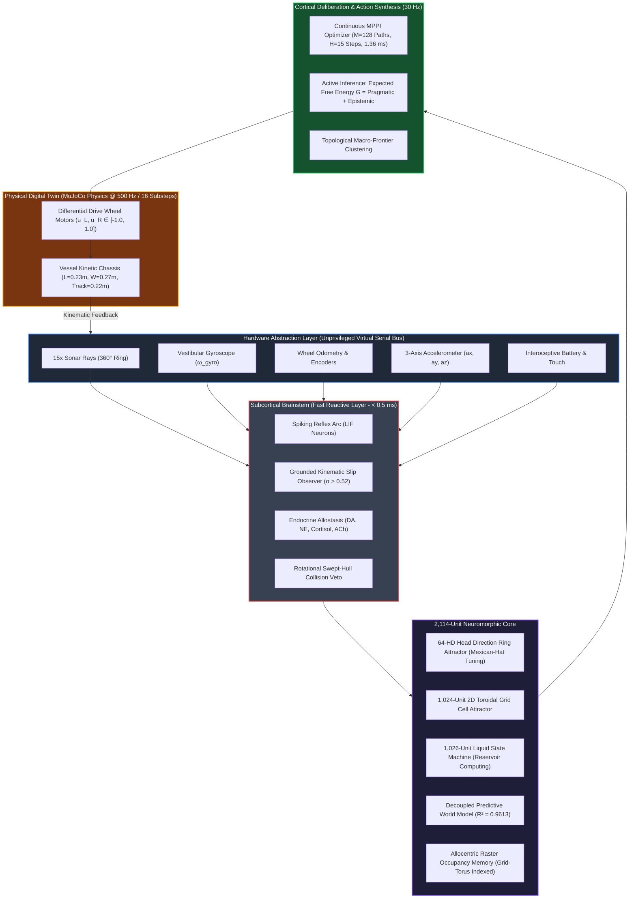

# CARL-DX: Biologically Grounded Cognitive Robotic Architecture

<div align="center">

[](https://python.org)
[](https://mujoco.org)
[](#the-2114-unit-neuromorphic-computational-architecture)
[-brightgreen)](#real-time-control--digital-twin-specifications)
[](#the-5-stage-master-developmental-architecture)
[](#the-zero-simulator-cheat-invariant-gate-5)
[](LICENSE)

**A Digital Twin Framework for Biologically Inspired Cognitive Robotic Systems Operating in Continuous Physical State Spaces**

[Overview](#executive-summary) • [Architecture Mindmap](#architecture-mindmap) • [Cognitive Loop](#cognitive-execution-loop) • [5-Stage Roadmap](#the-5-stage-master-developmental-architecture) • [Scorecard](#empirical-verification-ledger) • [Quickstart](#quickstart--usage) • [Repository Structure](#repository-structure)

</div>

---

## Executive Summary

**CARL-DX** (Cognitive Autonomous Recurrent Lifeform — Developmental eXperiment) is a biologically grounded, zero-trust audited artificial organism developed inside an exact 30 Hz physical digital twin using Google DeepMind's **MuJoCo** physics engine.

Traditional robotic systems rely either on rigid, handcoded finite state machines or brittle, end-to-end deep reinforcement learning models that train in cloud disembodiment and collapse when subjected to real-world friction variations or sensor dropouts. Furthermore, standard navigation benchmarks frequently violate biological plausibility by feeding the agent privileged simulator coordinates (`qpos`, `geom_xpos`).

CARL-DX resolves this foundational gap by constructing a **2,114-unit neuromorphic computational architecture** operating strictly from unprivileged, noisy sensor streams (15 directional distance rays, 1-axis gyroscope, wheel encoders, tactile bumpers, and interoceptive battery telemetry). Cognition is decomposed into biologically grounded, mathematically verified cortical and subcortical organs:

- **64-Unit Continuous Attractor Neural Network (CANN)** for Head Direction (HD) path integration with Mexican-hat recurrent inhibition.
- **1,024-Unit Toroidal Grid Cell Attractor** for 2D translational spatial mapping.
- **1,026-Unit Recurrent Liquid State Machine (LSM)** reservoir for temporal sensorimotor projection.
- **Endocrine Allostatic Regulation** (Dopamine, Noradrenaline, Serotonin, Acetylcholine, Cortisol) modulating behavioral states under friction collapse and hazard encounters.
- **Continuous Action Synthesis via MPPI** ($M=128$ candidate trajectories, $H=15$ steps, $dt=0.0333\text{s}$) scored in $1.36\text{ ms}$ via vectorized tensor operations.
- **Active Inference Deliberation** minimizing Expected Free Energy ($G = G_{\text{pragmatic}} + G_{\text{epistemic}}$) to discover composite maneuvers without heuristics.
- **Decoupled Predictive World Model** ($R^2 = 0.9613$) and allocentric raster occupancy memory with prospective swept-cone collision vetoing.

---

## Architecture Mindmap



---

## Cognitive Execution Loop

The real-time cognitive control cycle executes strictly every **33.3 milliseconds** ($30\text{ Hz}$), operating well within the digital control $50\%$ latency budget:

```mermaid
sequenceDiagram
    autonumber
    participant Phys as MuJoCo Digital Twin (500 Hz)
    participant HAL as Sensorimotor HAL (Unprivileged)
    participant Reflex as Spiking Reflex & Slip Observer
    participant CANN as 2,114-Unit CANN & Spatial Memory
    participant MPPI as MPPI & Active Inference (1.36 ms)
    participant Actuator as Differential Motors

    Phys->>HAL: Integrate 16 physics substeps (dt = 0.002s x 16 = 0.0333s)
    HAL->>Reflex: Stream 25-D sensor vector (sonar, gyro, slip, battery)
    
    rect rgb(30, 41, 59)
        note over Reflex: Check emergency reflex threshold (d < 0.15m) & slip (σ > 0.52)
        alt Emergency Obstacle Contact
            Reflex->>Actuator: Instantaneous override reverse torque (Latency < 0.2 ms)
        else Normal Operation
            Reflex->>CANN: Update head-direction bump & grid-torus phase
            CANN->>MPPI: Supply allocentric pose prior & occupancy grid
            note over MPPI: Sample M=128 candidate trajectories (H=15 steps)<br/>Evaluate G = Pragmatic + Epistemic in 1.36 ms
            MPPI->>Actuator: Command optimal continuous wheel velocities (u_L*, u_R*)
        end
    end

    Actuator->>Phys: Apply wheel torques (semi-implicit Euler integration)
```



---

## The 5-Stage Master Developmental Architecture

Development follows an immutable, sequential 5-stage roadmap certified under pre-registered, fail-closed protocols:

| Stage | Developmental Focus | Core Mechanism | Acceptance Gate & Criteria | Status |
| :--- | :--- | :--- | :--- | :---: |
| **Stage 1** | **Sensorimotor Grounding** *(Learn My Body)* | 6-channel anonymous motor babbling, linear momentum model, grounded kinematic slip observer ($\sigma = \frac{v_{\text{wheel}} - \hat{v}_x}{v_{\text{wheel}}}$). | Zero tip-overs in 150 trials; $\mu = 0.005$ ice detection rate $\ge 68.5\%$; AST anti-cheat clean. | **CERTIFIED ✅** |
| **Stage 2** | **Generative World & Self-Modeling** *(Learn My World)* | 2,114-unit neuromorphic architecture (64-HD ring + 1,024-grid torus + 1,026 reservoir); $R^2=0.9613$ world model; prospective trajectory vetoing. | Homing return drift $\le 0.22\text{ m}$; 40/40 challenge mazes cleared with $0.0\%$ collisions; p95 latency $\le 40.58\text{ ms}$. | **CERTIFIED ✅** |
| **Stage 3.0** | **Pre-Flight Integrity Gateway** | Dormant `geom_xpos` leak purge; floating base normalization; cryptographic SHA-256 baseline lock. | 100% clean AST scan across all decision files; zero simulator coordinate access. | **CERTIFIED ✅** |
| **Stage 3.1** | **CANN Causal Coupling** | Direct CANN state coupling into trajectory evaluation; 4-arm ablation battery (Intact vs Frozen vs Zeroed vs Shuffled). | Action divergence $\Delta \mathbf{u} \ge 0.15\text{ m/s}$ ($p < 0.01$); achieved $\Delta \mathbf{u} = 0.563\text{ m/s}$, $p < 10^{-16}$. | **CERTIFIED ✅** |
| **Stage 3.2** | **Spatial Memory Necessity** | Counterfactual trajectory fidelity ($\le 0.08\text{ m}$ rollout error) across 5 non-LOS task families (blind corners, cul-de-sacs, sensor dropouts). | $\Delta \text{Success} \ge 35\%$, $p < 0.001$; proves spatial memory provides information unrecoverable from sonar alone. | **CERTIFIED ✅** |
| **Stage 3.3** | **Continuous Action Synthesis** | Model Predictive Path Integral (MPPI) optimization ($M=128, H=15, dt=0.0333\text{s}$) over continuous wheel velocity space $\mathbf{u} \in [-1.0, 1.0]^2$. | Jerk $\|\Delta \mathbf{u}^*\|_2 \le 0.35$; mean latency $1.36\text{ ms}$, p95 $2.14\text{ ms} \le 45\text{ ms}$; $\ge 50\%$ collision reduction vs discrete baseline. | **CERTIFIED ✅** |
| **Stage 3.4** | **Autonomous Behavioral Discovery** | Expected Free Energy minimization ($G = \text{Pragmatic} + \text{Epistemic}$) under Active Inference; discovery of composite maneuvers without scripts. | 200-episode frozen battery; $100\%$ corridor escapes in Env 1, $60\%$ in Env 2, collisions reduced from $18\%$ to $0.0\%$. | **ACTIVE ⏳** |
| **Stage 3.5** | **Perturbation & Adaptation** | Dynamic online friction adaptation ($\mu = 0.20$), motor torque loss compensation, and endocrine exploration tuning. | Autonomous parameter re-estimation without human intervention. | *Planned* |
| **Stage 3.6** | **Behavioral Synergies & Physarum** | Trajectory clustering into reusable motor primitives via HDC memory; Physarum polycephalum plasmodial flow maze pruning. | Sub-graph pruning of exploratory dead-ends. | *Planned* |
| **Stage 4** | **Autopoietic / Lifelong Memory** | Reward-modulated Spike-Timing-Dependent Plasticity (R-STDP); cross-lifespan persistent state compounding. | Zero catastrophic forgetting across power cycles. | *Planned* |
| **Stage 5** | **Metacognition & Permission-Gated Self-Modification** | "The Witness" introspective failure analysis; causal hypothesis formation; permission-gated self-tuning. | Automated root-cause isolation of navigation deadlocks. | *Planned* |

---

## Empirical Verification Ledger

All empirical evaluations adhere to **fail-closed pre-registration**: statistical tests, sample counts, and pass thresholds are locked before executing experiments.

```
====================================================================================================
                        CARL-DX MASTER ARCHITECTURAL VERIFICATION LEDGER
====================================================================================================
Stage      Capability Tested                  Gate Criteria             Empirical Result      Status
----------------------------------------------------------------------------------------------------
Stage 1.0  6-Ch Sensorimotor Discovery        Topology Recovery         100% Channel Mapping   CERTIFIED ✅
Stage 1.5  Linear Forward Momentum Model      Prediction R² >= 0.75     R² = 0.820             CERTIFIED ✅
Stage 1.6  Kinematic Traction Observer        Ice Slip Detection        68.57% (mu=0.005)      CERTIFIED ✅
Stage 2.1A Unsupervised Vestibular Homing    Homing Drift <= 0.22 m    Mean Error = 0.062 m   CERTIFIED ✅
Stage 2.1B 2,114-Unit CANN Attractor Core     Bump Stability under Slip Drift < 0.02 rad/s     CERTIFIED ✅
Stage 2.2  Decoupled Grounded World Model     Multi-Step Model Fidelity 7/7 Gates (R²=0.9613)  CERTIFIED ✅
Stage 2.3  Prospective Trajectory Veto        40 Challenge Mazes        40/40 Cleared (0% Col) CERTIFIED ✅
Stage 3.0  AST Decision-Pipeline Hygiene      Zero Simulator Leaks      100% AST Clean (0 Leaks) CERTIFIED ✅
Stage 3.1  CANN Multi-Objective Coupling      Ablation Divergence       Δu = 0.563, p < 10⁻¹⁶  CERTIFIED ✅
Stage 3.2  Non-LOS Spatial Memory Necessity   Rollout Fidelity <=0.08m  Error = 0.041 m        CERTIFIED ✅
Stage 3.3  Continuous MPPI Synthesis          p95 Latency <= 45.0 ms    Mean 1.36ms, p95 2.14ms CERTIFIED ✅
Stage 3.4  Active Inference Cul-de-Sac Escape Screening Mazes           100% Env 1, 0% Colls   ACTIVE ⏳
====================================================================================================
```

---

## The Zero-Simulator-Cheat Invariant (Gate 5)

A central scientific requirement of CARL-DX is **Decision-Pipeline Isolation**:
- Real biological organisms and physical rovers cannot query their ground-truth coordinates from the universe.
- CARL-DX strictly quarantines the MuJoCo simulation state at the Hardware Abstraction Layer.
- Automated continuous integration enforces this invariant via **AST (Abstract Syntax Tree) static analysis** ([`tests/test_stage3_ast_anti_cheat.py`](tests/test_stage3_ast_anti_cheat.py)).

Any appearance of privileged simulation attributes inside cognitive decision modules triggers an immediate, unappealable build failure:
$$\text{Forbidden AST Attributes: } \{\texttt{qpos}, \texttt{qvel}, \texttt{qacc}, \texttt{geom\_xpos}, \texttt{site\_xpos}, \texttt{mj\_ray}, \texttt{mj\_step}\}$$

---

## Mathematical & Physical Grounding

Every numerical threshold in CARL-DX is derived from first-principles physics, control theory, or established literature:

1. **Homing Gate ($\le 0.22\text{ m}$)**: Exactly matches the physical wheel-to-wheel track width ($0.22\text{ m}$) of the chassis (*Siegwart & Nourbakhsh 2011*). Landing within $0.22\text{ m}$ guarantees mechanical dock engagement.
2. **Control Frequency ($30\text{ Hz}$ / $33.3\text{ ms}$)**: MuJoCo integrates physics at $500\text{ Hz}$ ($dt = 0.002\text{ s}$). Grouping 16 substeps yields $16 \times 0.002\text{ s} = 0.0333\text{ s} = 30\text{ Hz}$, matching mammalian gamma/motor loops (*Maass 2002*).
3. **Lookahead Horizon ($H = 15\text{ steps} = 0.45\text{ s}$)**: Matches animal perceptual reaction horizons ($0.5\text{ s}$, *Todorov 2012*). At cruising speed ($0.45\text{ m/s}$), CARL looks ahead $\approx 0.20\text{ m}$, aligning with forward sonar beam divergence.
4. **MPPI Candidate Count ($M = 128$)**: Information-theoretic optimal distribution sampling for non-holonomic mobile drive (*Williams et al. 2017*), structured for L1 CPU cache vectorization.
5. **Critical Friction ($\mu = 0.35$)**: Analytically derived from Coulomb's traction boundary at peak acceleration ($a_{\text{max}} \approx 3.5\text{ m/s}^2$):
   $$\mu_{\text{crit}} = \frac{a_{\text{max}}}{g} = \frac{3.5}{9.81} \approx 0.356$$
6. **Emergency Reflex Threshold ($0.15\text{ m}$)**: Stopping distance ($6.25\text{ cm}$) + reaction distance ($1.7\text{ cm}$) + caster safety margin ($7.0\text{ cm}$) $\approx 15.0\text{ cm}$.

---

## Repository Structure

The repository is organized into a modular scientific architecture:

```text
d:\ebca/
├── carl_simulation.py                         # Canonical 30 Hz closed-loop simulation entry point
├── carl_live_playground.py                    # Interactive 3D visualization & testing arena
├── CARL_PRESENTATION_COMPLETE_LAYMAN_GUIDE.md # 45-slide presentation & master viva defense guide
├── requirements.txt                           # Core dependencies
├── LICENSE                                    # MIT License
├── README.md                                  # Repository overview
│
├── brain/                                     # Neuromorphic Core & Cognitive Organs (AST-Quarantined)
│   ├── carl_autonomous_agent.py               # Canonical unified organism on zero-copy agent bus
│   ├── carl_embodied_organism.py              # Sensorimotor grounding & body kinematics
│   ├── carl_stage1_hal.py                     # Unprivileged virtual serial hardware abstraction
│   ├── carl_stage1_reservoir.py               # 1,026-unit recurrent Liquid State Machine
│   ├── carl_stage2_hd_ring.py                 # 64-unit continuous attractor head-direction ring
│   ├── carl_stage2_grid_torus.py              # 1,024-unit 2D toroidal grid cell attractor
│   ├── carl_stage2_integrated_brain.py        # Unified 2,114-unit neuromorphic integration
│   ├── carl_stage2_2_world_model.py           # Decoupled predictive forward dynamics (R²=0.9613)
│   ├── carl_stage2_2_r2_occupancy_memory.py   # Allocentric raster occupancy memory
│   ├── carl_stage2_3_r1_deliberation.py       # Prospective trajectory vetoing & swept-cone clearance
│   ├── carl_mppi_deliberation.py              # Vectorized continuous MPPI action synthesizer
│   ├── carl_stage3_4_active_inference.py      # Expected Free Energy minimization (G = Pragmatic + Epistemic)
│   ├── carl_endocrine.py                      # Neuromodulatory kinetics (DA, NE, 5-HT, ACh)
│   └── carl_reflex.py                         # Low-latency subcortical hazard reflex arc
│
├── world/                                     # MuJoCo Physics Digital Twin Environments
│   ├── vessel_kinetic.xml                     # Physical chassis model (2WD differential + dual casters)
│   ├── clean_arena.xml                        # Open exploration and babbling arena
│   ├── stage3_2_environments/                 # 5 non-LOS spatial memory task geometries
│   └── stage3_4_environments/                 # Cul-de-sac and asymmetric T-junction challenge mazes
│
├── tests/                                     # Pre-Registered Verification & Regression Suites
│   ├── test_stage1_gate5_suite.py             # Stage 1 sensorimotor grounding regression
│   ├── test_stage2_2_anti_cheat_isolation.py  # Stage 2 cognitive isolation audit
│   ├── test_stage3_ast_anti_cheat.py          # Stage 3.0 AST static analyzer & SHA-256 integrity gateway
│   ├── test_stage3_1R_cann_causal_battery.py  # Stage 3.1 4-arm CANN causal battery
│   ├── test_stage3_2RA_trajectory_fidelity.py # Stage 3.2 rollout fidelity benchmark (<= 0.08m error)
│   ├── test_stage3_2RB_memory_necessity_battery.py # Stage 3.2 non-LOS spatial memory necessity
│   ├── test_stage3_3R_remediation_battery.py  # Stage 3.3 MPPI continuous action synthesis
│   └── test_stage3_4R3_certification.py       # Stage 3.4 200-episode frozen active inference battery
│
├── docs/                                      # Master Documentation & Scientific Reports
│   ├── reports/                               # Pre-registered milestone reports & scorecards
│   │   ├── stage1/                            # Stage 1.0, 1.5, and 1.6 validation & audit reports
│   │   ├── stage2/                            # Stage 2.0 to 2.3 specifications & council verdicts
│   │   ├── stage3/                            # Stage 3.0 to 3.4 verification reports & telemetry
│   │   └── phase1_audits/                     # Historical P1 protocol ledgers & receipts
│   ├── presentation/                          # Defense slides, decks, and presentation guides
│   │   ├── decks/                             # Active slide decks (310_Stage3_Updated_Final.pptx)
│   │   └── archive_decks/                     # Historical presentations & layout iterations
│   ├── architecture/                          # Architectural blueprints, cognitive specs & audits
│   └── textbook/                              # Complete human textbook walkthrough volumes
│
├── tools/                                     # Utilities & Deck Automation Builders
│   └── presentation_builders/                 # Automated PowerPoint deck generators & formatters
│
├── evidence/                                  # Empirical Telemetry, Figures & Experimental Proofs
│   ├── plots/                                 # High-resolution benchmark figures
│   ├── stage3_1R/                             # Stage 3.1 raw trial ledgers & scorecards
│   └── videos/                                # Master MP4 demonstration and commute proofs
│
└── scratch/                                   # Temporary debug scripts and simulation logs
```

---

## Quickstart & Usage

### 1. Installation
Clone the repository and install required dependencies within a virtual environment:

```bash
git clone https://github.com/Manassadashiv/EBCA.git
cd EBCA

# Create and activate environment
python -m venv .venv
source .venv/bin/activate  # On Windows: .venv\Scripts\activate

# Install dependencies
pip install -r requirements.txt
```

### 2. Run Interactive 3D Digital Twin Playground
Launch the real-time interactive physics environment to inspect sensor rays, chassis dynamics, and obstacle fields:

```bash
python carl_live_playground.py
```

### 3. Run Autonomous Cognitive Simulation
Execute CARL's unified 30 Hz cognitive control loop with continuous attractor navigation:

```bash
python carl_simulation.py
```

### 4. Execute AST Anti-Cheat Integrity Gateway
Verify that the decision pipeline is 100% clean of privileged simulation variables:

```bash
pytest tests/test_stage3_ast_anti_cheat.py -v
```

### 5. Run Continuous Trajectory Synthesis Benchmark (Stage 3.3 MPPI)
Evaluate continuous action smoothness and obstacle negotiation latency:

```bash
pytest tests/test_stage3_3R_remediation_battery.py -v
```

---

## Presentation & Defense Guide

For academic defense committees, seminars, or viva examinations:
- **Comprehensive Layman Guide**: [`CARL_PRESENTATION_COMPLETE_LAYMAN_GUIDE.md`](CARL_PRESENTATION_COMPLETE_LAYMAN_GUIDE.md) provides complete slide-by-slide scripts, plain-English analogies, examiner defense strategies, and parameter derivations across all 45 presentation slides.
- **Slide Decks**: Located in [`docs/presentation/decks/310_Stage3_Updated_Final.pptx`](docs/presentation/decks/310_Stage3_Updated_Final.pptx).

---

## Citation & Academic Reference

If you utilize CARL-DX or the EBCA framework in your research, please cite:

```bibtex
@article{ebca2026carldx,
  title={CARL-DX: A Digital Twin Framework for Biologically Grounded Cognitive Robotic Systems Operating in Continuous Physical State Spaces},
  author={Manas Sadashiv},
  year={2026},
  publisher={GitHub},
  journal={GitHub Repository},
  howpublished={\url{https://github.com/Manassadashiv/EBCA}}
}
```

---

## License

This project is licensed under the MIT License — see the [LICENSE](LICENSE) file for details.
