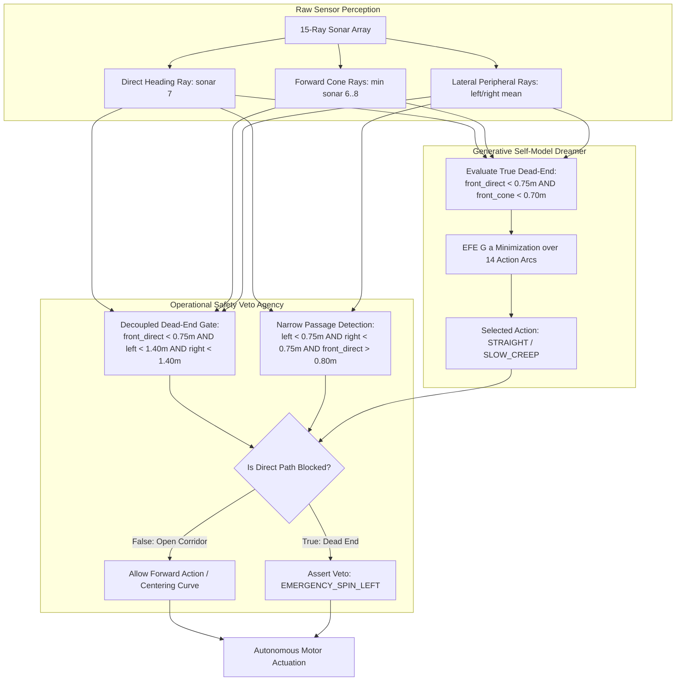

# CARL-DX P0-03 Narrow-Corridor vs. Dead-End Veto Forensic Analysis

---

## 1. Executive Summary & Problem Statement

During the execution of narrow-corridor benchmarks (`P0_G2_S42_CORRIDOR_NARROW_250T` and `P0_K3_S42_CORRIDOR_NARROW_250T`), a fundamental cognitive-safety conflict was discovered between the **Generative Self-Model (Dreamer Engine)** and the **Operational Safety Veto (Agency Core)**:

1. **Generative Self-Model**: Simulates candidate forward kinematic arcs along the longitudinal corridor axis. When the vehicle is aligned, direct forward ray `sonar_rays[7]` reads $0.85\text{m} - 4.80\text{m}$ of open space, selecting `SLOW_CREEP_FORWARD` or `STRAIGHT_FORWARD` as the lowest Expected Free Energy ($G(a)$) candidate.
2. **Operational Safety Veto**: Evaluated dead-end enclosure using:
   $$\text{is\_dead\_end} = (\text{front\_clearance} < 1.10\text{m} \land \text{left\_clearance} < 1.40\text{m} \land \text{right\_clearance} < 1.40\text{m})$$
   where `front_clearance` was computed as $\min(\text{sonar\_rays}[5:10])$.
3. **Geometric Conflict**: In a $0.75\text{m}$ corridor, rays 5 and 9 at $\pm 34.28^\circ$ hit the sidewalls at distance $d = \frac{0.375\text{m}}{\sin(34.28^\circ)} = 0.586\text{m}$. Thus, `front_clearance` was mathematically bounded above by $0.586\text{m} < 1.10\text{m}$ 100% of the time.
4. **Pathology**: The safety veto falsely classified an open, straight, traversable narrow corridor as a `DEAD_END_ENCLOSURE`, overrode the forward policy commands, and forced `EMERGENCY_SPIN_LEFT` / in-place spin oscillations.

---

## 2. Architectural Flow & Conflict Resolution

---

## 3. Mathematical & Geometric Proof

### A. Sidewall Projection Geometry
- Corridor Width: $W = 0.75\text{m}$.
- Centerline Distance to Sidewall: $d = 0.375\text{m}$.
- Sonar Array Configuration: 15 rays spanning $[-120^\circ, +120^\circ]$ at $\Delta\theta = 17.14^\circ$.
  - Ray 7: $0.0^\circ$ (pointing directly along corridor axis $\to 4.80\text{m}$).
  - Rays 6 / 8: $\pm 17.14^\circ \to d / \sin(17.14^\circ) = 1.27\text{m}$.
  - Rays 5 / 9: $\pm 34.28^\circ \to d / \sin(34.28^\circ) = 0.586\text{m}$ (in MuJoCo).

### B. Before vs. After Classification Matrix

| Scenario Type | Direct Ray 7 | Cone Min (6..8) | Left Mean | Right Mean | Old `is_dead_end` | New `is_dead_end` | Physical Truth |
| :--- | :---: | :---: | :---: | :---: | :---: | :---: | :--- |
| **Narrow Corridor (`G2/K3`)** | $4.80\text{m}$ | $0.88\text{m}$ | $0.40\text{m}$ | $0.40\text{m}$ | **TRUE (False Pos)** | **FALSE** | Traversable Corridor |
| **Wide Corridor (`N2/C5`)** | $4.80\text{m}$ | $4.80\text{m}$ | $1.71\text{m}$ | $1.71\text{m}$ | **FALSE** | **FALSE** | Traversable Corridor |
| **True Dead End (`F2/L4`)** | $0.60\text{m}$ | $0.58\text{m}$ | $0.85\text{m}$ | $0.85\text{m}$ | **TRUE** | **TRUE** | Blocked Enclosure |
| **Turn Trap (`D1`)** | $1.45\text{m}$ | $1.33\text{m}$ | $1.60\text{m}$ | $1.60\text{m}$ | **FALSE** | **FALSE** | Constrained Turn |
| **Open Arena (`B1–B4`)** | $4.80\text{m}$ | $4.80\text{m}$ | $4.95\text{m}$ | $4.95\text{m}$ | **FALSE** | **FALSE** | Open Space |

---

## 4. Minimal Architectural Repair

1. **Decoupled Longitudinal Clearance**:
   Replaced $\min(\text{sonar\_rays}[5:10])$ with direct heading ray `sonar_rays[7]` for longitudinal path clearance.
2. **True Dead-End Gate**:
   Enforced that dead-end classification strictly requires the **direct forward path to be physically blocked** ($< 0.75\text{m}$ along ray 7 and $< 0.70\text{m}$ in frontal cone) in both `CarlGenerativeSelfModel` and `CarlEndogenousAgency`.
3. **Balanced Collision Risk Curve**:
   Adjusted anticipatory collision threshold from $0.95\text{m}$ ($70.0/\text{m}$) to $0.75\text{m}$ ($30.0/\text{m}$) and $0.45\text{m}$ ($200.0/\text{m}$), eliminating false braking/freezing when clearance is $0.85\text{m}$.
4. **Narrow Passage Centering**:
   In narrow passages (`left < 0.75m`, `right < 0.75m`, `front_direct > 0.80m`), the safety veto permits smooth forward translation and centering rather than asserting spin vetoes.
