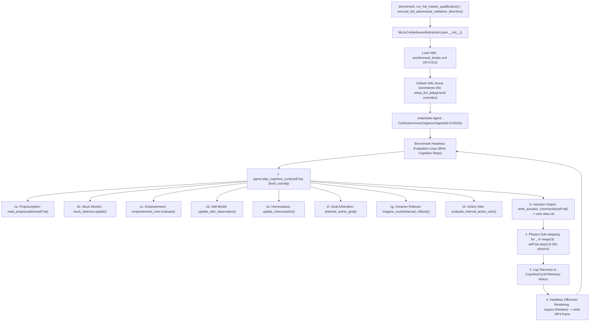

# CARL-DX BENCHMARK SUITE EXECUTION GRAPH & CODE-PATH AUDIT

**Mission Standard**: NASA-Inspired Systems Engineering Rigor (Zero-Trust)  
**Target Files**: [`brain/carl_reflex_laboratory.py`](file:///D:/ebca/brain/carl_reflex_laboratory.py), [`brain/carl_adversarial_emergence_harness.py`](file:///D:/ebca/brain/carl_adversarial_emergence_harness.py)

---

## 1. Benchmark Suite Initialization & Execution Graph

---

## 2. Key Execution Parameters in Benchmark Suite
- **Physics Timestep**: $0.01\text{s}$ (from `vessel_kinetic.xml`)
- **Cognitive Cycle Rate**: $30\text{ Hz}$ ($dt_{\text{agent}} = 0.0333\text{s}$)
- **Physics Sub-steps per Tick**: **3 sub-steps** ($\Delta t_{\text{sim\_per\_tick}} = 3 \times 0.01\text{s} = 0.03\text{s}$)
- **Physics-to-Cognitive Ratio**: $0.03\text{s} / 0.0333\text{s} = \mathbf{0.90\times} \approx \mathbf{1.0\times}$ (Physics is synchronous with the internal forward world model).
- **Arena Wall Configuration**: Default XML maze layout or programmatic adversarial disturbance geoms.
