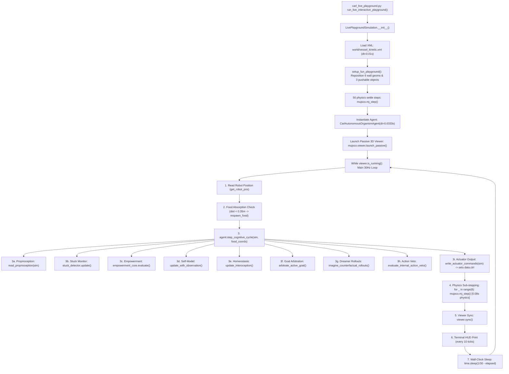

# CARL-DX LIVE PLAYGROUND EXECUTION GRAPH & CODE-PATH AUDIT

**Mission Standard**: NASA-Inspired Systems Engineering Rigor (Zero-Trust)  
**Target File**: [`carl_live_playground.py`](file:///D:/ebca/carl_live_playground.py)

---

## 1. Live Playground Initialization & Execution Graph

---

## 2. Key Execution Parameters in Live Playground
- **Physics Timestep**: $0.01\text{s}$ (from `vessel_kinetic.xml`)
- **Cognitive Cycle Rate**: $30\text{ Hz}$ ($dt_{\text{agent}} = 0.0333\text{s}$)
- **Physics Sub-steps per Tick**: **8 sub-steps** ($\Delta t_{\text{sim\_per\_tick}} = 8 \times 0.01\text{s} = 0.08\text{s}$)
- **Physics-to-Cognitive Ratio**: $0.08\text{s} / 0.0333\text{s} = \mathbf{2.4\times}$ (Physics runs 2.4x faster than the internal forward world model expects).
- **Arena Wall Configuration**: Repositioned by `setup_fun_playground()`.
