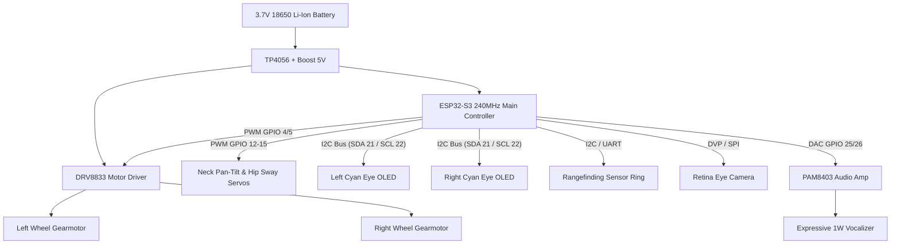

# CARL-DX: Physical Manufacturing Blueprint & Bill of Materials (BOM)

## 1. Executive Summary & Design Overview
CARL-DX is an armless, expressive cyber-companion organism designed for **maximum physical intelligence, high emotional expressiveness, and cost-effective real-world prototyping**. 

By utilizing a statically stable 3-point differential drive configuration (2 active motorized drive wheels + 1 low-friction passive rear caster sphere), 0% of onboard microcontroller compute is wasted on balancing PID loops, allowing 100% of processing power to be dedicated to:
1. Active Vision-Sonar Fusion
2. 500-neuron Liquid State Machine Reservoir dynamics
3. Neuro-endocrine homeostatic allostasis
4. Spiking reflex obstacle negotiation and episodic memory

---

## 2. 3D Printing Specifications (FDM / SLA)

| Component | Recommended Material | Print Layer Height | Infill Density | Notes |
| :--- | :--- | :--- | :--- | :--- |
| **Main Capsule Chassis** | PLA+ / PETG (Matte White) | 0.20 mm | 20% Gyroid | Houses battery, mainboard, and gearmotors at lowest CG |
| **Wheel Fender Arches** | PLA+ / PETG (Pastel Orange) | 0.16 mm | 15% Grid | Snap-fit or M2.5 screw mounting to chassis sides |
| **Drive Wheel Rims** | PLA+ / ABS (Orange) | 0.16 mm | 100% Solid | D-shaft keyed hub for direct N20 motor coupling |
| **Tires (Left & Right)** | TPU 95A / 85A (Black) | 0.16 mm | 10% Concentric | High-grip textured rubber tread for maximum traction |
| **Torso Shell** | PLA+ (Matte White) | 0.20 mm | 15% Gyroid | Lightweight shell with central diffusing LED aperture |
| **Dome Head** | PLA+ (Matte White) | 0.12 mm | 15% Gyroid | Smooth curved outer dome for cute aesthetic |
| **Curved Visor** | Smoked Acrylic / PETG (Translucent Black) | SLA Resin / 0.12 mm | 100% Solid | Glossy smoked dark visor shielding dual OLED screens |
| **Flexible Ear Fins** | TPU 95A (Slate Gray / Pastel Orange) | 0.12 mm | 15% Line | Soft, compliant ear accents that wobble on head turns |
| **Passive Caster Housing**| PLA+ / Delrin (Black) | 0.16 mm | 50% Grid | Holds 1/2" POM or steel ball transfer unit |

---

## 3. Complete Bill of Materials (Off-The-Shelf Electronics < $25 Total)

| Category | Component Description | Quantity | Unit Est. (USD) | Total (USD) | Function |
| :--- | :--- | :---: | :---: | :---: | :--- |
| **Compute Core** | ESP32-S3 Dual-Core (16MB Flash, 8MB PSRAM) | 1 | $4.50 | $4.50 | Brain execution (SNN, Endocrine, Reservoir) |
| **Actuators (Drive)** | Micro N20 Metal Gearmotors (6V 300 RPM) | 2 | $1.80 | $3.60 | Active differential wheel locomotion |
| **Actuators (Servos)**| SG90 / MG90S Micro Servos (Metal Gear) | 4 | $1.50 | $6.00 | Pan-tilt neck, head yaw, and hip sway |
| **Motor Driver** | DRV8833 Dual H-Bridge Driver Module | 1 | $0.80 | $0.80 | Low-heat PWM motor speed/direction control |
| **Visual Displays** | 0.96" I2C Monochrome OLED Displays (Cyan) | 2 | $1.80 | $3.60 | Dual glowing circular eye animation screens |
| **Proximity Sensors** | HC-SR04P or VL53L0X ToF Lidar Sensors | 4 | $1.20 | $4.80 | 360-degree obstacle awareness & rangefinding |
| **Vision Camera** | ESP32-CAM (OV2640 2MP) | 1 | $3.50 | $3.50 | Color retina for food beacon visual tracking |
| **Audio Vocalizer** | PAM8403 Mini Amplifier + 1W 8Ω Speaker | 1 | $0.90 | $0.90 | Expressive chirps, trills, and growls |
| **Power Supply** | 3.7V 18650 Li-Ion (2500mAh) + TP4056 + Step-up | 1 | $3.50 | $3.50 | 4-6 hour continuous autonomous lifespan |
| **Hardware** | M2 / M2.5 Fasteners & 12mm Ball Caster | 1 set | $1.50 | $1.50 | Mechanical assembly |
| **TOTAL ESTIMATED BOM** | | | | **~$32.70** | Full Production-Ready Companion |

---

## 4. Electronics Wiring & Architecture Diagram

---

## 5. Assembly Instructions
1. **Chassis Integration**: Install the two N20 gearmotors into the lower chassis clips. Press-fit the rubber TPU tires onto the orange rim hubs and attach to the motor D-shafts.
2. **Caster Installation**: Snap the 12mm smooth ball caster into the rear retaining socket with a dab of PTFE dry lubricant.
3. **Neck & Head Articulation**: Mount the tilt servo to the torso base and the pan servo to the neck pillar. Secure the dome head assembly onto the pan horn.
4. **Visor & Displays**: Mount the two 0.96" cyan OLED screens inside the dark visor pocket facing forward. Snap the smoked visor into the dome head rim.
5. **Mainboard & Battery**: Slide the 18650 battery cell into the lowest compartment of the chassis core for optimal low center of gravity. Fasten the ESP32-S3 PCB directly above.
6. **Calibration & First Boot**: Flash firmware, verify 30 Hz control loop latency, and confirm zero-drag smooth rolling on flat tabletop surfaces.
