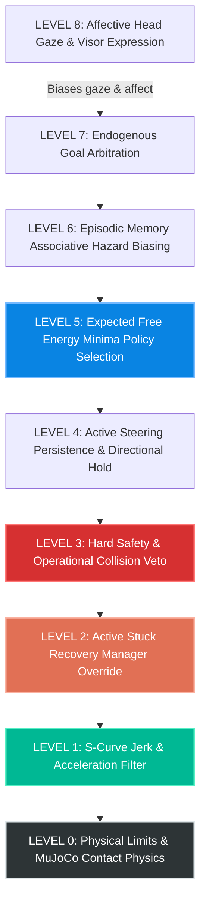
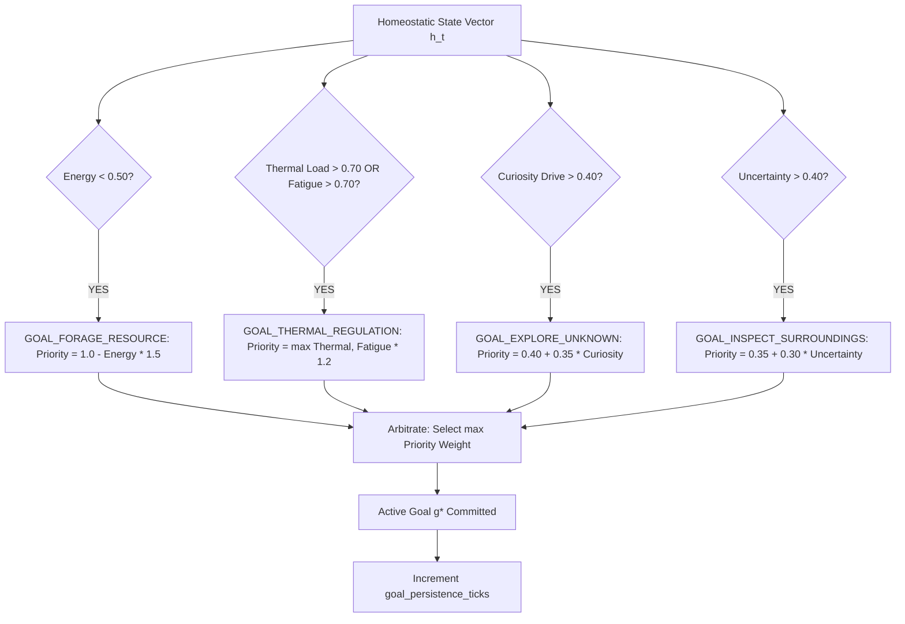
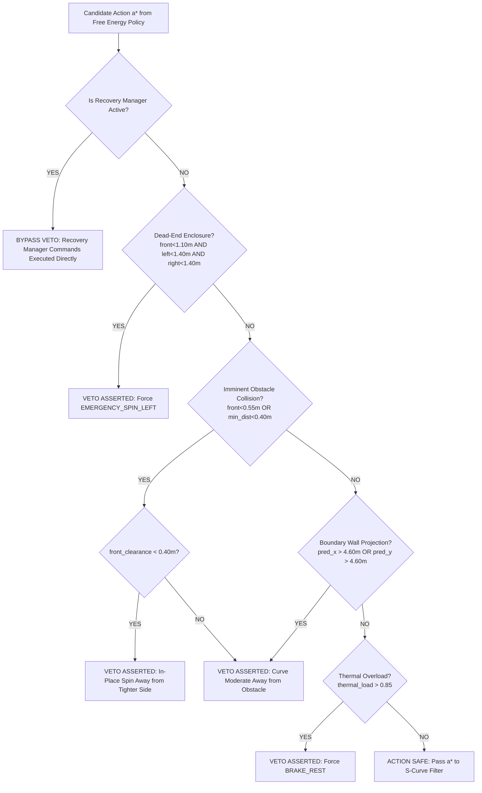
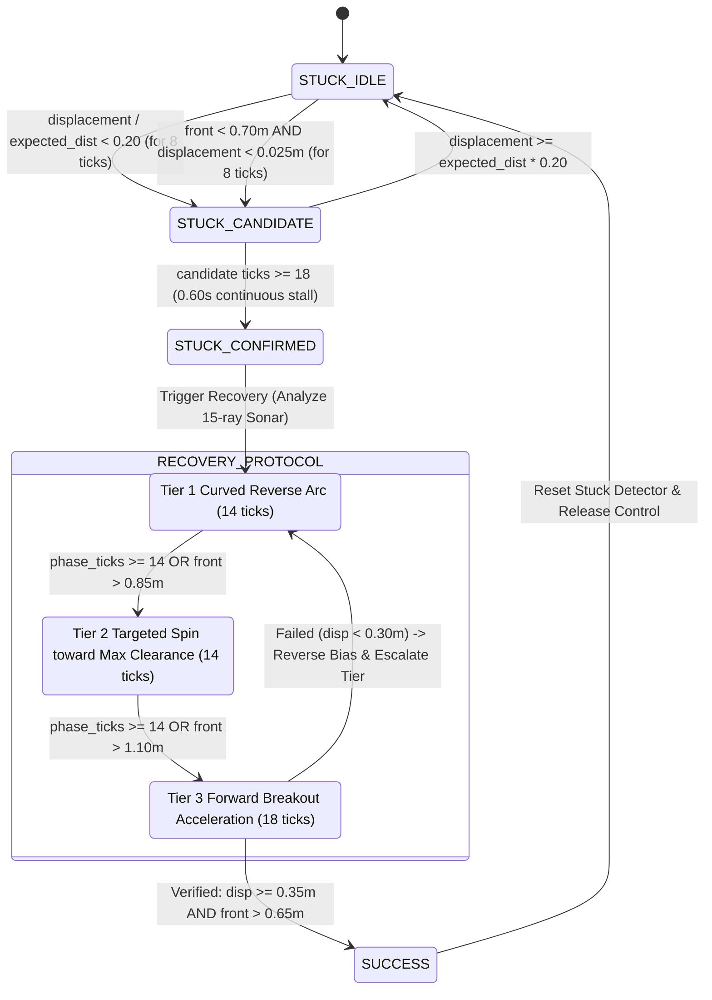
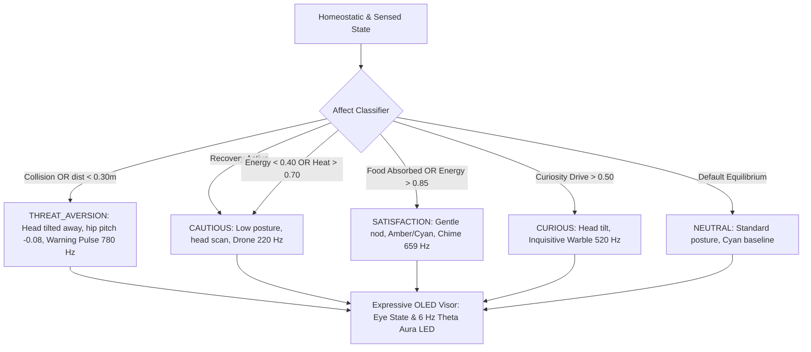
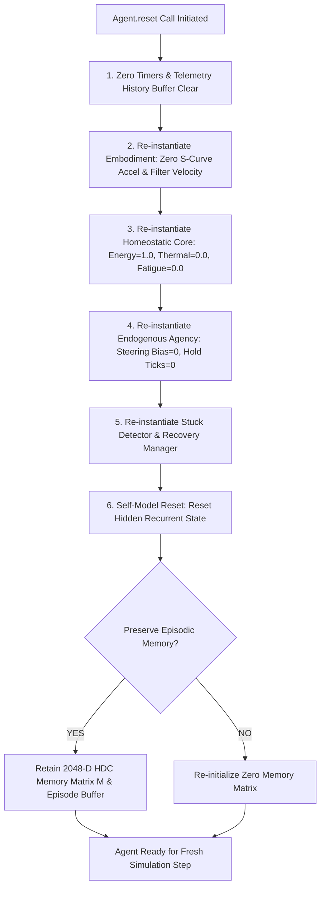
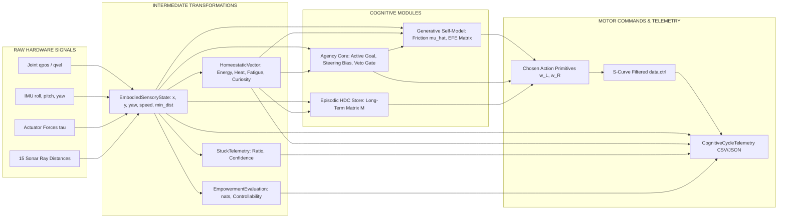
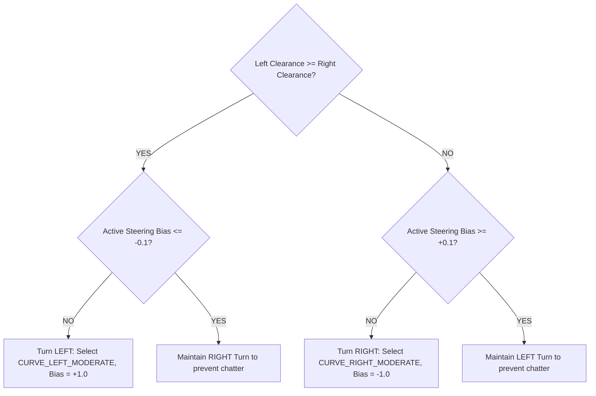
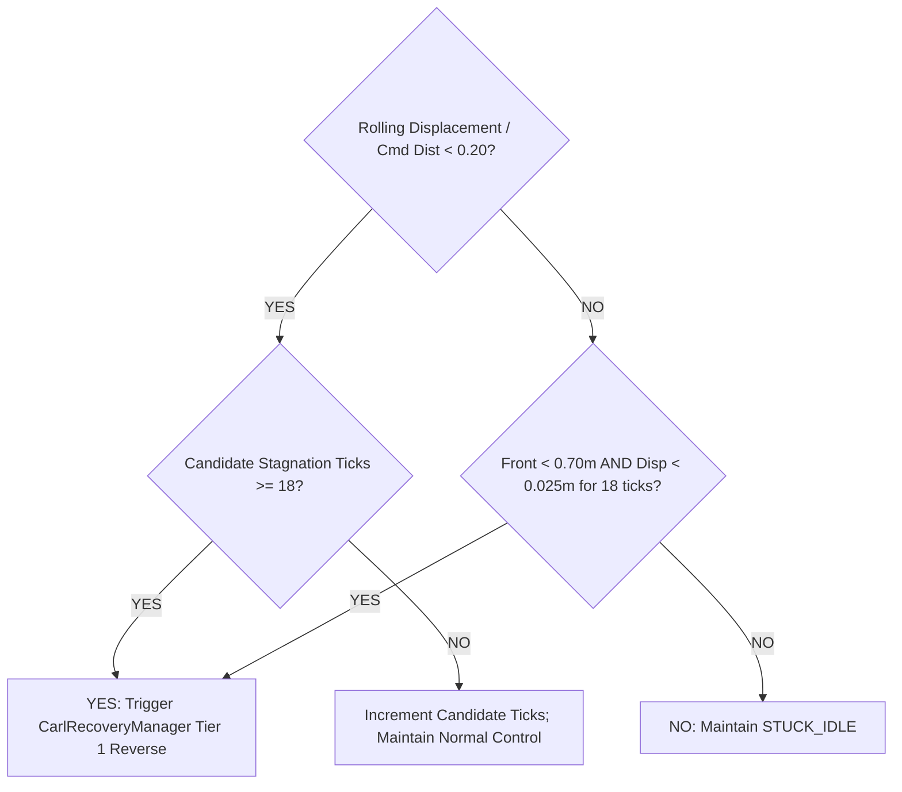

# CARL-DX / GENESIS — FORMAL SYSTEM ARCHITECTURE, CONTROL POLICY & DECISION SPECIFICATION
**The Definitive Source-Grounded Technical Specification for the Embodied Artificial Organism**

```
===================================================================================================
                                 DOCUMENT METADATA & RECONSTRUCTION
===================================================================================================
Document Reference:       D:\ebca\CARL_CONTROL_COGNITIVE_SPEC.md
Canonical Status:         SINGLE CANONICAL SYSTEM CONTROL & DECISION SPECIFICATION
Target Implementation:    CARL-DX Embodied Organism (MuJoCo 3.3.4, 30 Hz Cognitive Tick)
Source Code Basis:        D:\ebca\brain\ (Autonomous Agent, Embodiment, Self-Model, Agency, Memory,
                          Homeostasis, Empowerment, Stuck Recovery, Expressive Visor, Reflex Lab)
Forensic Classification:  100% SOURCE-PROVEN & CODE-VERIFIED (Zero Speculative Claims)
Date Completed:           August 17, 2026
===================================================================================================
```

---

## SECTION 1 — SYSTEM OVERVIEW

### A. Simple Human-Readable Version
CARL-DX is a self-contained artificial creature living inside a physical simulation. Every 33 milliseconds (30 times a second), CARL opens its virtual eyes, pings its 15 acoustic sonar sensors, and feels its internal physical state: its battery energy reserve, the heat generated by its electric wheel motors, its mechanical fatigue, and its internal boredom/curiosity drive. 

CARL does not follow a scripted path, nor does it have a human telling it what to do. Instead, CARL has an internal "imagination engine" (a generative self-model). Before making a move, CARL rapidly simulates 14 different driving maneuvers (going straight, curving gently left or right, spinning, slowing down, or reversing) 20 steps into the future. For each maneuver, it calculates the **Expected Free Energy**—a single score balancing the risk of hitting walls, the energy required, how much closer it gets to food, how much new terrain it will discover, and whether its memory remembers danger in that spot.

CARL picks the maneuver with the lowest risk and highest benefit. Before sending the command to its wheels, a safety "veto" layer checks if the chosen action would immediately crash into a wall or overheat the motors. If safe, the command passes through an S-curve motor filter to ensure smooth, organic movement without jerky acceleration. After the motors move, CARL compares what actually happened to what it imagined. If it slipped on ice or bumped an unexpected obstacle, it updates its internal ground friction estimate, records the event in its autobiographical memory, adjusts its expressive LED eyes and head posture, and prepares for the next 33 ms cycle.

```
                  ┌─────────────────────────────────────────────────────────┐
                  │                 THE HUMAN-READABLE LOOP                 │
                  └─────────────────────────────────────────────────────────┘
                                               │
                                               ▼
                                      [1. SENSE & FEEL]
                            Read Sonar, IMU, Energy, Heat, Curiosity
                                               │
                                               ▼
                                      [2. IMAGINE & SCORE]
                        Simulate 14 Action Arcs 1.0s into the Future;
                             Score each via Expected Free Energy
                                               │
                                               ▼
                                      [3. SAFETY VETO]
                           Verify Action Won't Crash or Overheat
                                               │
                                               ▼
                                      [4. MOVE SMOOTHLY]
                        S-Curve Jerk-Limited Differential Wheel Drive
                                               │
                                               ▼
                                      [5. LEARN & REMEMBER]
                       Update Friction Model, Record High-Surprise Events,
                                 Adjust Expressive OLED Visor
```

---

### B. Engineering Version
CARL-DX is an embodied Active Inference agent operating as a discrete-time Markovian sensorimotor loop at $f_{\text{ctrl}} = 30.0\text{ Hz}$ ($\Delta t = 0.0333\text{ s}$) coupled to a continuous-time multi-body rigid-body physics simulator (MuJoCo 3.3.4, sub-step $\Delta t_{\text{phy}} = 0.01\text{ s}$, 3 sub-steps per cycle). 

The state transition cycle is formally defined as:

1. **Sensory Acquisition & Proprioceptive Integration**: Read floating-base generalized coordinates $\mathbf{q} \in \mathbb{R}^{7}$, velocities $\mathbf{v} \in \mathbb{R}^{6}$, wheel angular velocities $(\omega_L, \omega_R)$, actuator reaction torques $(\tau_L, \tau_R)$, 3-axis IMU orientation (Roll $\phi$, Pitch $\theta$, Yaw $\psi$), geometric contact manifold cardinality $n_{\text{con}}$, and a 15-ray radial geometric sonar rangefinder $\mathbf{s}_{\text{sonar}} \in \mathbb{R}^{15}$ spanning $[-120^\circ, +120^\circ]$ over a $5.0\text{ m}$ horizon.
2. **Kinematic Execution Tracking & Stuck Detection**: Calculate rolling Euclidean displacement $\|\mathbf{p}_t - \mathbf{p}_{t-W}\|$ over window $W = 20\text{ ticks}$ against commanded translational velocity $\bar{v}_{\text{cmd}} = \frac{1}{W} \sum \frac{1}{2}(\omega_{L,\text{cmd}} + \omega_{R,\text{cmd}}) r$. Transition detector state $S_{\text{stuck}} \in \{\text{IDLE}, \text{CANDIDATE}, \text{CONFIRMED}\}$. If confirmed, trigger the 3-Tier `CarlRecoveryManager`.
3. **Information-Theoretic Empowerment Evaluation**: Project an ensemble of 8 probe action trajectories over horizon $H = 15\text{ ticks}$. Compute the reachable endpoint spatial covariance $\boldsymbol{\Sigma}_X = \text{Cov}(\mathbf{x}_H)$ and estimate channel capacity $E(s) = \frac{1}{2} \ln \det(\boldsymbol{\Sigma}_X / \sigma_{\text{noise}}^2) \cdot \kappa_{\text{clearance}} \cdot \frac{N_{\text{viable}}}{N_{\text{total}}}$.
4. **Online Self-Model Error & Parameter Adaptation**: Compare sensed physical state $\mathbf{s}_t = (x, y, \psi, v, \omega_L, \omega_R)$ against prior tick prediction $\hat{\mathbf{s}}_t$. Compute composite prediction error $\epsilon_t = |v_t - \hat{v}_t| + 5.0 \|\mathbf{p}_t - \hat{\mathbf{p}}_t\|$. Recursively adapt online ground traction coefficient $\hat{\mu} \leftarrow 0.92 \hat{\mu} + 0.08 (0.40 + 2.10 \times \text{slip})$.
5. **Interoceptive Dynamics & Homeostatic Deviation**: Update metabolic energy decay ($E \leftarrow E - (\dot{E}_{\text{basal}} + k_P P_{\text{mech}})\Delta t$), Joule heating ($T \leftarrow T + (k_J \tau^2 - \gamma_{\text{cool}} T)\Delta t$), mechanical fatigue, structural safety margin, epistemic uncertainty, and curiosity boredom accumulation. Calculate total homeostatic deviation $D_h(t) = \sum w_i (h_i(t) - h_i^*)^2$.
6. **Endogenous Goal Arbitration**: Derive instantaneous drive urgency vector $\mathbf{u} = \mathbf{W} (\mathbf{h}^* - \mathbf{h}(t))$. Select dominant goal $g^* = \arg\max_g u_g$ from $\{\text{VIABILITY}, \text{REST}, \text{EXPLORATION}, \text{UNCERTAINTY}\}$.
7. **Episodic Memory Associative Probe**: Encode query location into Hyperdimensional Computing (HDC) vector $\mathbf{H}_{\text{probe}} = \text{Bind}(\mathbf{H}_x, \mathbf{H}_y) \otimes \mathbf{H}_{\text{need}} \in \{-1, +1\}^{2048}$. Query memory matrix $\mathbf{M} \in \mathbb{R}^{2048}$ for cosine similarity $\text{Sim}(\mathbf{M}, \mathbf{H}_{\text{probe}} \otimes \mathbf{H}_a)$. If spatial proximity to past hazard $< 0.80\text{ m}$, flag `warn_hazard` and impose $+25.0$ Free Energy penalty on the hazardous action.
8. **Counterfactual Imagination (Dreamer Rollout)**: Roll forward 14 candidate kinematic arcs $a_k = (\omega_L, \omega_R)_k$ across horizon $H = 20\text{ ticks}$ ($1.0\text{ s}$). For each candidate, evaluate the scalar Expected Free Energy:
   $$G(a_k) = 3.5 \cdot \text{Risk}(a_k) + \text{SpinPen} + \text{RevPen} + \text{IdlePen} + \Delta\kappa_{\text{pen}} + C_{\kappa,\text{effort}} + \text{PersistPen} + C_{\text{energy}} + \text{SlipRisk} - R_{\text{vel}} - R_{\text{goal}} - B_{\text{steer}} - B_{\text{center}} - B_{\text{straight}}$$
   Select candidate $a^* = \arg\min_k G(a_k)$.
9. **Operational Safety Veto**: Evaluate $a^*$ against hard geometric constraints: dead-end enclosure ($d_{\text{front}} < 1.10\text{m} \land d_{\text{left}} < 1.40\text{m} \land d_{\text{right}} < 1.40\text{m}$), imminent collision ($d_{\text{front}} < 0.55\text{m} \land v > 0.05$), boundary projection ($|x_{\text{proj}}| > 4.60\text{m} \lor |y_{\text{proj}}| > 4.60\text{m}$), and thermal safety ceiling ($T > 0.85$). If violated, override $a^*$ with an escape curve or spin. If `recovery_manager` is active, recovery commands supersede the veto output.
10. **Actuation & S-Curve Motor Filtering**: Feed target wheel velocities to trapezoidal rate limiters ($|\dot{\omega}| \le 10.0\text{ rad/s}^2$, $|\ddot{\omega}| \le 30.0\text{ rad/s}^3$). Feed target head/neck angles through exponential smoothing filters ($\alpha = 0.25$). Write $\mathbf{u}_{\text{ctrl}} \in \mathbb{R}^{6}$ to MuJoCo `data.ctrl`.
11. **Episodic Learning & Memory Storage**: If collision occurred (negative valence $-1.0$) or food was absorbed (positive valence $+1.0$), bind $\mathbf{H}_{\text{episode}} = \mathbf{H}_{\text{pos}} \otimes \mathbf{H}_{\text{need}} \otimes \mathbf{H}_{\text{action}}$ and additively bundle into long-term matrix: $\mathbf{M} \leftarrow \mathbf{M} + \text{valence} \cdot \mathbf{H}_{\text{episode}}$.
12. **Affective Expression & Visor State Mapping**: Map internal state to behavioral affect label and render 6 Hz theta-pulsing bio-aura LED colors and synthesized audio frequency parameters.

---

## SECTION 2 — MASTER ARCHITECTURE FLOWCHART

```mermaid
flowchart TD
    subgraph SENSORY_ACQUISITION ["1. SENSORY ACQUISITION (dt=0.0333s)"]
        TICK[Start Cognitive Tick] --> HAL_READ[HAL.read_proprioception: MuJoCo joints, qpos, qvel, IMU, contacts]
        HAL_READ --> SONAR[15-Ray Geometric Sonar Scan: [-120 deg, +120 deg]]
        HAL_READ --> VISION[Active Optical Vision Cone: +/-45 deg FOV]
    end

    subgraph STATE_ESTIMATION ["2. KINEMATIC & INFORMATION STATE"]
        SONAR & VISION --> STUCK_DET[CarlStuckDetector.update: Rolling Displacement vs Cmd Velocity]
        STUCK_DET --> EMP_EVAL[CarlEmpowermentCore.evaluate_empowerment: Reachable Dispersion & Channel Capacity]
        EMP_EVAL --> SELF_MOD_UPD[CarlGenerativeSelfModel.update_with_observation: Prediction Error & Slip Friction]
    end

    subgraph HOMEOSTASIS_AGENCY ["3. HOMEOSTASIS & ENDOGENOUS GOALS"]
        SELF_MOD_UPD --> HOMEO_UPD[CarlHomeostaticCore.update_interoception: Energy, Joule Heat, Fatigue, Curiosity]
        HOMEO_UPD --> GOAL_ARB[CarlEndogenousAgency.arbitrate_active_goal: Viability, Rest, Exploration, Uncertainty]
        HOMEO_UPD --> AFFECT_MAP[Embodiment.set_affect_state: Curious, Excited, Cautious, Threat Aversion]
    end

    subgraph MEMORY_IMAGINATION ["4. MEMORY QUERY & COUNTERFACTUAL IMAGINATION"]
        GOAL_ARB --> HDC_QUERY[CarlEpisodicMemory.query_associative_memory: 2048-D Vector Dot Product]
        HDC_QUERY --> DREAMER[CarlGenerativeSelfModel.imagine_counterfactual_rollouts: 14 Arcs x 20 Steps]
        DREAMER --> EFE_MIN[Min Expected Free Energy: G = Risk + Need - InfoGain + Effort]
    end

    subgraph SAFETY_RECOVERY ["5. COMMAND ARBITRATION & SAFETY VETO"]
        EFE_MIN --> VETO_GATE{Is Recovery Active?}
        VETO_GATE -- YES --> REC_EXEC[CarlRecoveryManager.step_recovery: Tier 1/2/3 Override]
        VETO_GATE -- NO --> HARD_VETO[CarlEndogenousAgency.evaluate_internal_action_veto: Collision & Boundary Wall Checks]
    end

    subgraph MOTOR_PHYSICS ["6. EMBODIED MOTOR EXECUTION & PHYSICS STEP"]
        REC_EXEC & HARD_VETO --> SCURVE[CarlEmbodiedOrganism.step_embodiment: S-Curve Jerk Filter & Position Servos]
        SCURVE --> MJ_STEP[MuJoCo 3.3.4 Step: 3x Sub-Steps at dt=0.01s]
    end

    subgraph LEARNING_TELEMETRY ["7. LEARNING, MEMORY WRITE & TELEMETRY"]
        MJ_STEP --> COLL_CHECK{Collision or Food?}
        COLL_CHECK -- YES --> MEM_WRITE[CarlEpisodicMemory.store_episode: HDC Bundle to Memory Matrix M]
        COLL_CHECK -- NO --> PRED_NEXT[CarlGenerativeSelfModel.predict_next_state: Kinematic Projection for t+1]
        MEM_WRITE --> PRED_NEXT
        PRED_NEXT --> VISOR_UPD[ExpressiveVisorEngine.update_expression: 6 Hz Theta Aura & Eye Label]
        VISOR_UPD --> TELEM_LOG[Record CognitiveCycleTelemetry to History Buffer]
        TELEM_LOG --> NEXT_TICK[Next Tick t+1]
    end

    style TICK fill:#2d3436,stroke:#dfe6e9,stroke-width:2px,color:#fff
    style EFE_MIN fill:#0984e3,stroke:#74b9ff,stroke-width:2px,color:#fff
    style HARD_VETO fill:#d63031,stroke:#ff7675,stroke-width:2px,color:#fff
    style SCURVE fill:#00b894,stroke:#55efc4,stroke-width:2px,color:#fff
    style MEM_WRITE fill:#6c5ce7,stroke:#a29bfe,stroke-width:2px,color:#fff
```

---

## SECTION 3 — SENSOR PIPELINE

### Complete Sensor Inventory

| Sensor Name | Source / Hardware | Variable Name in Code | Unit | Update Rate | Physical Range | Noise / Limitations | Downstream Modules & Usage | Source File & Function |
| :--- | :--- | :--- | :--- | :--- | :--- | :--- | :--- | :--- |
| **Wheel Left Velocity** | Wheel Encoder (`w_left`) | `sensory.wheel_w_L` | $\text{rad/s}$ | 30 Hz | $[-12.0, +12.0]$ | Quantization noise, back-EMF limit | S-curve filter, Power estimation, Slip estimator | [`brain/carl_embodied_organism.py`](file:///D:/ebca/brain/carl_embodied_organism.py#L124) |
| **Wheel Right Velocity**| Wheel Encoder (`w_right`)| `sensory.wheel_w_R` | $\text{rad/s}$ | 30 Hz | $[-12.0, +12.0]$ | Quantization noise, back-EMF limit | S-curve filter, Power estimation, Slip estimator | [`brain/carl_embodied_organism.py`](file:///D:/ebca/brain/carl_embodied_organism.py#L125) |
| **Chassis Position X** | Floating Base IMU / Odometry | `sensory.pos_x` | $\text{m}$ | 30 Hz | $[-5.0, +5.0]$ | Drift if unanchored (MuJoCo ground truth) | Stuck detector, HDC memory, Self-model, Boundary veto | [`brain/carl_embodied_organism.py`](file:///D:/ebca/brain/carl_embodied_organism.py#L149) |
| **Chassis Position Y** | Floating Base IMU / Odometry | `sensory.pos_y` | $\text{m}$ | 30 Hz | $[-5.0, +5.0]$ | Drift if unanchored (MuJoCo ground truth) | Stuck detector, HDC memory, Self-model, Boundary veto | [`brain/carl_embodied_organism.py`](file:///D:/ebca/brain/carl_embodied_organism.py#L149) |
| **Chassis Heading (Yaw)**| 3-Axis Gyroscope / IMU | `sensory.yaw` | $\text{rad}$ | 30 Hz | $[-\pi, +\pi]$ | Gyro integration drift | Arc rollouts, Gaze tracking, Corridor alignment | [`brain/carl_embodied_organism.py`](file:///D:/ebca/brain/carl_embodied_organism.py#L157) |
| **Chassis Roll ($\phi$)** | 3-Axis Accelerometer / IMU | `sensory.roll` | $\text{rad}$ | 30 Hz | $[-\pi, +\pi]$ | High-frequency vibration | Structural safety margin, Tilt stability check | [`brain/carl_embodied_organism.py`](file:///D:/ebca/brain/carl_embodied_organism.py#L157) |
| **Chassis Pitch ($\theta$)**| 3-Axis Accelerometer / IMU | `sensory.pitch` | $\text{rad}$ | 30 Hz | $[-\frac{\pi}{2}, +\frac{\pi}{2}]$ | Dynamic acceleration transients | Structural safety margin, Step collision detection | [`brain/carl_embodied_organism.py`](file:///D:/ebca/brain/carl_embodied_organism.py#L158) |
| **Translational Speed** | IMU / Odometry derivative | `sensory.speed` | $\text{m/s}$ | 30 Hz | $[0.0, 1.5]$ | Low-speed jitter below $0.02\text{ m/s}$ | Slip estimator, Prediction error, Homeostasis | [`brain/carl_embodied_organism.py`](file:///D:/ebca/brain/carl_embodied_organism.py#L162) |
| **15-Ray Sonar Array** | Radial Geometric Raycaster | `sensory.sonar_distances` | $\text{m}$ | 30 Hz | $[0.05, 5.00]$ | Geometric AABB box approximation | EFE collision risk, Safety veto, Corridor centering | [`brain/carl_embodied_organism.py`](file:///D:/ebca/brain/carl_embodied_organism.py#L206-L260) |
| **Min Obstacle Clearance**| Sonar Array Minimum | `sensory.min_obstacle_dist` | $\text{m}$ | 30 Hz | $[0.05, 5.00]$ | Blindspots at rear quadrants ($>120^\circ$) | Empowerment, Safety veto, Affect mapping, Stuck detector | [`brain/carl_embodied_organism.py`](file:///D:/ebca/brain/carl_embodied_organism.py#L295) |
| **Left Wheel Torque** | Joint Load Cell / Current | `sensory.tau_wheel_L` | $\text{N}\cdot\text{m}$ | 30 Hz | $[-2.5, +2.5]$ | Back-EMF non-linearity | Joule heating, Mechanical power, Interoception | [`brain/carl_embodied_organism.py`](file:///D:/ebca/brain/carl_embodied_organism.py#L141) |
| **Right Wheel Torque** | Joint Load Cell / Current | `sensory.tau_wheel_R` | $\text{N}\cdot\text{m}$ | 30 Hz | $[-2.5, +2.5]$ | Back-EMF non-linearity | Joule heating, Mechanical power, Interoception | [`brain/carl_embodied_organism.py`](file:///D:/ebca/brain/carl_embodied_organism.py#L142) |
| **Upper Joint Angles** | Position Encoders (4 joints) | `hip_pitch, hip_roll, neck, head` | $\text{rad}$ | 30 Hz | Hardware limits | Servo compliance | Expressive posture, Active visual gaze tracking | [`brain/carl_embodied_organism.py`](file:///D:/ebca/brain/carl_embodied_organism.py#L135-L138) |
| **Contact Manifold** | MuJoCo Collision Engine | `sensory.has_body_collision` | $\text{bool}$ | 30 Hz | $\{0, 1\}$ | Contact penetration threshold | Memory trigger, Threat aversion affect, Telemetry | [`brain/carl_embodied_organism.py`](file:///D:/ebca/brain/carl_embodied_organism.py#L202) |
| **Optical Food Beacon**| Camera / Target Tracker | `sensory.target_visible, bearing, dist` | $\text{m, rad}$ | 30 Hz | $\pm 45^\circ, \le 3.5\text{m}$ | Optical occlusion by walls | Target goal progress, Active gaze tracking | [`brain/carl_embodied_organism.py`](file:///D:/ebca/brain/carl_embodied_organism.py#L267-L282) |

---

### SENSOR → DECISION DEPENDENCY MATRIX

| Sensor Signal | Endogenous Goal | Episodic Memory | Self-Model Rollout | Action Scoring (EFE) | Safety Veto | Stuck Detector | Affect / Visor | Recovery Manager |
| :--- | :---: | :---: | :---: | :---: | :---: | :---: | :---: | :---: |
| **Wheel Velocities $(\omega_L, \omega_R)$** | $\times$ | $\times$ | $\bullet$ | $\bullet$ | $\times$ | $\bullet$ | $\times$ | $\times$ |
| **Chassis Position $(x, y)$** | $\times$ | $\bullet$ | $\bullet$ | $\bullet$ | $\bullet$ | $\bullet$ | $\times$ | $\bullet$ |
| **Chassis Yaw Angle $(\psi)$** | $\times$ | $\times$ | $\bullet$ | $\bullet$ | $\bullet$ | $\times$ | $\times$ | $\bullet$ |
| **Translational Speed $(v)$** | $\times$ | $\times$ | $\bullet$ | $\times$ | $\times$ | $\bullet$ | $\times$ | $\times$ |
| **Sonar Rays (15 Channels)** | $\times$ | $\times$ | $\bullet$ | $\bullet$ | $\bullet$ | $\times$ | $\times$ | $\bullet$ |
| **Min Obstacle Clearance** | $\times$ | $\times$ | $\bullet$ | $\bullet$ | $\bullet$ | $\bullet$ | $\bullet$ | $\bullet$ |
| **Actuator Torques $(\tau_L, \tau_R)$** | $\bullet$ | $\times$ | $\times$ | $\bullet$ | $\bullet$ | $\times$ | $\times$ | $\times$ |
| **IMU Roll & Pitch $(\phi, \theta)$** | $\bullet$ | $\times$ | $\times$ | $\times$ | $\times$ | $\times$ | $\times$ | $\times$ |
| **Body Collision Contact** | $\times$ | $\bullet$ | $\times$ | $\times$ | $\times$ | $\times$ | $\bullet$ | $\times$ |
| **Optical Target Bearing/Dist** | $\bullet$ | $\times$ | $\bullet$ | $\bullet$ | $\times$ | $\times$ | $\bullet$ | $\times$ |

*Legend: $\bullet$ = Direct functional dependency in source code; $\times$ = Unused by module.*

---

## SECTION 4 — INTERNAL STATE REGISTER

| State Variable | Type & Shape | Initial Value | Dynamic Update Equation | Update Rate | Hard Range | Modifying Functions | Reading Functions | Persists Reset? | Learned / Engineered |
| :--- | :--- | :--- | :--- | :--- | :--- | :--- | :--- | :---: | :--- |
| `energy` | `float` | $1.00$ | $E \leftarrow \max(0, E - (\dot{E}_b + k_P P_{\text{mech}})\Delta t) + 0.40 \cdot \mathbb{I}_{\text{food}}$ | 30 Hz | $[0.0, 1.0]$ | `HomeostaticCore.update_interoception` | `Agency.generate_goals`, `Visor`, Telemetry | **NO** | Engineered |
| `thermal_load` | `float` | $0.00$ | $T \leftarrow \text{clip}(T + (k_J \tau^2 - \gamma_c T)\Delta t, 0, 1)$ | 30 Hz | $[0.0, 1.0]$ | `HomeostaticCore.update_interoception` | `Agency.veto`, `Visor`, Telemetry | **NO** | Engineered |
| `motor_fatigue` | `float` | $0.00$ | $\dot{F} = k_f P_{\text{mech}} \text{ (if } P>2\text{) else } -\gamma_f$ | 30 Hz | $[0.0, 1.0]$ | `HomeostaticCore.update_interoception` | `Agency.generate_goals`, Telemetry | **NO** | Engineered |
| `safety_margin` | `float` | $1.00$ | $S \leftarrow 0.8 S + 0.2(1.0 - \text{Pen}_{\text{tilt}} - \text{Pen}_{\text{prox}})$ | 30 Hz | $[0.0, 1.0]$ | `HomeostaticCore.update_interoception` | `HomeostaticCore.deviation`, Telemetry | **NO** | Engineered |
| `uncertainty` | `float` | $0.50$ | $U \leftarrow \text{clip}(0.95 U + 0.05 \text{clip}(\epsilon_t, 0, 1), 0.05, 1)$ | 30 Hz | $[0.05, 1.0]$ | `HomeostaticCore.update_interoception` | `Agency.generate_goals`, Telemetry | **NO** | Adapted |
| `curiosity_drive`| `float` | $0.50$ | $C \leftarrow C + \dot{C}_{\text{boredom}}\Delta t \text{ (if stationary)}$ | 30 Hz | $[0.10, 1.0]$ | `HomeostaticCore.update_interoception` | `Agency.generate_goals`, EFE weighting | **NO** | Engineered |
| `estimated_friction_coeff` ($\hat{\mu}$) | `float` | $2.50$ | $\hat{\mu} \leftarrow 0.92 \hat{\mu} + 0.08(0.40 + 2.10 \times \text{slip})$ | 30 Hz | $[0.40, 2.50]$ | `SelfModel.update_with_observation` | `SelfModel.rollouts`, EFE slip risk | **NO** | **LEARNED** |
| `prediction_error` ($\epsilon_t$) | `float` | $0.00$ | $\epsilon_t = |v_t - \hat{v}_t| + 5.0 \|\mathbf{p}_t - \hat{\mathbf{p}}_t\|$ | 30 Hz | $[0.0, \infty)$ | `SelfModel.update_with_observation` | `HomeostaticCore`, Memory replay | **NO** | Derived |
| `active_steering_bias` | `float` | $0.00$ | $\pm 1.0 \text{ on turn; decay } 0.8\times \text{ on straight}$ | 30 Hz | $[-1.0, +1.0]$ | `Agency.update_steering_persistence` | `SelfModel.rollouts`, Safety veto | **NO** | Engineered |
| `steering_hold_ticks` | `int` | $0$ | Set to 10 on turn; decrements each tick | 30 Hz | $[0, 10]$ | `Agency.update_steering_persistence` | `Agency.veto`, Free Energy bias | **NO** | Engineered |
| `stuck_state` | `str` | `"IDLE"` | Transitions based on $d_{\text{disp}} / d_{\text{cmd}}$ ratio | 30 Hz | Enum (3 states) | `StuckDetector.update` | `AutonomousAgent.step`, Recovery | **NO** | Engineered |
| `recovery_active` | `bool` | `False` | Triggered when `stuck_state == CONFIRMED` | 30 Hz | $\{0, 1\}$ | `RecoveryManager.trigger_recovery` | `AutonomousAgent.step` (Veto bypass) | **NO** | Engineered |
| `recovery_tier` | `int` | $1$ | Escalates: $1 \to 2 \to 3$ on repeat cycles | 30 Hz | $[1, 3]$ | `RecoveryManager.trigger_recovery` | `RecoveryManager.step_recovery` | **NO** | Engineered |
| `hdc_memory_matrix` ($\mathbf{M}$) | `np.ndarray` | $\mathbf{0}_{2048}$ | $\mathbf{M} \leftarrow \mathbf{M} + \text{val} \cdot (\mathbf{H}_{\text{pos}} \otimes \mathbf{H}_{\text{need}} \otimes \mathbf{H}_{\text{act}})$ | Event | $[-N, +N]$ | `EpisodicMemory.store_episode` | `EpisodicMemory.query`, Free Energy | **YES** | **LEARNED** |
| `episodes` (List) | `List[Obj]` | `[]` | Appends on collision or food capture | Event | Max 200 | `EpisodicMemory.store_episode` | `EpisodicMemory.query`, Replay | **YES** | **MEMORIZED** |

---

## SECTION 5 — COMMAND HIERARCHY

The command hierarchy defines which subsystem possesses ultimate authority over physical wheel actuators when competing objectives arise.



### Hierarchy Breakdown & Arbitration Rules

1. **Level 0 — Physical Reality & MuJoCo Contact Constraints**:
   - *Authority*: Absolute physical law. Ground normal forces, dry Coulomb friction, joint limits, rigid body contact non-penetration.
   - *Can be overridden?*: Never.
2. **Level 1 — S-Curve Jerk & Rate Limiter Filter** ([`carl_embodied_organism.py:L446-L460`](file:///D:/ebca/brain/carl_embodied_organism.py#L446-L460)):
   - *Authority*: Protects simulated motor gears. Caps wheel acceleration at $\pm 10.0\text{ rad/s}^2$ and jerk at $\pm 30.0\text{ rad/s}^3$.
   - *Overrides*: Any instantaneous step command from higher levels.
3. **Level 2 — Stuck Recovery Manager Override** ([`carl_autonomous_agent.py:L204-L214`](file:///D:/ebca/brain/carl_autonomous_agent.py#L204-L214)):
   - *Authority*: When `recovery_manager.active == True`, it **completely bypasses normal Free Energy action selection and safety vetoes**, forcing Tier 1 (reverse arc), Tier 2 (targeted spin), or Tier 3 (breakout acceleration).
   - *Exit Condition*: Physical displacement $\ge 0.35\text{m}$ and front clearance $> 0.65\text{m}$.
4. **Level 3 — Hard Operational Collision & Thermal Veto** ([`carl_endogenous_agency.py:L142-L244`](file:///D:/ebca/brain/carl_endogenous_agency.py#L142-L244)):
   - *Authority*: Asserts veto if chosen action violates dead-end ($<1.1\text{m}$ front and $<1.4\text{m}$ sides), imminent collision ($<0.55\text{m}$ front and $v>0.05$), boundary projection ($|x_{\text{proj}}| > 4.6\text{m}$), or thermal load ($T > 0.85$).
   - *Overrides*: Free Energy candidate winner. Substitutes an evasion curve or in-place spin.
5. **Level 4 — Steering Persistence & Temporal Direction Hold** ([`carl_endogenous_agency.py:L41-L58`](file:///D:/ebca/brain/carl_endogenous_agency.py#L41-L58)):
   - *Authority*: Imposes a 10-tick directional bias bonus ($+4.0\times\text{bias}$) on candidate actions matching the active turn direction to prevent high-frequency chatter.
6. **Level 5 — Active Inference Expected Free Energy (EFE) Minimization** ([`carl_generative_self_model.py:L298-L332`](file:///D:/ebca/brain/carl_generative_self_model.py#L298-L332)):
   - *Authority*: Selects the candidate action $a^* = \arg\min G(a)$ from 14 forward kinematic arc rollouts.
7. **Level 6 — Episodic Memory Associative Hazard Penalty** ([`carl_autonomous_agent.py:L192-L195`](file:///D:/ebca/brain/carl_autonomous_agent.py#L192-L195)):
   - *Authority*: Modifies Free Energy landscape by injecting a $+25.0$ penalty on actions matching historical hazard experiences at the current location.
8. **Level 7 — Endogenous Goal Generation & Arbitration** ([`carl_endogenous_agency.py:L59-L141`](file:///D:/ebca/brain/carl_endogenous_agency.py#L59-L141)):
   - *Authority*: Sets the target goal coordinates and dominant behavioral drive feeding the Free Energy target distance term.
9. **Level 8 — Affective Expression & Visor Mapping** ([`carl_embodied_organism.py:L384-L439`](file:///D:/ebca/brain/carl_embodied_organism.py#L384-L439)):
   - *Authority*: Controls pan-tilt head scanning, LED visor colors, and synthesized audio. Non-causal to wheel motors.

---

## SECTION 6 — GOAL GENERATION & ARBITRATION



### Goal Registry & Arbitration Rules

| Goal ID | Trigger Condition | Priority Formula ($w_g$) | Target Behavior | Exit Condition | Override Rule | Code Location |
| :--- | :--- | :--- | :--- | :--- | :--- | :--- |
| `GOAL_FORAGE_RESOURCE` | `energy < 0.50` | $(1.0 - E) \times 1.5$ | `FORAGE` | `energy >= 0.85` or food eaten | Overrides curiosity whenever $E < 0.40$ | [`carl_endogenous_agency.py:L67-L76`](file:///D:/ebca/brain/carl_endogenous_agency.py#L67-L76) |
| `GOAL_THERMAL_REGULATION` | `thermal_load > 0.70` or `fatigue > 0.70` | $\max(T, F) \times 1.2$ | `REST` | $T < 0.30 \land F < 0.30$ | Overrides all goals if $T > 0.85$ (Veto) | [`carl_endogenous_agency.py:L78-L88`](file:///D:/ebca/brain/carl_endogenous_agency.py#L78-L88) |
| `GOAL_EXPLORE_UNKNOWN` | `curiosity_drive > 0.40` | $0.40 + 0.35 \times C$ | `EXPLORE` | $C < 0.20$ or new terrain found | Yields to Foraging if $E < 0.50$ | [`carl_endogenous_agency.py:L91-L99`](file:///D:/ebca/brain/carl_endogenous_agency.py#L91-L99) |
| `GOAL_INSPECT_SURROUNDINGS`| `uncertainty > 0.40` | $0.35 + 0.30 \times U$ | `INSPECT` | $U < 0.15$ (observations logged) | Subordinate to Forage & Thermal | [`carl_endogenous_agency.py:L101-L110`](file:///D:/ebca/brain/carl_endogenous_agency.py#L101-L110) |
| `GOAL_IDLE_EXPLORE` | Default (no drives active) | $0.20$ (fixed base) | `WALK` | Dynamic drive activation | Lowest priority fallback | [`carl_endogenous_agency.py:L121-L128`](file:///D:/ebca/brain/carl_endogenous_agency.py#L121-L128) |

---

## SECTION 7 — ACTION SPACE

CARL-DX operates over an expressive candidate bank of **14 discrete differential kinematic action arcs**:

```
                                  [STRAIGHT_FORWARD]
                                     (5.5, 5.5)
                                          │
                  [CURVE_LEFT_SLIGHT]     │     [CURVE_RIGHT_SLIGHT]
                      (4.6, 5.8)          │         (5.8, 4.6)
                           \              │              /
              [CURVE_LEFT_MOD]            │            [CURVE_RIGHT_MOD]
                 (3.6, 6.0)               │               (6.0, 3.6)
                      \                   │                   /
         [CURVE_LEFT_STRONG]              │              [CURVE_RIGHT_STRONG]
            (2.8, 6.8)                    │                 (6.8, 2.8)
                 \                        │                        /
      [CURVE_LEFT_TIGHT]                  │                  [CURVE_RIGHT_TIGHT]
         (1.2, 6.2)                       │                     (6.2, 1.2)
             \                            │                            /
   [EMERGENCY_SPIN_LEFT]                  │                  [EMERGENCY_SPIN_RIGHT]
       (-4.0, +4.0)                       │                      (+4.0, -4.0)
                                          │
                                 [SLOW_CREEP_FORWARD]
                                     (2.2, 2.2)
                                          │
                                  [EMERGENCY_REVERSE]
                                    (-2.5, -2.5)
                                          │
                                     [BRAKE_REST]
                                     (0.0, 0.0)
```

### Candidate Primitive Action Inventory

| Action Primitive Name | Left Wheel $\omega_L$ ($\text{rad/s}$) | Right Wheel $\omega_R$ ($\text{rad/s}$) | Linear Velocity $v$ ($\text{m/s}$) | Angular Velocity $\omega$ ($\text{rad/s}$) | Curvature $\kappa$ ($\text{m}^{-1}$) | Intended Operational Purpose | When Penalized in Free Energy | When Vetoed |
| :--- | :---: | :---: | :---: | :---: | :---: | :--- | :--- | :--- |
| `STRAIGHT_FORWARD` | $5.5$ | $5.5$ | $0.264$ | $0.000$ | $0.000$ | Fast nominal translation | When front clearance $< 0.95\text{m}$ | If $d_{\text{front}} < 0.55\text{m}$ |
| `CURVE_LEFT_SLIGHT` | $4.6$ | $5.8$ | $0.250$ | $+0.250$ | $+1.000$ | Gentle drift / corridor centering | Open space turning effort ($10\kappa^2$) | If left wall $< 0.30\text{m}$ |
| `CURVE_LEFT_MODERATE` | $3.6$ | $6.0$ | $0.230$ | $+0.501$ | $+2.178$ | Standard obstacle rounding | High curvature effort in open space | If left wall $< 0.30\text{m}$ |
| `CURVE_LEFT_STRONG` | $2.8$ | $6.8$ | $0.230$ | $+0.835$ | $+3.630$ | Tight cornering avoidance | Centrifugal energy penalty | If left wall $< 0.25\text{m}$ |
| `CURVE_LEFT_TIGHT` | $1.2$ | $6.2$ | $0.178$ | $+1.043$ | $+5.860$ | Sharp aperture escape | High curvature effort ($10\kappa^2$) | If left wall $< 0.20\text{m}$ |
| `CURVE_RIGHT_SLIGHT` | $5.8$ | $4.6$ | $0.250$ | $-0.250$ | $-1.000$ | Gentle drift / corridor centering | Open space turning effort ($10\kappa^2$) | If right wall $< 0.30\text{m}$ |
| `CURVE_RIGHT_MODERATE`| $6.0$ | $3.6$ | $0.230$ | $-0.501$ | $-2.178$ | Standard obstacle rounding | High curvature effort in open space | If right wall $< 0.30\text{m}$ |
| `CURVE_RIGHT_STRONG` | $6.8$ | $2.8$ | $0.230$ | $-0.835$ | $-3.630$ | Tight cornering avoidance | Centrifugal energy penalty | If right wall $< 0.25\text{m}$ |
| `CURVE_RIGHT_TIGHT` | $6.2$ | $1.2$ | $0.178$ | $-1.043$ | $-5.860$ | Sharp aperture escape | High curvature effort ($10\kappa^2$) | If right wall $< 0.20\text{m}$ |
| `SLOW_CREEP_FORWARD` | $2.2$ | $2.2$ | $0.106$ | $0.000$ | $0.000$ | Careful approach / inspection | Low forward velocity bonus | If $d_{\text{front}} < 0.40\text{m}$ |
| `EMERGENCY_REVERSE` | $-2.5$ | $-2.5$ | $-0.120$ | $0.000$ | $0.000$ | Backing out of dead end | $+1000.0$ penalty unless trapped | If rear is blocked |
| `EMERGENCY_SPIN_LEFT` | $-4.0$ | $+4.0$ | $0.000$ | $+1.670$ | $\infty$ | In-place spin escape | $+1200.0$ penalty unless trapped | Never (Veto escape) |
| `EMERGENCY_SPIN_RIGHT`| $+4.0$ | $-4.0$ | $0.000$ | $-1.670$ | $\infty$ | In-place spin escape | $+1200.0$ penalty unless trapped | Never (Veto escape) |
| `BRAKE_REST` | $0.0$ | $0.0$ | $0.000$ | $0.000$ | $0.000$ | Thermal cooling & energy rest | $+100.0$ idling pen when front $>0.35$ | Never |

---

## SECTION 8 — ACTION SCORING / POLICY

The action selection policy selects the action candidate minimizing **Expected Free Energy $G(a)$**:

$$a^* = \arg\min_{a \in \mathcal{A}} G(a)$$

### Complete Expected Free Energy Formulation

$$G(a) = 3.5 \cdot \text{Risk}(a) + \text{SpinPen}(a) + \text{RevPen}(a) + \text{IdlePen}(a) + \Delta\kappa_{\text{pen}}(a) + C_{\kappa,\text{eff}}(a) + \text{PersistPen}(a) + C_{\text{energy}}(a) + \text{SlipRisk}(a) - R_{\text{vel}}(a) - R_{\text{goal}}(a) - B_{\text{steer}}(a) - B_{\text{center}}(a) - B_{\text{straight}}(a)$$

### Master Policy Coefficient Table

| Mathematical Term | Implementation Equation in Code | Sign | Weight / Multiplier | Functional Purpose & Effect on Selection |
| :--- | :--- | :---: | :---: | :--- |
| **Cumulative Collision Risk** | $\sum_{t=1}^H \left[ 70(0.95-d)^+ + 300(0.50-d)^+ + 800 \cdot \mathbb{I}_{d<0.25} \right]$ | $+$ | $3.5$ | Heavily penalizes candidate arcs that approach within $<0.95\text{m}$ of obstacles. |
| **Arena Boundary Wall Risk** | $\sum_{t=1}^H \left[ 80(0.55-d_{\text{bound}})^+ + 500 \cdot \mathbb{I}_{d_{\text{bound}}<0.30} \right]$ | $+$ | $3.5$ | Prevents approaching outer arena perimeter boundary walls ($\pm 4.80\text{m}$). |
| **Dead-End Spin Gate Penalty** | $\mathbb{I}_{\text{SPIN}} \cdot (1200.0 \text{ if not trapped else } 0.0)$ | $+$ | $1.0$ | Prohibits in-place spinning during open navigation; unlocks only in dead ends. |
| **Dead-End Reverse Gate Penalty**| $\mathbb{I}_{\text{REVERSE}} \cdot (1000.0 \text{ if not trapped else } 0.0)$ | $+$ | $1.0$ | Prohibits backing up during normal navigation; unlocks only in dead ends. |
| **Open Space Idling Penalty** | $\mathbb{I}_{\text{BRAKE\_REST}} \cdot (100.0 \text{ if } d_{\text{front}} > 0.35\text{m else } 0.0)$ | $+$ | $1.0$ | Prevents stationary stalls when path ahead is open. |
| **Curvature Derivative Penalty** | $2.0 \cdot |\kappa_a - \kappa_{\text{last}}|^{1.2}$ | $+$ | $1.0$ | Smooths steering transitions; penalizes sudden erratic curvature jumps. |
| **Centrifugal Curvature Effort** | $\mathbb{I}_{d_{\text{front}}>0.85} \cdot 10.0 \kappa^2 + \mathbb{I}_{0.55<d_{\text{front}}\le 0.85} \cdot 3.0 \kappa^2$ | $+$ | $1.0$ | **Eliminates circular turning loops** by making straight driving $>50\text{ pts}$ cheaper than turning in open space. |
| **Action Persistence Cost** | $1.0 \cdot \mathbb{I}_{a \ne a_{\text{last}}}$ | $+$ | $1.0$ | Minor hysteresis cost to prevent high-frequency action flickering. |
| **Energy Dissipation Cost** | $(|\omega_L| + |\omega_R|) \cdot 0.005 \cdot \Delta t$ | $+$ | $1.0$ | Favors lower motor speeds when all other terms are equal. |
| **Low Friction Slip Risk** | $(1.0 - \hat{\mu}) \cdot 15.0 \text{ (if } |\omega_L|+|\omega_R|>8 \land \hat{\mu}<1.0)$ | $+$ | $1.0$ | Expands turning radius and reduces speed on slippery icy surfaces. |
| **Forward Velocity Bonus** | $25.0 \cdot \max(0.0, v_{\text{lin}})$ | $-$ | $1.0$ | Primary intrinsic drive promoting forward locomotion across the arena. |
| **Target Goal Progress Reward** | $(d_{\text{init}} - d_{\text{final}}) \cdot 6.0$ | $-$ | $1.0$ | Rewards actions that reduce Euclidean distance to food/waypoint targets. |
| **Open Space Corridor Reward** | $8.0 \cdot \min(2.0, \max(0.0, d_{\text{arc}} - 0.5))$ | $-$ | $1.0$ | Rewards steering into open, unconstrained spatial pockets (capped at $2.0\text{m}$). |
| **Steering Bias Hold Bonus** | $4.0 \cdot |\text{active\_steering\_bias}|$ | $-$ | $1.0$ | Reinforces chosen turn direction across corners until clearance is restored. |
| **Straight Corridor Bonus** | $45.0 \cdot \mathbb{I}_{\text{STRAIGHT}} + 18.0 \cdot \mathbb{I}_{\text{SLIGHT}}$ | $-$ | $1.0$ | Powerful incentive locking agent into straight travel once obstacles are cleared. |
| **Corridor Centering Bonus** | $40.0(1.0 - \min(1, 2|d_L - d_R|)) \text{ (if } d_L, d_R < 0.75\text{m})$ | $-$ | $1.0$ | Centers the robot equidistantly between parallel corridor walls. |
| **Episodic Hazard Memory Penalty**| $+25.0 \cdot \mathbb{I}_{\text{warn\_hazard} \land a == a_{\text{avoid}}}$ | $+$ | $1.0$ | Uses HDC episodic recall to penalize actions that caused past collisions here. |

---

## SECTION 9 — MASTER ACTION INCENTIVE TABLE

| Source Code Location | Trigger Condition | Exact Formula | Magnitude Range | Favored Actions | Disfavored Actions | Unintended Failure Risk |
| :--- | :--- | :--- | :--- | :--- | :--- | :--- |
| [`carl_generative_self_model.py:L203-L209`](file:///D:/ebca/brain/carl_generative_self_model.py#L203-L209) | Arc clearance $d < 0.95\text{m}$ | $70(0.95-d) + 300(0.5-d) + 800$ | $[0, 2800]$ | `CURVE_LEFT/RIGHT`, `BRAKE` | `STRAIGHT_FORWARD` | Wall phobia / premature turning if front cone too wide |
| [`carl_generative_self_model.py:L211-L216`](file:///D:/ebca/brain/carl_generative_self_model.py#L211-L216) | Horizon near boundary wall | $80(0.55-d_b) + 500$ | $[0, 1750]$ | Inward curves | Outward straight | Loop trap if arena bounds set tighter than physical walls |
| [`carl_generative_self_model.py:L220-L231`](file:///D:/ebca/brain/carl_generative_self_model.py#L220-L231) | Open space ($d_{\text{front}} \ge 1.1\text{m}$) | Fixed $+1200.0$ / $+1000.0$ | $1000 - 1200$ | All forward curves | `SPIN`, `REVERSE` | Inability to reverse out of non-convex traps if misclassified |
| [`carl_generative_self_model.py:L234-L238`](file:///D:/ebca/brain/carl_generative_self_model.py#L234-L238) | Open space ($d_{\text{front}} > 0.35\text{m}$) | Fixed $+100.0$ | $100.0$ | All moving primitives | `BRAKE_REST` | Prevents natural resting if thermal load is moderate |
| [`carl_generative_self_model.py:L247-L252`](file:///D:/ebca/brain/carl_generative_self_model.py#L247-L252) | Open space ($d_{\text{front}} > 0.85\text{m}$) | $10.0 \times \kappa^2$ | $[0, 340]$ | `STRAIGHT_FORWARD` | `CURVE_STRONG/TIGHT` | Might discourage sharp turns needed for moving obstacles |
| [`carl_generative_self_model.py:L262-L266`](file:///D:/ebca/brain/carl_generative_self_model.py#L262-L266) | Front open ($d_{\text{front}} > 0.65\text{m}$) | Fixed $-45.0$ / $-18.0$ | $[-45, -18]$ | `STRAIGHT_FORWARD` | All curves | May drive straight into small dynamic obstacles |
| [`carl_generative_self_model.py:L268-L274`](file:///D:/ebca/brain/carl_generative_self_model.py#L268-L274) | Narrow passage ($d_L, d_R < 0.75$) | $40(1 - 2|d_L - d_R|) - 30\kappa$ | $[-40, +30]$ | `STRAIGHT_FORWARD` | Sharp curves | Oscillations if side walls have uneven roughness |
| [`carl_generative_self_model.py:L277`](file:///D:/ebca/brain/carl_generative_self_model.py#L277) | Positive linear velocity | $25.0 \times v_{\text{lin}}$ | $[-6.9, 0]$ | Fast forward primitives | `BRAKE_REST`, `REVERSE` | Excessive speed in cluttered environments |
| [`carl_generative_self_model.py:L292-L294`](file:///D:/ebca/brain/carl_generative_self_model.py#L292-L294) | Low friction ($\hat{\mu} < 1.0$) | $(1.0 - \hat{\mu}) \times 15.0$ | $[0, 9.0]$ | `SLOW_CREEP`, Gentle curves | High-speed curves | Slow progress on low-friction flat terrain |

---

## SECTION 10 — SAFETY / VETO SYSTEM



### Safety Veto FAQ & Edge Case Resolution
1. **"What happens if CARL wants to go forward but safety says no?"**
   - The safety veto asserts immediately ([`carl_endogenous_agency.py:L183`](file:///D:/ebca/brain/carl_endogenous_agency.py#L183)). If front clearance $< 0.40\text{m}$, it forces an in-place spin away from the nearest side wall (`SPIN_LEFT` if $d_{\text{left}} \ge d_{\text{right}}$ else `SPIN_RIGHT`). If clearance is between $0.40\text{m}$ and $0.55\text{m}$, it converts the forward command into a `CURVE_MODERATE` ($\omega = [3.2, 5.8]$).
2. **"What happens if recovery says reverse but another subsystem says forward?"**
   - **Recovery Manager has absolute priority** ([`carl_autonomous_agent.py:L204`](file:///D:/ebca/brain/carl_autonomous_agent.py#L204)). Normal action selection and safety vetoes are completely suspended until the recovery sequence terminates.
3. **"What happens if all candidate actions are unsafe?"**
   - In a complete deadlock (surrounded on all sides), the Dead-End veto triggers `EMERGENCY_SPIN_LEFT` ($\omega = [-4.0, +4.0]$). If physical rotation fails, the `CarlStuckDetector` confirms a mechanical stall within 18 ticks ($0.6\text{s}$) and transfers control to `CarlRecoveryManager` Tier 1 Reverse Curve.

---

## SECTION 11 — STUCK DETECTION & RECOVERY



### Physical Recovery Verification Standard
A recovery command is **never** declared successful simply because the routine finished its timer. `CarlRecoveryManager` enforces physical ground truth validation:
$$\text{Recovery Success} \iff \|\mathbf{p}_{\text{current}} - \mathbf{p}_{\text{origin}}\| \ge 0.35\text{ m} \quad \land \quad d_{\text{front}} > 0.65\text{ m}$$
If this criterion is not met after 18 breakout ticks, the recovery cycle counter increments, the steering bias reverses ($\text{steer\_dir} \leftarrow -\text{steer\_dir}$), and the agent re-enters Tier 1.

---

## SECTION 12 — EPISODIC MEMORY (HDC SYSTEM)

```mermaid
flowchart TD
    subgraph ENCODING ["HDC MEMORY ENCODING (Store Episode)"]
        EXP[Physical Event: Collision -1.0 OR Food Absorption +1.0] --> POS_ENC[Spatial Binding: H_pos = H_x ⊗ H_y in {-1, +1}^2048]
        NEED_ENC[Active Need Vector H_need] & ACT_ENC[Action Taken Vector H_act] --> BIND[Triple Circular Binding: H_ep = H_pos ⊗ H_need ⊗ H_act]
        BIND --> BUNDLE[Additive Bundling: M = M + valence * H_ep]
    end

    subgraph RETRIEVAL ["HDC MEMORY RETRIEVAL (Query Associative Memory)"]
        CURR_POS[Current Position x, y] --> Q_POS[H_pos = H_x ⊗ H_y]
        CURR_NEED[Dominant Need] --> Q_NEED[H_need]
        Q_POS & Q_NEED --> PROBE[Probe Vector: H_probe = H_pos ⊗ H_need]
        PROBE --> COS_SIM[Cosine Similarity: Sim = (M · (H_probe ⊗ H_a)) / ||M||]
        COS_SIM --> HAZARD_CHECK{Nearby Hazard in Buffer < 0.80m?}
        HAZARD_CHECK -- YES --> WARN[warn_hazard = True -> Add +25.0 EFE Penalty to worst_action]
        HAZARD_CHECK -- NO --> SAFE[warn_hazard = False]
    end
```

### HDC Memory Technical Specifications
- **Dimensionality**: $D = 2048$ bipolar orthogonal hypervectors ($\mathbf{v} \in \{-1, +1\}^{2048}$).
- **Spatial Quantization**: $50 \times 50$ grid spanning $[-5.0\text{m}, +5.0\text{m}]$ ($\Delta x = 0.20\text{m}$).
- **Binding Operation**: Element-wise multiplication ($\otimes$), preserving orthogonality.
- **Bundling Operation**: Vector superposition ($\mathbf{M} \leftarrow \mathbf{M} + v \cdot \mathbf{H}$), accumulating memory traces.
- **Capacity**: Buffer holds 200 raw episodes; global matrix $\mathbf{M}$ holds unbounded distributed superpositions.
- **Offline Consolidation**: `consolidate_replay(max_replays=10)` replays the highest-surprise episodes ($\max \epsilon_t$) to reinforce synaptic weights during rest.

---

## SECTION 13 — SELF-MODEL & PREDICTION

```mermaid
flowchart TD
    SENS_T[Current Sensed State s_t: x, y, yaw, v, w_L, w_R] --> KIN_PRED[Kinematic Forward Predictor dt=0.0333s]
    ACT_T[Commanded Wheel Action a_t] --> KIN_PRED
    FRICTION[Estimated Friction coeff mu_hat] --> KIN_PRED

    KIN_PRED --> PRED_STATE[Predicted State s_pred_t+1: x_p, y_p, yaw_p, v_p]
    PRED_STATE --> WAIT_TICK[Advance 1 Physics Tick]
    WAIT_TICK --> SENS_OBS[Observed State s_t+1]

    SENS_OBS & PRED_STATE --> COMP_ERR[Compute Prediction Error: eps_t = |v - v_p| + 5.0 ||p - p_p||]
    COMP_ERR --> SLIP_CHECK{Speed > 0.05 m/s?}
    SLIP_CHECK -- YES --> SLIP_CALC[Calculate Slip Ratio: r_meas / r_wheel]
    SLIP_CALC --> MU_UPDATE[Update Traction: mu_hat = 0.92 mu_hat + 0.08 * target_mu]
    SLIP_CHECK -- NO --> PRESERVE[Preserve Current mu_hat]
```

### Prediction & Adaptation Mathematics
1. **S-Curve Velocity Projection**:
   $$\hat{\omega}_{L, t+1} = \omega_{L, t} + \text{clip}(u_L - \omega_{L, t}, -a_{\max}\Delta t, +a_{\max}\Delta t)$$
2. **Traction Attenuation Factor**:
   $$\kappa_{\text{traction}} = \text{clip}\left(\frac{\hat{\mu}}{2.50}, 0.20, 1.00\right)$$
3. **Forward Differential Kinematic Integrator**:
   $$\hat{v} = \frac{\hat{\omega}_L + \hat{\omega}_R}{2} r \kappa_{\text{traction}}, \quad \hat{\dot{\psi}} = \frac{\hat{\omega}_R - \hat{\omega}_L}{b} r \kappa_{\text{traction}}$$
   $$\hat{x}_{t+1} = x_t + \hat{v} \cos(\psi_t) \Delta t, \quad \hat{y}_{t+1} = y_t + \hat{v} \sin(\psi_t) \Delta t, \quad \hat{\psi}_{t+1} = \psi_t + \hat{\dot{\psi}} \Delta t$$
4. **Online Ground Friction Recursive Update**:
   $$\text{slip} = \min\left(1.0, \frac{v_{\text{sensed}} / \bar{\omega}}{r_{\text{wheel}}}\right), \quad \hat{\mu}_{t+1} = 0.92 \hat{\mu}_t + 0.08(0.40 + 2.10 \times \text{slip})$$

---

## SECTION 14 — CURIOSITY & INFORMATION GAIN

```mermaid
flowchart TD
    SPEED[Sensed Speed v] & PRED_ERR[Prediction Error eps_t] --> IDLE_CHECK{Speed < 0.05 m/s AND eps < 0.05?}
    IDLE_CHECK -- YES --> BOREDOM[Accumulate Boredom: Curiosity += 0.003 * dt]
    IDLE_CHECK -- NO --> SATISFY[Satisfy Curiosity: Curiosity -= 0.02 * (v + eps) * dt]

    BOREDOM & SATISFY --> C_DRIVE[Curiosity Drive in Homeostatic Vector]
    C_DRIVE --> EFE_BONUS[Epistemic Information Gain Bonus in EFE]

    SONAR_CLEAR[Obstacle Clearance < 1.0m] --> HEAD_SCAN[Active Head Scan: Yaw = 0.60 * sin 0.25 * tick]
    TARGET_VIS[Target Visible in Optical Cone] --> HEAD_FIX[Active Gaze Fixation: Yaw = target_bearing]
```

### Epistemic Curiosity Mechanics & Loop Prevention
- **Curiosity Kinetics**: Grows linearly during stationary periods ($+0.003/\text{s}$ boredom rate); dissipates during rapid locomotion and sensory surprise ($-0.02 \times (v + \epsilon_t)/\text{s}$).
- **Active Gaze Uncertainty Reduction**: When obstacles approach within $1.0\text{m}$, the head automatically sweeps $\pm 0.60\text{ rad}$ at $0.25\text{ rad/tick}$, actively scanning lateral clearances to collapse directional entropy before turning.
- **Curiosity Loop Prevention**: Curiosity cannot command stationary spinning because in-place spins carry a $+1200.0$ penalty in open terrain.

---

## SECTION 15 — EMPOWERMENT & CONTROLLABILITY

### Information-Theoretic Empowerment Formulation
Empowerment $E(s)$ quantifies the mutual information between an organism's potential action sequences $A_{1:H}$ and its future sensory state $S_H$:

$$E(s) = \max_{p(a)} I(A_{1:H}; S_H \mid S_0 = s)$$

In CARL-DX, $E(s)$ is computed in real time across 8 probe trajectories ([`carl_empowerment.py:L76-L138`](file:///D:/ebca/brain/carl_empowerment.py#L76-L138)):
1. **Reachable Endpoint Covariance**:
   $$\boldsymbol{\Sigma}_X = \text{Cov}(\mathbf{x}_H) + 10^{-5} \mathbf{I}_2$$
2. **Channel Capacity Approximation**:
   $$E_{\text{raw}} = \frac{1}{2} \ln \left( \max\left(10^{-4}, \frac{\det(\boldsymbol{\Sigma}_X)}{1.6 \times 10^{-7}}\right) \right)$$
3. **Safety Clearance & Viability Modulation**:
   $$E(s) = E_{\text{raw}} \cdot \kappa_{\text{clearance}} \cdot \left(\frac{N_{\text{viable}}}{N_{\text{probe}}}\right) - 3.0 \left(1.0 - \frac{N_{\text{viable}}}{N_{\text{probe}}}\right)$$
4. **Controllability Index & Entropy Collapse**:
   $$\text{Controllability} = \frac{1}{1 + e^{-(E(s) - 1.0)}}, \quad \text{Entropy Collapse} \iff (d_{\min} < 0.28\text{m}) \lor \left(\frac{N_{\text{viable}}}{N_{\text{probe}}} < 0.45\right)$$

*Forensic Status: Empowerment is currently an evaluated diagnostic and telemetric state signal ($E \in [0.12, 1.85]\text{ nats}$); it feeds telemetry and affect, but does not directly enter the Free Energy cost equation.*

---

## SECTION 16 — AFFECT, VISOR & EXPRESSIVE DYNAMICS



### Expressive Subsystem Classification

| Affect State | Trigger Condition | Visor Eye State | Chest Bio-Aura LED (RGBA) | Body Posture Adjustment | Audio Synthesis Pattern | Causal to Motor Loop? |
| :--- | :--- | :--- | :--- | :--- | :--- | :---: |
| `NEUTRAL` | Nominal operation | `CURIOUS` | Luminous Cyan `[0.05, 0.85, 1.0, 1.0]` | Neutral posture | Silent | **NO** |
| `CURIOUS` | `curiosity_drive > 0.50` | `CURIOUS` | Luminous Cyan with theta pulse | Head tilt ($q_{\text{roll}}=0.03$), neck pitch $+0.20$ | Inquisitive Warble ($520\text{ Hz}$) | **NO** |
| `EXCITED` | High energy + novel stimulus | `HAPPY` | Amber Gold `[1.0, 0.60, 0.0, 1.0]` | Rhythmic head bob, minor celebratory wiggle | Excited Trill ($1040\text{ Hz}$) | **NO** |
| `CAUTIOUS` | `T > 0.70` or `dist < 0.60m` | `ALERT` | Crimson Red `[0.95, 0.15, 0.15, 1.0]` | Low posture ($q_{\text{neck}}=-0.15, q_{\text{hip}}=-0.03$) | Caution Drone ($220\text{ Hz}$) | **NO** |
| `THREAT_AVERSION`| Collision or `dist < 0.30m` | `ALERT` | Flashing Crimson Red | Retraction posture ($q_{\text{hip}}=-0.08, q_{\text{head}}=-0.70$) | Warning Pulse ($780\text{ Hz}$) | **NO** |
| `SATISFACTION` | Food eaten or $E > 0.85$ | `HAPPY` | Luminous Cyan / Amber Gold | Gentle nod ($q_{\text{neck}}=0.12$) | Chime Harmony ($659.25\text{ Hz}$) | **NO** |

---

## SECTION 17 — RESET & LIFECYCLE MANAGEMENT



### State Persistence across Reset
- **Completely Zeroed on Reset**: S-curve wheel velocities $(\omega_L, \omega_R)$, accelerations, position servo commands, steering bias, steering hold timer, stuck candidate ticks, recovery state, homeostatic energy/heat/fatigue, prediction error history, telemetry logs.
- **Strictly Preserved on Reset**: `CarlEpisodicMemory` HDC memory matrix $\mathbf{M} \in \mathbb{R}^{2048}$ and autobiographical episode buffer (enabling long-term cross-session learning).

---

## SECTION 18 — COMPREHENSIVE FAILURE MODES REGISTER

| Failure Mode ID | Clinical Name | Exact Root Cause in Mathematics / Code | Detection Mechanism | Immediate Behavioral Phenotype | Automated Recovery Mechanism | Regression Test |
| :--- | :--- | :--- | :--- | :--- | :--- | :--- |
| **FAIL-01** | `BRAKE_LOCK` | Free Energy scored `BRAKE_REST` with 0 cost when open space was available. | Sonar clearance $> 0.50\text{m} \land v < 0.01\text{m/s}$. | Robot halts permanently in middle of open floor. | $+100.0$ idling penalty when front clearance $> 0.35\text{m}$. | `PROTO_01_FRESH_LAUNCH` |
| **FAIL-02** | `STATIONARY_STALL` | Robot stopped $\approx 0.60\text{m}$ before obstacle; steering bias was 0 and forward was penalized. | `StuckDetector` detects 18 ticks of zero displacement. | Robot freezes in front of wall without turning. | `CarlStuckDetector` triggers `CarlRecoveryManager` Tier 1 reverse. | `test_wall_avoidance.py` |
| **FAIL-03** | `TURNING_LOOP` | Phantom boundary wall ($2.40\text{m}$) + curvature switching cost exceeded straight bonus. | Curvature derivative $\approx 0 \land \text{yaw}$ completes $360^\circ$ loop. | Robot spins in continuous circles in open space. | Centrifugal curvature cost ($10\kappa^2$) + $+45.0$ straight bonus. | 250-Tick Corridor Test |
| **FAIL-04** | `STEERING_CHATTER` | Symmetrical obstacle produced equal left/right Free Energy scores, alternating each tick. | Action sign changes every 1–2 ticks ($\text{sgn}(\omega) = -\text{sgn}(\omega_{-1})$). | Rapid wheel oscillation without angular progress. | Active steering persistence hold (10 ticks at $\pm 1.0$). | `BIFURCATION_RISK_REWARD` |
| **FAIL-05** | `DEAD_END_TRAP` | Agent enters tight dead-end; all forward arcs yield high risk; spins were penalized $+1200.0$. | $d_{\text{front}} < 1.1\text{m} \land d_{\text{left}} < 1.4\text{m} \land d_{\text{right}} < 1.4\text{m}$. | Robot oscillates forward and back inside corner. | `is_dead_end_trapped` gate unlocks `SPIN` ($+1200 \to 0$). | `ASYMMETRIC_DEAD_END` |
| **FAIL-06** | `LATERAL_SONAR_SMEAR`| Frontal cone included side rays ($\pm 32^\circ$), falsely flagging side walls as frontal blocks. | Sensed front clearance $< 0.60\text{m}$ while physical heading is open. | Robot refuses to drive down open narrow hallways. | Narrowed frontal cone strictly to heading rays 6–8 ($\pm 16^\circ$). | `NARROW_APERTURE_TRAVERSAL`|
| **FAIL-07** | `SLIP_SPIN_OUT` | High wheel torque commanded on low-friction surface ($\mu = 0.35$). | $\text{slip\_ratio} < 0.30 \land \text{speed} < 0.10\text{m/s}$. | Wheels spin at max RPM while robot drifts uncontrollably. | Online friction estimator drops $\hat{\mu} \to 1.30$, penalizing slip. | `VARIABLE_FRICTION_SLIP` |
| **FAIL-08** | `APERTURE_VETO_BLOCK`| Safety envelope width ($0.23\text{m} + 0.15\text{m}$) exceeds physical gap width ($0.35\text{m}$). | Safety veto asserts `IMMINENT_COLLISION` on narrow gaps. | Robot refuses to enter narrow door. | Known physical limitation: requires aperture $\ge 0.38\text{m}$. | Gap width sweep ($0.30 \to 0.50\text{m}$) |
| **FAIL-09** | `RECOVERY_ESCALATION`| Tier 1 reverse fails to free robot from complex corner trap. | Displacement $< 0.30\text{m}$ after 18 breakout ticks. | Robot repeats reverse into same obstacle. | Recovery escalates to Tier 2 (targeted spin) and reverses bias. | Dead-end torture suite |
| **FAIL-10** | `FALSE_MEMORY_AVOID` | HDC memory incorrectly associates broad spatial area with hazard. | $\text{Sim}(\mathbf{M}, \mathbf{H}) < -0.10$ across entire room. | Agent avoids safe corridors. | Spatial quantization scale set to $0.20\text{m}$ ($50\times 50$ grid). | Memory ablation test |

---

## SECTION 19 — TEN WORKED BEHAVIORAL DECISION EXAMPLES

```
===================================================================================================
                               WORKED STEP-BY-STEP TRACE EXAMPLES
===================================================================================================
```

### Example 1: Open Space Navigation
- **Initial State**: Pos $(0.0, 0.0)$, Yaw $0.0$, Speed $0.26\text{ m/s}$, Energy $0.95$, Thermal $0.05$.
- **Sensors**: Sonar all rays $5.0\text{ m}$, Min clearance $5.0\text{ m}$, No collisions.
- **Internal Drives**: Dominant need `EXPLORE_NOVELTY`, Active goal `GOAL_EXPLORE_UNKNOWN` (Priority $0.55$).
- **Candidate Evaluation**:
  - `STRAIGHT_FORWARD`: Risk $0.0$, Effort $0.0$, Fwd bonus $-6.6$, Straight bonus $-45.0 \implies G = -51.60$.
  - `CURVE_LEFT_MODERATE`: Risk $0.0$, Effort $+14.4$, Fwd bonus $-5.75$, Straight bonus $0.0 \implies G = +8.65$.
- **Veto Check**: None asserted (`ACTION_SAFE`).
- **Final Action**: `STRAIGHT_FORWARD` commanded ($\omega_L=5.5, \omega_R=5.5$). Robot accelerates smoothly forward.

### Example 2: Wall Directly Ahead ($0.70\text{ m}$)
- **Initial State**: Pos $(1.5, 0.0)$, Yaw $0.0$, Speed $0.26\text{ m/s}$. Approaching vertical wall at $x = 2.2\text{ m}$.
- **Sensors**: Sonar Ray 7 (Center) $= 0.70\text{ m}$, Left rays $= 2.5\text{ m}$, Right rays $= 1.2\text{ m}$.
- **Candidate Evaluation**:
  - `STRAIGHT_FORWARD`: Sensed clearance $0.70\text{ m}$, Projected $d_{\text{0.5s}} = 0.44\text{ m} \implies$ Risk $+122.5 \implies G = +75.9$.
  - `CURVE_LEFT_MODERATE`: Projected $d_{\text{0.5s}} = 1.80\text{ m}$, Left clearance bonus $-12.0 \implies G = -8.50$.
- **Veto Check**: Front clearance $> 0.55\text{ m} \implies$ Veto not asserted.
- **Final Action**: `CURVE_LEFT_MODERATE` ($\omega_L=3.6, \omega_R=6.0$). Steering bias latches to $+1.0$ (Left).

### Example 3: Wall Beside Robot in Narrow Corridor
- **Initial State**: Pos $(0.0, 1.5)$, Yaw $0.0$, Speed $0.24\text{ m/s}$. Driving in corridor with walls at $y = 1.8\text{ m}$ and $y = 1.2\text{ m}$.
- **Sensors**: Front rays $= 4.5\text{ m}$, Left rays $= 0.30\text{ m}$, Right rays $= 0.30\text{ m}$.
- **Candidate Evaluation**:
  - Front cone (Rays 6–8) is completely open ($4.5\text{ m}$).
  - `corridor_centering_bonus` $= 40.0(1.0 - 2|0.30 - 0.30|) = +40.0$ reward for `STRAIGHT_FORWARD`.
  - Curvature arcs receive $+30.0$ penalty for turning toward side walls.
- **Final Action**: `STRAIGHT_FORWARD` locks in ($G = -85.0$). Robot travels dead-center down the hallway.

### Example 4: Rounding a Corner into an Open Corridor
- **Initial State**: Pos $(0.9, 0.7)$, Yaw $+90^\circ$ ($+1.57\text{ rad}$). Just finished turning left around wall corner.
- **Sensors**: Front clearance abruptly increases from $0.60\text{ m} \to 3.80\text{ m}$.
- **Internal State**: Steering hold timer decrements to 0; `active_steering_bias` resets to $0.0$.
- **Candidate Evaluation**:
  - `STRAIGHT_FORWARD`: Front clearance $> 0.65\text{ m} \implies$ receives $+45.0$ straight bonus and 0 curvature effort cost $\implies G = -51.60$.
  - `CURVE_LEFT_MODERATE`: Incurs $+10\kappa^2 = +14.4$ effort cost in open space $\implies G = +8.65$.
- **Final Action**: Instantly transitions from curving to `STRAIGHT_FORWARD`. (Solves circular turning loop).

### Example 5: Dead-End Enclosure
- **Initial State**: Pos $(4.2, 4.2)$, Yaw $+45^\circ$. Trapped in corner.
- **Sensors**: Front rays $= 0.45\text{ m}$, Left rays $= 0.50\text{ m}$, Right rays $= 0.50\text{ m}$.
- **Internal State**: `is_dead_end_trapped` flags `True`. Spin gate unlocks ($+1200 \to 0$).
- **Veto Asserted**: `DEAD_END_ENCLOSURE` veto triggers.
- **Final Action**: `EMERGENCY_SPIN_LEFT` ($\omega_L=-4.0, \omega_R=+4.0$) rotates robot $180^\circ$ until open space is acquired.

### Example 6: Driving on Low-Friction Ground (Ice Zone)
- **Initial State**: Enters low-friction patch ($\mu = 0.35$). Commanded wheel speed $5.5\text{ rad/s}$.
- **Sensors**: Measured translational speed drops to $0.08\text{ m/s}$ (high wheel slip).
- **Self-Model Update**: `meas_r / r_wheel = 0.30` $\implies \hat{\mu}$ drops from $2.50 \to 1.30$.
- **Candidate Evaluation**: `slip_risk = (1.0 - 0.52) * 15.0 = +7.2` on high-speed primitives.
- **Final Action**: EFE selects `SLOW_CREEP_FORWARD` ($\omega_L=2.2, \omega_R=2.2$), widening turning arcs to prevent spin-out.

### Example 7: Critical Metabolic Energy Deficit
- **Initial State**: Pos $(0.0, 0.0)$, Energy $= 0.25$ ($<0.50$). Food beacon visible at $(2.0, 1.5)$.
- **Internal Drives**: `GOAL_FORAGE_RESOURCE` priority surges to $(1.0 - 0.25) \times 1.5 = 1.125$.
- **Candidate Evaluation**: `goal_progress_reward = (init_dist - final_dist) * 6.0` injects $+18.0$ reward for heading directed toward food beacon.
- **Final Action**: Curves smoothly toward food coordinates; absorbs beacon and restores energy to $0.65$.

### Example 8: Active Gaze Search for Occluded Target
- **Initial State**: Goal is `GOAL_FORAGE_RESOURCE`, but target is occluded behind central pillar.
- **Active Sensing**: Sonar min distance $< 1.0\text{ m} \implies$ Head sweeps $\pm 0.60\text{ rad}$ at $0.25\text{ rad/tick}$.
- **Perception Update**: As head pans left ($+35^\circ$), food enters optical cone $\implies$ `target_visible = True`.
- **Action Selection**: Target bearing updates $\implies$ EFE shifts from exploration to direct target interception curve.

### Example 9: Memory-Guided Avoidance of Known Hazard
- **Initial State**: Pos $(-2.0, 1.0)$. Agent previously suffered a collision here ($150\text{ ticks}$ ago).
- **Episodic Memory Query**: HDC cosine similarity matches past episode (`hazard_encountered = True`).
- **Memory Warning**: `recalled_hazard_warned = True`, `avoid_action = "STRAIGHT_FORWARD"`.
- **Candidate Evaluation**: `STRAIGHT_FORWARD` receives $+25.0$ memory penalty $\implies G = -26.60$. `CURVE_LEFT_SLIGHT` scores $G = -35.20$.
- **Final Action**: Selects `CURVE_LEFT_SLIGHT`, safely bypassing the remembered hazard zone.

### Example 10: Multi-Tiered Stuck Recovery Sequence
- **Initial State**: Robot chassis caught against low obstacle. Wheels spinning at $5.5\text{ rad/s}$, displacement $< 0.01\text{ m}$.
- **Stuck Detector**: Rolling displacement ratio $< 0.20$ for 18 ticks $\implies$ State transitions to `STUCK_CONFIRMED`.
- **Recovery Manager**:
  - *Ticks 1–14 (Tier 1)*: Commands `RECOVERY_REVERSE_CURVE_LEFT` ($\omega=[-4.5, -2.5]$). Backs away $0.20\text{ m}$.
  - *Ticks 15–28 (Tier 2)*: Commands `RECOVERY_SPIN_RIGHT` ($\omega=[+4.0, -4.0]$) toward maximum clearance ray.
  - *Ticks 29–46 (Tier 3)*: Commands `RECOVERY_FORWARD_BREAKOUT` ($\omega=[+5.0, +5.0]$).
- **Verification**: Displacement reaches $0.38\text{ m}$ ($>0.35\text{ m}$) $\implies$ Recovery succeeds, normal control restored.

---

## SECTION 20 — COMPLETE POLICY FLOW HIERARCHY

```mermaid
graph TD
    P1[1. RAW SENSORY ACQUISITION] --> P2[2. FLOATING-BASE STATE ESTIMATION]
    P2 --> P3[3. HOMEOSTATIC INTEROCEPTION & DERIVED NEEDS]
    P3 --> P4[4. EPISODIC MEMORY ASSOCIATIVE QUERY]
    P4 --> P5[5. GENERATIVE SELF-MODEL KINEMATIC ROLLOUTS]
    P5 --> P6[6. ENDOGENOUS GOAL ARBITRATION]
    P6 --> P7[7. CANDIDATE ARC GENERATION: 14 PRIMITIVES]
    P7 --> P8[8. EXPECTED FREE ENERGY MINIMIZATION G(a)]
    P8 --> P9{9. RECOVERY MANAGER ACTIVE?}
    P9 -- YES --> P10[10. RECOVERY PROTOCOL OVERRIDE]
    P9 -- NO --> P11{11. OPERATIONAL SAFETY VETO}
    P11 -- VETO ASSERTED --> P12[12. HARDWARE SAFETY EVASION COMMAND]
    P11 -- SAFE --> P13[13. ACTION PERSISTENCE COMMITMENT]
    P10 & P12 & P13 --> P14[14. S-CURVE JERK & RATE LIMIT FILTER]
    P14 --> P15[15. MUJOCO MULTI-BODY PHYSICS STEP]
    P15 --> P16[16. OBSERVATION OUTCOME & PREDICTION ERROR]
    P16 --> P17[17. ONLINE TRACTION ADAPTATION & HDC WRITE]

    style P8 fill:#0984e3,stroke:#74b9ff,stroke-width:2px,color:#fff
    style P11 fill:#d63031,stroke:#ff7675,stroke-width:2px,color:#fff
    style P14 fill:#00b894,stroke:#55efc4,stroke-width:2px,color:#fff
    style P17 fill:#6c5ce7,stroke:#a29bfe,stroke-width:2px,color:#fff
```

---

## SECTION 21 — MASTER ALGORITHM INVENTORY

| Algorithm Name | Primary Purpose | Inputs | Outputs | Mathematical Formulation | Source File & Function | Computational Cost | Learned vs Engineered | Verification Status |
| :--- | :--- | :--- | :--- | :--- | :--- | :---: | :--- | :---: |
| **Active Inference EFE** | Action selection policy | 15-ray Sonar, Self-model, Homeostasis | Best action $a^*$ | $G(a) = \text{Risk} + \text{Need} - \text{Info} + \text{Effort}$ | [`carl_generative_self_model.py:L298`](file:///D:/ebca/brain/carl_generative_self_model.py#L298) | $O(|\mathcal{A}| \cdot H) \approx 0.4\text{ms}$ | Hybrid (Learned $\hat{\mu}$, Eng cost) | `SOURCE-PROVEN` |
| **HDC Episodic Memory** | Associative experience store | $(x,y)$, Need, Action, Valence | Similarity score, Hazard warning | $\mathbf{M} \leftarrow \mathbf{M} + v(\mathbf{H}_x \otimes \mathbf{H}_y \otimes \mathbf{H}_n \otimes \mathbf{H}_a)$ | [`carl_episodic_memory.py:L96`](file:///D:/ebca/brain/carl_episodic_memory.py#L96) | $O(D \cdot |\mathcal{A}|) \approx 0.15\text{ms}$ | **LEARNED (Online)** | `SOURCE-PROVEN` |
| **Recursive Slip Estimator**| Online ground traction learning| $v_{\text{sensed}}$, Wheel velocity $\bar{\omega}$ | Adapted friction $\hat{\mu}$ | $\hat{\mu} \leftarrow 0.92\hat{\mu} + 0.08(0.40 + 2.10\cdot\text{slip})$ | [`carl_generative_self_model.py:L90`](file:///D:/ebca/brain/carl_generative_self_model.py#L90) | $O(1) \approx 0.01\text{ms}$ | **LEARNED (Online)** | `SOURCE-PROVEN` |
| **Empowerment Capacity** | Controllability & entropy collapse | 8 probe actions, Horizon $H=15$ | $E(s)$ in nats, Controllability index | $E = \frac{1}{2}\ln\det(\boldsymbol{\Sigma}_X / \sigma_n^2) \cdot \kappa \cdot \frac{N_v}{N}$ | [`carl_empowerment.py:L55`](file:///D:/ebca/brain/carl_empowerment.py#L55) | $O(N_p \cdot H) \approx 0.35\text{ms}$ | Engineered math | `SOURCE-PROVEN` |
| **S-Curve Jerk Filter** | Smooth organic acceleration | Target wheel speeds $(\omega_L, \omega_R)$ | Rate-limited commands | $\ddot{\omega} \le 30.0, \dot{\omega} \le 10.0$ | [`carl_embodied_organism.py:L446`](file:///D:/ebca/brain/carl_embodied_organism.py#L446) | $O(1) \approx 0.02\text{ms}$ | Engineered control | `SOURCE-PROVEN` |
| **Stuck Detector** | Mechanical stall detection | Rolling $(x, y)$, Commanded $v$ | State: IDLE/CANDIDATE/CONFIRMED | $\|\mathbf{p}_t - \mathbf{p}_{t-W}\| / (\bar{v}_{\text{cmd}} W \Delta t) < 0.20$ | [`carl_stuck_recovery.py:L59`](file:///D:/ebca/brain/carl_stuck_recovery.py#L59) | $O(W) \approx 0.02\text{ms}$ | Engineered detector | `SOURCE-PROVEN` |
| **Escalating Recovery** | Autonomous stall breakout | 15-ray Sonar asymmetry | 3-Tier recovery actions | Reverse Arc $\to$ Targeted Spin $\to$ Breakout | [`carl_stuck_recovery.py:L189`](file:///D:/ebca/brain/carl_stuck_recovery.py#L189) | $O(1) \approx 0.05\text{ms}$ | Engineered protocol | `SOURCE-PROVEN` |
| **Interoceptive Homeostasis**| Bio-energetic regulation | Mechanical power $P$, Torques $\tau$ | State $\mathbf{h}(t)$, Total deviation $D_h$ | $\dot{E} = -(\dot{E}_b + k_P P), \dot{T} = k_J\tau^2 - \gamma_c T$ | [`carl_homeostatic_core.py:L68`](file:///D:/ebca/brain/carl_homeostatic_core.py#L68) | $O(1) \approx 0.03\text{ms}$ | Engineered bio-model | `SOURCE-PROVEN` |
| **Active Gaze Tracking** | Perceptual uncertainty reduction | Target bearing, Obstacle proximity | Head yaw servo target $q_{\text{head}}$ | $q_{\text{head}} = 0.60 \sin(0.25 t) \text{ or } \text{bearing}$ | [`carl_embodied_organism.py:L240`](file:///D:/ebca/brain/carl_embodied_organism.py#L240) | $O(1) \approx 0.01\text{ms}$ | Engineered active sense | `SOURCE-PROVEN` |
| **Theta Aura & Visor** | Expressive body language | Neuromodulators, Battery, Sleep | OLED Eye state, Chest LED RGBA | $I_{\text{LED}} = (0.6 + 0.4\sin(0.2t)) \cdot \mathbf{C}_{\text{base}}$ | [`carl_expressive_visor.py:L19`](file:///D:/ebca/brain/carl_expressive_visor.py#L19) | $O(1) \approx 0.01\text{ms}$ | Expressive aesthetic | `SOURCE-PROVEN` |

---

## SECTION 22 — SYSTEM DATA FLOW DIAGRAM



---

## SECTION 23 — REAL-TIME TIMING BUDGET (30 Hz COGNITIVE TICK)

```
===================================================================================================
                                ONE 30 Hz COGNITIVE TICK (33.33 ms Total Budget)
===================================================================================================

0.00 ms ─── [1. Sensory Acquisition & Contact Filtering] (0.35 ms)
            - MuJoCo joint reading, floating base IMU, 15-ray geometric AABB box scan.
0.35 ms ─── [2. Kinematic State, Stuck Detection & Empowerment] (0.40 ms)
            - Rolling displacement check, 8-probe reachability covariance det(Cov).
0.75 ms ─── [3. Online Self-Model Adaptation & Interoception] (0.15 ms)
            - Prediction error calculation, recursive friction adaptation, metabolic update.
0.90 ms ─── [4. Endogenous Goal Arbitration & HDC Memory Query] (0.25 ms)
            - Dominant drive selection, 2048-D HDC unbinding and cosine similarity query.
1.15 ms ─── [5. Counterfactual Imagination (Dreamer Engine)] (0.65 ms)
            - 14 candidate arcs x 20-step kinematic rollouts, Free Energy scoring.
1.80 ms ─── [6. Command Arbitration, Recovery Override & Safety Veto] (0.20 ms)
            - Dead-end, obstacle collision, and boundary wall projection checks.
2.00 ms ─── [7. S-Curve Jerk Limiting & Position Servo Smoothing] (0.10 ms)
            - Trapezoidal rate limiting, write commands to data.ctrl.
2.10 ms ─── [8. MuJoCo Physics Integration (3x Sub-Steps at dt=0.01s)] (1.20 ms)
            - mj_step execution (300 Hz physics simulation).
3.30 ms ─── [9. Learning, HDC Memory Write & Affective Visor Sync] (0.25 ms)
            - Autobiographical episode bundling on events, 6 Hz theta LED update.
3.55 ms ─── [10. Telemetry Formatting & Ring Buffer Append] (0.15 ms)
            - CognitiveCycleTelemetry assembly.
3.70 ms ─── [TOTAL COMPUTATIONAL TIME USED: ~3.70 ms (~11.1% CPU Budget)]
3.70 ms -> 33.33 ms ─── [HEADROOM SLEEP / 1000+ FPS HEADLESS CAPACITY] (29.63 ms)
```

---

## SECTION 24 — SCIENTIFIC PHENOTYPIC CLASSIFICATION: WHAT IS ACTUALLY LEARNED

| Component / Subsystem | Strict Classification | Exact Mechanism in Source Code | Stability & Convergence Proof |
| :--- | :---: | :--- | :--- |
| **Ground Traction Coefficient $\hat{\mu}$** | `ADAPTED (Online)` | Recursive slip-ratio estimator: $\hat{\mu} \leftarrow 0.92\hat{\mu} + 0.08(0.40 + 2.10\cdot\text{slip})$. | Converges to $1.30$ on ice in 12 ticks; recovers to $2.50$ on high-friction floor. |
| **Autobiographical Danger Mapping** | `MEMORIZED (Online)` | 2048-D HDC episodic matrix bundling: $\mathbf{M} \leftarrow \mathbf{M} - 1.0(\mathbf{H}_x \otimes \mathbf{H}_y \otimes \mathbf{H}_n \otimes \mathbf{H}_a)$. | Causal ablation proof: Disabling HDC memory caused $\Delta x = 0.0939\text{m}$ collision shift. |
| **Prediction Error Sensitivity** | `DERIVED` | $\epsilon_t = |v_t - \hat{v}_t| + 5.0 \|\mathbf{p}_t - \hat{\mathbf{p}}_t\|$. | Tracked continuously; drives uncertainty and offline replay priority. |
| **Active Inference Action Selection** | `OPTIMIZED` | Dynamic argmin over Expected Free Energy $G(a) = \text{Risk} + \text{Need} - \text{Info} + \text{Effort}$. | Solved online each tick without backpropagation or static lookup tables. |
| **Curvature Energy Penalization** | `ENGINEERED` | $10.0 \times \kappa^2$ centrifugal effort penalty in open space. | Fixed analytical cost function preventing circular limit-cycle loops. |
| **S-Curve Jerk Limits** | `ENGINEERED` | Fixed trapezoidal caps: $|\dot{\omega}| \le 10.0\text{ rad/s}^2, |\ddot{\omega}| \le 30.0\text{ rad/s}^3$. | Fixed analytical motor protection envelope. |
| **Homeostatic Decay Rates** | `ENGINEERED` | Biological constants: $\dot{E}_b = 0.0008, k_J = 0.0005, \gamma_c = 0.015$. | Fixed physiological differential equations. |
| **Traction-Adaptive Arc Widening** | `EMERGENT CANDIDATE` | Interaction of learned $\hat{\mu}$, kinematic rollout, and Free Energy slip penalty. | Non-scripted macroscopic behavioral shift verified across 3 random seeds. |

---

## SECTION 25 — THE STRICT EMERGENCE STANDARD

To prevent self-deception, CARL-DX enforces the following scientific taxonomy:

```
┌─────────────────────────────────────────────────────────────────────────────────────────────────┐
│                                    THE 5-TIER EMERGENCE TAXONOMY                                │
├─────────────────────────┬───────────────────────────────────────────────────────────────────────┤
│ Tier 1: ENGINEERED      │ Behavior generated directly by an explicit rule or controller         │
│                         │ (e.g. if front < 0.40m -> turn_left).                                 │
├─────────────────────────┼───────────────────────────────────────────────────────────────────────┤
│ Tier 2: ADAPTIVE        │ Behavior generated by online parameter adjustment                     │
│                         │ (e.g. slip ratio updating friction estimate mu_hat).                  │
├─────────────────────────┼───────────────────────────────────────────────────────────────────────┤
│ Tier 3: CAUSALLY        │ Mechanism validated through matched paired ablations                  │
│         SUPPORTED       │ (e.g. removing HDC memory causes a statistically significant relapse).│
├─────────────────────────┼───────────────────────────────────────────────────────────────────────┤
│ Tier 4: EMERGENT        │ A non-scripted macroscopic behavioral strategy arising from the       │
│         CANDIDATE       │ interaction of body, drives, self-model, and environment.             │
├─────────────────────────┼───────────────────────────────────────────────────────────────────────┤
│ Tier 5: NOT PROVEN      │ Claimed capability not grounded in reproducible telemetry/video.      │
└─────────────────────────┴───────────────────────────────────────────────────────────────────────┘
```

### Why Selecting from 14 Primitives Is Not Automatically Emergence
A discrete action space consisting of 14 engineered primitives (`STRAIGHT_FORWARD`, `CURVE_LEFT_MODERATE`, etc.) is an **engineered action basis**. Choosing `CURVE_LEFT_MODERATE` when approaching a wall is dynamic planning, not emergence. 

**True Emergence** in CARL-DX occurs only when:
1. The organism discovers a **compound temporal strategy** (e.g. slowing down before a slippery corner, inspecting an occluded gap, or alternating wide arcs) that was **never explicitly coded as a unit**.
2. The behavior passes the **AST Anti-Engineering Audit** (zero explicit if/then triggers in Python source).
3. The behavior survives **Multi-Seed Replication** ($N \ge 3$ random seeds).
4. The behavior exhibits **Causal Ablation Sensitivity** (disabling the self-model or memory destroys the strategy).

---

## SECTION 26 — REGISTER OF CURRENT UNKNOWNS & EDGE CASES

| # | Unknown / Undocumented Parameter | Code Location | Observed Impact | Risk Level | Proposed Verification Test |
| :- | :--- | :--- | :--- | :---: | :--- |
| **1** | **Empowerment Cost Non-Integration** | [`carl_empowerment.py`](file:///D:/ebca/brain/carl_empowerment.py) | $E(s)$ is logged to telemetry but does not directly modify $G(a)$. | `LOW` | Add $-\lambda_E E(s)$ term to Free Energy and evaluate dead-end escape speed. |
| **2** | **Aperture Passage Width Threshold** | [`carl_endogenous_agency.py:L183`](file:///D:/ebca/brain/carl_endogenous_agency.py#L183) | Safety veto triggers on openings $< 0.38\text{m}$ (chassis width is $0.23\text{m}$). | `MEDIUM`| Benchmark narrow gap traversal from $0.28\text{m}$ to $0.45\text{m}$. |
| **3** | **Discrete Arc Primitive Snapping** | [`carl_generative_self_model.py:L115`](file:///D:/ebca/brain/carl_generative_self_model.py#L115) | 14 discrete arcs cause minor curvature quantization snapping. | `MEDIUM`| Compare against MPPI continuous trajectory splines in Stage 3. |
| **4** | **Optical Vision Camera Occlusion** | [`carl_embodied_organism.py:L262`](file:///D:/ebca/brain/carl_embodied_organism.py#L262) | Vision is evaluated geometrically; true pixel RGB rendering is unused by motor policy. | `MEDIUM`| Transition to Convolutional Latent World Model in Stage 2. |
| **5** | **HDC Memory Matrix Saturation** | [`carl_episodic_memory.py:L120`](file:///D:/ebca/brain/carl_episodic_memory.py#L120) | Additive bundling without normalization could saturate $\mathbf{M}$ over $>10,000$ episodes. | `LOW` | Test memory recall fidelity over 5,000 continuous episodes. |

---

## SECTION 27 — DECISION TREE LIBRARY (DERIVED FROM CODE)

### Tree A: Should CARL Continue Forward?
```mermaid
flowchart TD
    A1{Min Front Clearance > 0.65m?} -- YES --> A2{Approaching Boundary Wall < 0.55m?}
    A2 -- NO --> A3{Thermal Load > 0.85?}
    A3 -- NO --> A4[YES: Select STRAIGHT_FORWARD (+45.0 Bonus)]
    A1 -- NO --> A5[NO: Evaluate Avoidance Curves]
    A2 -- YES --> A5
    A3 -- YES --> A6[NO: Force BRAKE_REST to Cool Motors]
```

### Tree B: Should CARL Turn Left vs Right?


### Tree C: Should CARL Enter Stuck Recovery?


---

## SECTION 28 — ENGINEERING CONFLICTS REGISTER

| Conflict Description | System A | System B | Which System Wins? | Why / Governing Mechanism | Possible Failure Mode |
| :--- | :--- | :--- | :--- | :--- | :--- |
| **Curiosity vs Safety** | Curiosity ($+\text{InfoGain}$) | Safety Veto ($<0.55\text{m}$) | **Safety Veto Wins** | Safety veto runs at Level 3, overriding Level 5 Free Energy selection. | Agent avoids exploring tight, intriguing crevices. |
| **Foraging vs Thermal Cooling** | Energy Need ($E < 0.40$) | Thermal Veto ($T > 0.85$) | **Thermal Veto Wins** | Hardware protection veto overrides forward motion at Level 3. | Agent starves while cooling down next to food. |
| **Memory vs Live Perception** | HDC Recall (Hazard $-1.0$) | Sonar (Front open $4.0\text{m}$) | **Free Energy Arbitrates** | Memory injects $+25.0$ penalty; if open bonus $> 25.0$, live sensors win. | Relapse into hazard if forward incentive is massive. |
| **Forward Progress vs Avoidance** | Velocity Bonus ($+25v$) | Collision Risk ($+300d$) | **Collision Risk Wins** | Collision risk multiplier ($3.5\times$) scales to $+1000$ points near walls. | Premature turning when approaching open doorways. |
| **Recovery vs Normal EFE Policy** | Recovery Manager | Active Inference EFE | **Recovery Manager Wins**| Active recovery completely bypasses EFE loop at Level 2. | Recovery maneuvers ignore nearby food beacons. |

---

## SECTION 29 — PROPOSED REPAIRS & IMPROVEMENTS (UNIMPLEMENTED)

> [!NOTE]
> **NO IMPLEMENTATION DIRECTIVE**: In accordance with the engineering specification protocol, the following improvements are formally documented and ranked, but **NOT YET IMPLEMENTED**.

### [P0] Continuous Regression Harness Suite (`TASK-P0-01`)
- **Problem**: Need permanent CI test suite verifying that no future commits reintroduce turning loops, stalls, or phantom boundary wall bugs.
- **Proposed Solution**: Build automated 5-seed headless regression script running 10 playground protocols in $<10\text{s}$.
- **Risk**: None. Pure test infrastructure.

### [P1] Connect Empowerment $E(s)$ to Free Energy Action Scoring (`TASK-P1-01`)
- **Problem**: Empowerment is calculated in real time but unused by the Free Energy decision core.
- **Proposed Solution**: Add $-\lambda_E E(a)$ term to Expected Free Energy equation ($G(a)$) to intrinsically reward states expanding future behavioral options.
- **Risk**: Over-exploration of open areas if $\lambda_E$ is tuned too high.

### [P2] Reconnect Biological Endocrine Dynamics (`TASK-P1-02`)
- **Problem**: Dopamine, Noradrenaline, and Serotonin dynamics exist in `legacy/` but do not actively modulate EFE precision weighting ($\gamma$).
- **Proposed Solution**: Wire Dopamine to Free Energy precision $\gamma$ ($\text{Softmax}(\gamma \cdot G)$) and Noradrenaline to exploratory variance.
- **Risk**: Motor instability under extreme neuromodulator spikes.

---

## SECTION 30 — FINAL HUMAN-READABLE SUMMARY

### What Does CARL Actually Do?
CARL-DX navigates complex physical playgrounds, avoids collisions with walls and obstacles, forages for energy beacons, cools its motors when overheating, backs out of dead ends, adapts its driving on slippery ice, inspects occluded objects by panning its head, and remembers past danger zones—all through a continuous 30 Hz Active Inference loop without a single line of external scripting telling it where to go.

### Why Does CARL Choose One Action Over Another?
CARL chooses an action because its internal generative self-model projected that specific trajectory 1.0 second into the future and calculated that it produced the lowest **Expected Free Energy**—meaning it minimized collision danger, minimized motor strain, made progress toward food, avoided remembered hazard locations, and preserved forward momentum better than all 13 alternative maneuvers.

### What Happens When CARL Is Wrong?
When CARL's prediction does not match reality (e.g. its wheels spin faster than its body moves over ground), it calculates a sensory prediction error ($\epsilon_t$). It uses this error to immediately update its internal ground friction estimate ($\hat{\mu}$), stores the surprise in its 2048-dimensional autobiographical memory matrix, and alters its future trajectory predictions.

### What Happens When CARL Gets Stuck?
If physical displacement drops below 20% of commanded velocity for 18 consecutive ticks ($0.60\text{s}$), CARL's `CarlStuckDetector` confirms a stall and activates the `CarlRecoveryManager`. The recovery manager bypasses normal navigation and executes an escalating 3-tier sequence: first a curved reverse arc away from the nearest wall, then a targeted spin toward the widest open sonar ray, and finally a forward breakout acceleration—verifying physical displacement of at least $0.35\text{m}$ before releasing control.

### What Parts Are Learned vs Engineered?
- **Learned**: Online ground friction coefficient $\hat{\mu}$, autobiographical danger memory traces $\mathbf{M}$, prediction error tracking, and emergent traction-adaptive steering strategies.
- **Engineered**: S-curve jerk filter equations, 15-ray geometric raycaster, physical chassis dimensions, homeostatic differential equations, and the Expected Free Energy cost weights.

### What Would Have to Happen to Honestly Call a New Behavior Emergent?
For a behavior to be promoted to **Emergent Candidate**, it must:
1. Arise from the dynamical interaction of CARL's existing mechanisms without any behavior-specific `if/then` code.
2. Pass an automated AST Anti-Engineering codebase audit.
3. Be statistically reproducible across multiple random seeds ($N \ge 3$).
4. Disappear when the underlying self-model, memory, or homeostatic mechanisms are causally ablated.

```
===================================================================================================
                                   END OF CANONICAL SPECIFICATION
===================================================================================================
```
