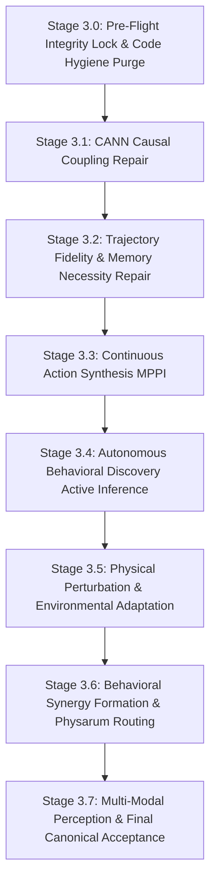

# CARL-DX STAGE 3: AUTHORITATIVE MASTER ROADMAP & FORENSIC GOVERNANCE CHARTER
**Document Reference:** `CARL-STAGE3-GOVERNANCE-2026-09-12-v2.0`  
**Classification:** Master Architectural Reference & Governance Specification  
**Governing Standard:** Master Implementation Directive v1.0 (Charter Revision 2)  
**Current Milestone:** **STAGE 3.4-R2 — REMEDIATION ADJUDICATED (FAILED CLOSED ❌)**  
**Execution Policy:** **FAIL-CLOSED, EVIDENCE-FIRST, ZERO SPECULATIVE ARCHITECTURE**  


---

## 1. Executive Certification Status: Stages 1 & 2 (Closed Baseline)

The CARL developmental progression strictly prohibits reinterpreting past milestones or reopening certified stages:

| Stage | Focus Area | Certified Scope & Boundary | Final Status |
| :--- | :--- | :--- | :--- |
| **Stage 1** | Sensorimotor Grounding ("Learn My Body") | 6-channel anonymous motor babbling, unlabelled topology discovery, linear forward momentum model, grounded kinematic slip and traction chatter estimation. | **COMPLETED & CERTIFIED ✅** |
| **Stage 2** | Generative World & Self Modeling ("Learn My World") | **Stage 2 certified the integrated sensorimotor, spatial-memory, predictive-deliberation substrate under its defined acceptance tests** (40/40 mazes cleared, 0.00% collisions, p95 40.58 ms, 100% organs active, decision-pipeline AST clean).<br><br>*Explicit Boundary:* **CANN causal coupling and non-LOS memory necessity remain explicitly unproven capabilities carried forward into Stage 3.** | **COMPLETED & CERTIFIED ✅**<br>*(Scope-bounded substrate)* |
| **Stage 3** | Continuous Action Synthesis & Behavioral Discovery ("Learn How to Behave") | Continuous trajectory optimization (MPPI), CANN causal coupling repair, non-LOS memory necessity repair, autonomous composite maneuver discovery, physical perturbation adaptation, motor synergy formation, multi-modal active vision. | **CURRENT ACTIVE MILESTONE ⏳** |
| **Stage 4** | Autopoietic / Lifelong Memory & Persistence ("Remember & Develop") | Online synaptic plasticity (R-STDP), Holographic HDC long-term memory, GIS-901 state compounding across lifespans. | **FUTURE MILESTONE** |
| **Stage 5** | Metacognition & Permission-Gated Self-Improvement ("Understand Myself & Improve") | "The Witness" introspective failure-pattern self-monitoring, causal hypothesis formulation, permission-gated architectural self-modification. | **FINAL MATURITY** |

> [!IMPORTANT]
> **Governing Rule on Capability Inheritance:**  
> **Stage 3 cannot inherit unproven capabilities simply because Stage 2's overall dashboard was green.**  
> Every capability claim carried forward must be independently validated through downstream behavioral necessity, not inferred from component execution or dashboard checks.

---

## 2. Older Roadmap (Presentation Slide 19) Reconciliation Table

To ensure no foundational developmental capability is dropped or silently deleted, all items from the legacy Slide 19 roadmap have been reconciled:

| Old Roadmap Item | Original Phase | Status in Repo | Assigned Stage | Concrete Implementation Plan |
| :--- | :--- | :--- | :--- | :--- |
| **Continuous Trajectory Optimization (MPPI)** | P3 (Adaptive Routing) | Prototype script exists (`carl_mppi.py`), unintegrated | **Stage 3.1 & 3.3** | Implement GPU/CPU MPPI ($M=128, H=15, dt=0.03\text{s}$) directly inside the canonical organism (`carl_autonomous_agent.py`). |
| **CANN Causal Action Coupling** | P2 / P3 | 2,114-U network executes, but output is currently unread by planner | **Stage 3.1 (Stage 2 Repair)** | Wire CANN heading and grid coordinates directly into trajectory/action evaluation cost; validate via pre-registered Intact vs. Ablation battery ($\Delta \mathbf{u} > 0.15, p < 0.01$). |
| **Non-LOS Spatial Memory Navigation** | P2 / P3 | Raster grid exists, but amnesic mode matched deliberative in short mazes | **Stage 3.2 (Stage 2 Repair)** | Force the question: *Does spatial memory contribute information unrecoverable from sonar alone?* Benchmark on deep cul-de-sacs, blind corners, and backtracking. |
| **Continuous Trajectory Optimization (MPPI)** | P3 (Adaptive Routing) | Prototype script exists (`carl_mppi.py`), unintegrated | **Stage 3.3** | Implement GPU/CPU MPPI ($M=128, H=15, dt=0.03\text{s}$) directly inside the canonical organism (`carl_autonomous_agent.py`) once internal state necessity is proven. |
| **Autonomous Behavioral Discovery (Active Inference)** | P3 | Reactive heuristic steering | **Stage 3.4** | Expected Free Energy minimization; autonomous discovery of composite maneuvers without handcoded rules. |
| **Physical Perturbation & Adaptation** | P1 / P3 | Open-loop physics | **Stage 3.5** | Online adaptation to friction drops ($\mu=0.2$), torque loss, and wheel slip; dynamic exploration tuning via endocrine kinetics (Cortisol/NE). |
| **Physarum Polycephalum Route Reinforcement** | P3 (Adaptive Routing) | Standalone module exists (`carl_physarum.py`), unintegrated | **Stage 3.6** | Use tubular flow network dynamics as an allocentric spatial prior over trajectory sampling to prune dead-ends. |
| **Behavioral Synergy Formation (HDC)** | P0 / P1 | Module exists (`carl_hdc.py`), unintegrated | **Stage 3.6** | Use HDC hypervectors to index and recall successful motor synergy trajectories. |
| **Active Optical Gaze & Visual Perception** | P2 (Sensory & Spatial) | Eye camera in XML, datasets & CNN exist (`train_vision.py`), active gaze scans head | **Stage 3.7** | Fuse camera bounding boxes and active gaze with sonar into unprivileged multi-modal occupancy grid; full organism integration. |
| **Synaptic Plasticity (R-STDP)** | P1 (Individual Emergence) | Standalone module (`carl_stdp.py`), unintegrated | **Stage 4** | **Quarantined to Stage 4:** Requires stable continuous behavioral foundation before learning weights online. |
| **Metacognitive Introspection ("The Witness")** | P6 (Metacognition) | Stub exists (`carl_witness.py`), unintegrated | **Stage 5** | **Quarantined to Stage 5:** Higher-order failure self-reflection belongs to final maturity stage. |
| **Social Imitation / Collective Swarms** | P4 / P5 | Prototype scripts (`carl_multi_agent.py`), unintegrated | **Future** | Quarantined until individual Stage 3–5 organism maturity is certified. |

---

## 3. The 8 Mandatory Subphases of Stage 3



### Stage 3.0 — Pre-Flight Integrity Lock & Code Hygiene Purge
* **Objectives:**
  1. Purge dormant `data.geom_xpos` lookup in [`brain/carl_embodied_organism.py:240`](file:///d:/ebca/brain/carl_embodied_organism.py#L240).
  2. Replace `data.qpos[qbase_adr + 2]` in [`brain/carl_embodied_organism.py:154`](file:///d:/ebca/brain/carl_embodied_organism.py#L154) with calibrated chassis rest height `0.05m`.
  3. Execute automated AST scanner (`tests/test_stage3_ast_anti_cheat.py`) verifying **zero privileged simulator access in the cognitive/decision pipeline**, while keeping simulator interfaces cleanly isolated at the HAL/environment boundary.
  4. Lock cryptographic SHA-256 baseline manifest for all Stage 2 artifacts.
  5. Verify CANN and spatial-memory data paths without altering Stage 2 logic.
* **Exit Gate:** 100% clean AST report in decision path; frozen manifest logged; zero compiler warnings; data paths confirmed intact.

### Stage 3.1 — CANN Causal Coupling (Stage 2 Repair Gate)
* **Objectives:**
  1. Wire CANN attractor states ($\hat{\theta}_{\text{CANN}}, \hat{\mathbf{p}}_{\text{CANN}}$) directly into trajectory evaluation cost.
  2. **Stage 2 Repair Objective:** Turn the current decorative CANN into a causally verified organ.
  3. Execute pre-registered CANN Causal Battery: Control A (Intact) vs Control B (Frozen) vs Control C (Zeroed) vs Control D (Shuffled).
* **Exit Gate:** Intact CANN significantly outperforms ablations ($\Delta \mathbf{u} > 0.15$, Cohen's $d \ge 0.50, p < 0.01$).

### Stage 3.2 — Counterfactual Trajectory Fidelity & Spatial Memory Necessity (Stage 2 Repair Gate)
* **Objectives:**
  1. **Trajectory Fidelity:** Compare forward-predicted mental rollouts against physical MuJoCo steps; max Euclidean displacement error $\le 0.08\text{ m}$ over 15 ticks across straight, turning, braking, and reverse moves.
  2. **Stage 2 Repair Objective:** Force the core question: *Does CARL's spatial memory contribute information that cannot be recovered from current sonar alone?*
  3. Evaluate memory necessity on 5 non-line-of-sight task families:
     - Blind corners (where sonar cannot see around the bend)
     - Deep cul-de-sacs (1.5m pockets where local reactive sonar is trapped)
     - Revisit-after-detour (recovering original axis after obstacle bypass)
     - Sonically symmetric locations with divergent global map topology
     - Partial-observation route recovery (20-tick sonar blackout)
* **Exit Gate:** Intact memory outperforms amnesic baseline by $\ge 35.0\%$ task clearance rate ($p < 0.001$).

### Stage 3.3 — Continuous Action Synthesis (MPPI)
* **Objectives:**
  1. Replace discrete candidate menu with continuous MPPI ($M=128, H=15, dt=0.03\text{s}$) over continuous wheel velocities $\mathbf{u} \in [-1.0, 1.0]^2$.
  2. Optimize trajectories evaluating state against learned world model, occupancy memory, and CANN spatial priors.
* **Exit Gate:** Real-time execution $\le 45\text{ ms}$ per cycle; smooth collision-free trajectory synthesis.

### Stage 3.4 — Autonomous Behavioral Discovery under Active Inference
* **Objectives:**
  1. Implement Expected Free Energy minimization: $G(\pi) = \text{Pragmatic Value} + \text{Epistemic Exploration Value}$.
  2. Deploy in environments where single primitives fail (deep dead-ends with obstacles).
* **Exit Gate:** Autonomous emergence of composite maneuvers (`reverse -> pivot 180° -> forward escape`) with $\ge 80.0\%$ escape rate without handcoded rules.
* **Status:**
  - **Stage 3.4 (Original): FAILED CLOSED ❌** (Tight trap physical clearance bottleneck).
  - **Stage 3.4-R (Remediation 1): FAILED CLOSED ❌** (Micro-local 3cm frontier shadow failed to pull egress).
  - **Stage 3.4-R2 (Remediation 2): FAILED CLOSED ❌** (210 episodes evaluated; connected macro-frontier enabled 180° turning-bay rotation, but narrow $W=0.70\text{m}$ corridor entrance margin penalty formed a free-energy barrier causing 0% escape and $p=1.0$).
  - **Stage 3.5 Status: STRICTLY LOCKED 🔒** (Cannot advance until Stage 3.4 passes all gates).


### Stage 3.5 — Physical Perturbation & Environmental Adaptation
* **Objectives:**
  1. Introduce controlled physical disturbances: floor friction drops ($\mu = 0.8 \to 0.2$), motor torque degradation ($-40\%$), and asymmetric wheel drag.
  2. Wire endocrine kinetics (Cortisol/NE) to dynamically modulate exploration covariance $\Sigma_u$.
* **Exit Gate:** Autonomous trajectory stabilization and recovery within $\le 15$ ticks without supervisor intervention.

### Stage 3.6 — Behavioral Synergy Formation & Physarum Routing
* **Objectives:**
  1. Cluster recurring successful continuous trajectories into reusable motor synergies using HDC associative memory.
  2. Integrate Physarum tubular flux equations as an allocentric prior over trajectory sampling to prune dead-ends.
* **Exit Gate:** Synergy-informed planner converges $\ge 20.0\%$ faster to optimal trajectories than unguided random sampling.

### Stage 3.7 — Multi-Modal Perception, Canonical Integration & Adversarial Acceptance
* **Objectives:**
  1. Merge all verified capabilities into [`brain/carl_autonomous_agent.py`](file:///d:/ebca/brain/carl_autonomous_agent.py).
  2. Execute 50-episode multi-seed multi-layout frozen acceptance suite.
* **Exit Gate:** Collision rate $\le 5.0\%$, p95 latency $\le 50.0\text{ ms}$, 100% organs active, zero privileged simulator reads.

---

## 4. Cryptographic Baseline Manifest (SHA-256)

```text
cdd95aaa03be8becb445072e2be81b8da148c6a968f5dd453e1b002987c5d49f  brain/carl_autonomous_agent.py
47b3591c6d5432fb55a014c1807d8a935279213c12e6355cfcb3914f3e8acad9  brain/carl_embodied_organism.py
3a37fd1569980880310f96b21b006ada74cfdf20f1e13a84ff9671c3fdf8f89f  brain/carl_stage1_hal.py
7ca0d38794de86088eb6b0a678b4b119b934b181573911d4bca8d970c5e1f78c  brain/carl_stage2_integrated_brain.py
1fa71ab575dc17c064a07a646703e120f24f84030e5e8a3142e3a21bde1f99fc  brain/carl_stage2_hd_ring.py
02a7c1cd70436fa14a66e51903a800a10c3a863e890c36189eccffa839859017  brain/carl_stage2_grid_torus.py
b316d8eaabc96c160eff9a065f7d3283074b58d2bf4dabb956e2679cbcd16b43  brain/carl_stage2_3_r1_deliberation.py
d68d1b6804ac09a2367f54f0a93bbc0aa6a7e5c3b78c545454a0f1c75f6bf904  brain/carl_stage2_2_r2_occupancy_memory.py
b23b2dac6b7c4d8830999cd57645cde867da2f76481ee02791ea892c8cf29b16  checkpoints/stage2_2_grounded/grounded_body_model.pt
9b79f52d82582b8299625a69e6439bb47774e60f25d7a92e0c13c048f7f05424  evidence/stage2_2_r2/arena_occupancy_grid.pt
39d211fcd376783b32e527ed9970bc5adff7612fe3ab51f8607626536662d908  evidence/stage2_final/stage2_final_scorecard.json
cd5e51f11185fece59986c783166f4a3b3b8e645b5499bf0640292f20c650be6  evidence/stage2_3_r1/stage2_3_r1_scorecard.json
```

---

## 5. Architectural Invariants & Anti-Cheat Rules (Zero-Tolerance)

1. **No Roadmap Mutation Without Written Approval:** Stages and subphases are immutable.
2. **Current-Stage Gate:** Always declare alignment: North Star, Current Stage (Stage 3), Current Subproblem (Stage 3.0 Pre-Flight).
3. **No Free-Ride Capability Inheritance:** Stage 3 cannot inherit unproven capabilities simply because Stage 2's overall dashboard was green. Every capability must demonstrate downstream behavioral necessity.
4. **Exact Timestep Rule:** Control loop timestep must be derived from `model.opt.timestep * substeps` ($dt = 0.030\text{s}$). Never assume hardcoded 0.0333 s.
5. **Single Organism Rule:** All capabilities are organs grown for [`carl_autonomous_agent.py`](file:///d:/ebca/brain/carl_autonomous_agent.py). No parallel or benchmark-only shadow brains.
6. **Decision-Pipeline Isolation Rule:** Zero privileged simulator coordinates (`qpos`, `qvel`, `qacc`, `geom_xpos`, `mj_ray`) permitted inside the active cognitive decision loop. Simulator physics interfaces remain cleanly quarantined at the HAL and environment setup boundary.
7. **Fail-Closed Rule:** A milestone passes only when all mandatory gates pass. No compensatory scoring; no threshold relaxation.
8. **Strict Terminology:** Use **"2,114-unit neuromorphic computational architecture"** (never "biological brain" or "machine consciousness").
