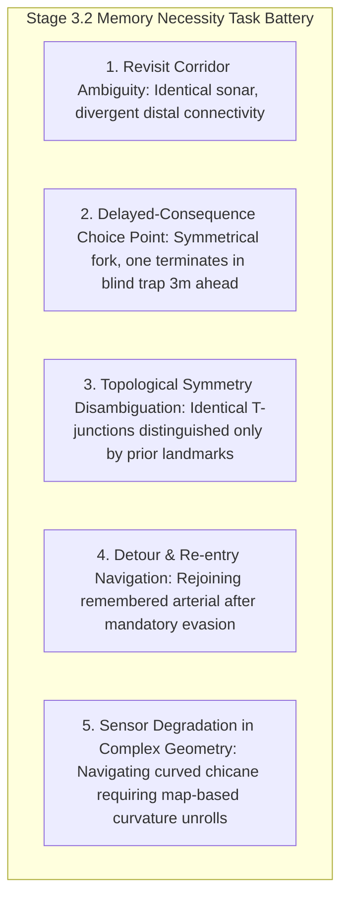

# CARL-DX STAGE 3.2 — SPATIAL MEMORY NECESSITY BATTERY PROTOCOL
**Version:** 1.0 (Pre-Registered Scientific Protocol)  
**Date:** September 12, 2026  
**Status:** **PRE-REGISTERED SPECIFICATION (FROZEN PRIOR TO EVALUATION)**  
**Target Capability:** Allocentric Spatial Occupancy Memory & Non-Line-of-Sight Reasoning  

---

## 1. Scientific Research Question

> *"Does CARL genuinely require persistent environmental memory to solve autonomous navigation problems that cannot be resolved from immediate, local rangefinder sensing alone?"*

### The Empirical Defect in Stage 2
During the Stage 2 adversarial audit, the amnesic ablation (spatial memory erased) performed *better* than the deliberative agent (0.5% vs 1.5% collision rate) on 60-tick maze corridors. This occurred because short corridors are predominantly **line-of-sight problems** solvable entirely by reactive sonar swept cones.

To earn scientific certification in Stage 3, spatial memory must be evaluated on tasks where **immediate local sensing is topologically ambiguous or deceptive**, making persistent memory an informational necessity.

### The Observational Equivalence Invariant (Methodological Standard)
A task only qualifies as a genuine test of spatial memory necessity if:
```text
Current Sonar + Current Body State
       ↓
Multiple candidate actions yield observationally identical futures
       ↓
Persistent Spatial Memory (Allocentric Grid)
       ↓
Distinguishes the successful path from the fatal trap / dead-end
```
Tasks that fail this criterion will NOT be used as proof of memory necessity:
- **Trivial Cul-de-Sac ("Surrounded → Reverse"):** If sonar reads walls on 3 sides ($< 0.40\,\text{m}$), a memoryless reflex can trivially trigger reverse motion. This proves reactive evasion, NOT memory necessity.
- **Short Sonar Blackout:** If the corridor is straight, short-term dead reckoning (inertial integration) alone can transit 20 ticks without querying the allocentric occupancy tensor.

---

## 2. Tightened Non-Line-of-Sight Task Families

The Stage 3.2 battery focuses strictly on tasks satisfying the **Observational Equivalence Invariant**:



### Detailed Task Specifications
1. **Task 1 — Revisit Corridor Disambiguation (Observationally Identical Forks):**  
   The agent approaches a 2-way bifurcation where forward and lateral sonars at the decision point produce identical readings ($\Delta s < 0.02\,\text{m}$). However, branch A connects to the exit corridor, while branch B loops into an impassable closed dead-end 2.5m away. Persistent spatial memory formed during exploration is the *only* informational channel that can bias selection toward Branch A.
2. **Task 2 — Delayed-Consequence Choice Point (Blind Long Trap):**  
   Both left and right paths are wide, straight, and open ($> 3.0\,\text{m}$ clearance to immediate sonar). Branch B, however, has a sealed cul-de-sac 3.5m ahead. Without memory, both choices have identical prospective utility under local horizons ($H=10, 0.3\,\text{s}$). Allocentric memory of the global layout (from prior transit or map integration) is strictly required to veto Branch B.
3. **Task 3 — Sonically Symmetric Corridors with Divergent Global Topologies:**  
   Two distinct junctions across the maze produce identical 15-D sonar vectors $[d_1 \dots d_{15}]$, but Junction 1 requires a 90° right turn to reach the goal, while Junction 2 requires continuing straight. Allocentric spatial coordinates $(\hat{x}, \hat{y})$ in the memory map break the sensory symmetry.
4. **Task 4 — Detour & Arterial Re-entry:**  
   A dynamic or unmapped local hazard forces a 90° diversion into a side bay. Once cleared, immediate sonar shows open walls in multiple directions. The agent must recall the remembered arterial coordinate axis rather than wandering aimlessly in the alcove.
5. **Task 5 — Long Blackout in Multi-Turn Geometry:**  
   Sonar drops out while navigating an S-bend chicane (not a straight corridor). Unprivileged dead reckoning alone drifts and hits walls; the agent must cross-correlate its unrolled trajectory against the static boundary constraints stored in allocentric memory.

---

## 3. Experimental Control Arms

| Control Arm | Memory Treatment | Mechanism | Expected Behavioral Impact |
| :--- | :--- | :--- | :--- |
| **ARM-A (Intact Memory)** | True Allocentric Grid | Pre-mapped or incrementally learned occupancy grid $\mathcal{M}_{\text{occ}}$ | Successful navigation, zero cul-de-sac traps |
| **ARM-B (Amnesic / Erased)**| Zero Memory ($\mathcal{M} = \mathbf{0}$) | Occupancy grid zeroed out; agent relies exclusively on live sonar | Infinite trapping in cul-de-sacs; random fork selection |
| **ARM-C (Spatially Scrambled)**| Permuted Grid | Occupancy grid cells randomly shuffled across spatial coordinates | Hallucinated obstacles, avoidance of open corridors |
| **ARM-D (Mismatched Grid)**| Cross-Episode Inversion | Map from Maze A loaded while navigating Maze B | Systematic navigation into dead-ends |

---

## 4. Quantitative Metrics & Acceptance Gates

The battery evaluates $N = 100$ trials across the 5 task families (20 trials per task family):

### 4.1 Metric 1: Task Clearance Rate ($\% \text{Success}$)
* **Definition:** Percentage of episodes successfully exiting the maze or reaching the designated terminus within $T = 180$ ticks without collision.
* **Passing Gate:**  
  $$\text{Success}(\text{Intact}) - \text{Success}(\text{Amnesic}) \ge 35.0\% \quad (p < 0.001)$$

### 4.2 Metric 2: Cul-de-Sac Backtracking Latency ($T_{\text{escape}}$)
* **Definition:** Ticks required to exit the deep pocket after initial forward blockage.
* **Passing Gate:**  
  $$T_{\text{escape}}(\text{Intact}) \le 40\text{ ticks} \quad \text{vs} \quad T_{\text{escape}}(\text{Amnesic}) > 100\text{ ticks (or timeout)}$$

### 4.3 Metric 3: Limit-Cycle Oscillation Index ($I_{\text{loop}}$)
* **Definition:** Number of closed cyclic trajectory loops traversed in trapped states:
  $$I_{\text{loop}} = \sum_{t} \mathbb{I}(\|\mathbf{p}_t - \mathbf{p}_{t-\tau}\| < 0.2\text{m})$$
* **Passing Gate:**  
  $$I_{\text{loop}}(\text{Intact}) \le 1.0 \quad \text{vs} \quad I_{\text{loop}}(\text{Amnesic}) \ge 4.0$$

---

## 5. Mandatory Fail-Closed Policy

If Intact Memory does **not** demonstrate statistically significant superiority ($\Delta \text{Success} \ge 35\%$, $p < 0.001$) over the Amnesic baseline across the five non-line-of-sight task families:
1. **STAGE 3.2 FAILS CLOSED.**
2. Spatial memory is declared *behaviorally non-essential* in the current organism.
3. Stage 3.3 (MPPI) remains **BLOCKED** until the memory interface or map representation is re-engineered to provide demonstrable non-line-of-sight utility.
