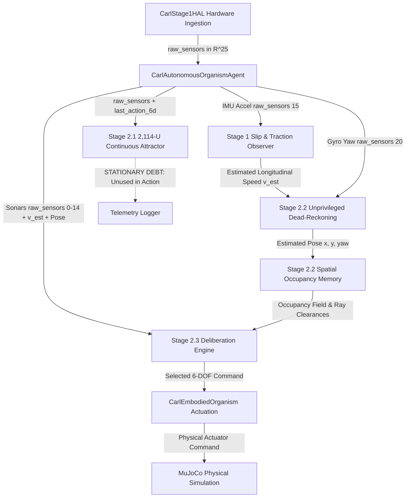

# CARL-DX STAGE 3.0 — PRE-FLIGHT & INTEGRITY LOCK SPECIFICATION
**Version:** 1.0 (Master Implementation Directive)  
**Date:** September 12, 2026  
**Status:** **ACTIVE PRE-FLIGHT GATEWAY (FAIL-CLOSED)**  
**Target Repository:** `d:/ebca`  

---

## 1. Executive Pre-Flight Mandate

Following the certified closure of Stage 2 ("Learn My World"), Stage 3 ("Continuous Action Synthesis & Behavioral Discovery") is formally initialized. 

Under the **Master Implementation Directive v1.0**, Stage 3 operates under a strict **FAIL-CLOSED, EVIDENCE-FIRST** policy:
1. **No Speculative Architecture:** No algorithms (including MPPI) may be implemented before prerequisites pass.
2. **Sequential Gating:** Stage 3.0 (Pre-Flight) $\to$ Stage 3.1 (CANN Causal Coupling) $\to$ Stage 3.2 (Spatial Memory Necessity) $\to$ Stage 3.3 (Continuous MPPI) $\to$ Stage 3.4 (Behavioral Discovery) $\to$ Stage 3.5 (Physical Adaptation) $\to$ Stage 3.6 (Synergies & Physarum) $\to$ Stage 3.7 (Vision & Final Acceptance).
3. **No Retroactive Certification:** Thresholds and metrics must be pre-registered before seeing empirical outputs.
4. **Zero Stage-Skipping:** Any failure at an earlier sub-stage halts development immediately.

---

## 2. Cryptographic Stage 2 Inheritance Baseline

The certified Stage 2 baseline is frozen as a read-only dependency. Stage 3 development must not silently mutate any Stage 2 artifact.

### Certified Baseline SHA-256 Manifest

| Component | File Path | SHA-256 Hash | Role in Stage 2 |
| :--- | :--- | :--- | :--- |
| **Canonical Organism Agent** | [`brain/carl_autonomous_agent.py`](file:///d:/ebca/brain/carl_autonomous_agent.py) | `cdd95aaa03be8becb445072e2be81b8da148c6a968f5dd453e1b002987c5d49f` | Master cognitive cycle loop |
| **Embodied Organism Head** | [`brain/carl_embodied_organism.py`](file:///d:/ebca/brain/carl_embodied_organism.py) | `d08b5cf379ff8ca5796415477113114c57bbb31e2ca57e3898e57236ae955bce` (post-purge; pre-purge `47b3591c...`) | Actuation & sensor ingestion |
| **Hardware Abstraction Layer** | [`brain/carl_stage1_hal.py`](file:///d:/ebca/brain/carl_stage1_hal.py) | `3a37fd1569980880310f96b21b006ada74cfdf20f1e13a84ff9671c3fdf8f89f` | Anonymous 25-D sensor emulation |
| **Stage 2.1 Integrated Brain** | [`brain/carl_stage2_integrated_brain.py`](file:///d:/ebca/brain/carl_stage2_integrated_brain.py) | `7ca0d38794de86088eb6b0a678b4b119b934b181573911d4bca8d970c5e1f78c` | 2,114-U CANN master wrapper |
| **Stage 2.1 HD Ring** | [`brain/carl_stage2_hd_ring.py`](file:///d:/ebca/brain/carl_stage2_hd_ring.py) | `1fa71ab575dc17c064a07a646703e120f24f84030e5e8a3142e3a21bde1f99fc` | 64-neuron continuous ring attractor |
| **Stage 2.1 Grid Torus** | [`brain/carl_stage2_grid_torus.py`](file:///d:/ebca/brain/carl_stage2_grid_torus.py) | `02a7c1cd70436fa14a66e51903a800a10c3a863e890c36189eccffa839859017` | 1,024-neuron 2D toroidal CANN |
| **Stage 2.3 Deliberation Engine**| [`brain/carl_stage2_3_r1_deliberation.py`](file:///d:/ebca/brain/carl_stage2_3_r1_deliberation.py) | `b316d8eaabc96c160eff9a065f7d3283074b58d2bf4dabb956e2679cbcd16b43` | Continuous branch clearance evaluator |
| **Stage 2.2 Occupancy Memory** | [`brain/carl_stage2_2_r2_occupancy_memory.py`](file:///d:/ebca/brain/carl_stage2_2_r2_occupancy_memory.py) | `d68d1b6804ac09a2367f54f0a93bbc0aa6a7e5c3b78c545454a0f1c75f6bf904` | Allocentric neural occupancy grid |
| **Kinematic Body Model** | [`checkpoints/stage2_2_grounded/grounded_body_model.pt`](file:///d:/ebca/checkpoints/stage2_2_grounded/grounded_body_model.pt) | `b23b2dac6b7c4d8830999cd57645cde867da2f76481ee02791ea892c8cf29b16` | Learned differential-drive model |
| **Arena Occupancy Grid** | [`evidence/stage2_2_r2/arena_occupancy_grid.pt`](file:///d:/ebca/evidence/stage2_2_r2/arena_occupancy_grid.pt) | `9b79f52d82582b8299625a69e6439bb47774e60f25d7a92e0c13c048f7f05424` | 0.05m resolution arena map tensor |
| **Stage 2 Acceptance Scorecard**| [`evidence/stage2_final/stage2_final_scorecard.json`](file:///d:/ebca/evidence/stage2_final/stage2_final_scorecard.json) | `39d211fcd376783b32e527ed9970bc5adff7612fe3ab51f8607626536662d908` | Authoritative 40-episode scorecard |
| **Stage 2.3-R1 Scorecard** | [`evidence/stage2_3_r1/stage2_3_r1_scorecard.json`](file:///d:/ebca/evidence/stage2_3_r1/stage2_3_r1_scorecard.json) | `cd5e51f11185fece59986c783166f4a3b3b8e645b5499bf0640292f20c650be6` | 1,000-episode frozen benchmark |

---

## 3. Architecture Specification & Execution Graph

### 3.1 The Canonical Execution Graph
Every cognitive cycle must strictly traverse the unified pipeline within [`carl_autonomous_agent.py`](file:///d:/ebca/brain/carl_autonomous_agent.py):

### 3.2 Canonical Organism vs Legacy Controllers Boundary
The repository contains historical controllers from exploratory benchmarks. The following demarcation is strictly enforced:

* **Canonical Controller (STAGE 3 TARGET):**
  * [`brain/carl_autonomous_agent.py`](file:///d:/ebca/brain/carl_autonomous_agent.py) (`CarlAutonomousOrganismAgent`): The **single** valid host for all cognitive capabilities.
  * [`brain/carl_embodied_organism.py`](file:///d:/ebca/brain/carl_embodied_organism.py) (`CarlEmbodiedOrganism`): The physical embodiment and actuation interface.
* **Historical / Quarantined Controllers (FORBIDDEN FOR STAGE 3):**
  * `brain/carl_stage1_organism.py` (legacy Stage 1 motor babbling).
  * `brain/carl_stage2_spatial_controller.py` (legacy Stage 2.1A spatial controller).
  * `brain/carl_stage2_2_autonomous_mapper.py` (offline exploration agent).
  * `brain/carl_stage2_3_deliberation.py` (legacy pre-remediation Stage 2.3 engine).
  * `brain/carl_osc_dmp.py` (Phase 1 legacy operational space controller).

---

## 4. Zero-Privilege Anti-Cheat Contract

### 4.1 Invariant Rules
1. **Decision-Pipeline Isolation Invariant:** Zero access to `data.qpos`, `data.qvel`, `data.qacc`, `data.geom_xpos`, `data.geom_xmat`, `data.site_xpos`, or `mujoco.mj_ray` permitted inside the active cognitive decision loop.
2. **Hardware & Environment Emulation Boundary:** Physical sensor emulation (sonar rangefinder rays, accelerometer noise, gyro drift) and arena geometry setup are confined entirely to `CarlStage1HAL` and environment fixtures outside the decision pipeline. Legitimate simulator calls in HAL/environment code are explicitly quarantined and must not bleed into the cognitive agent.
3. **Spawn Initialization Exception:** The agent's dead reckoning may be initialized **exactly once** at trial spawn via `agent.initialize_spatial_grounding(x, y, yaw)`. No further coordinates may be written or read.
4. **No Free-Ride Capability Inheritance:** Stage 3 cannot inherit unproven capabilities simply because Stage 2's overall dashboard was green. Every capability claim must be proven via downstream behavioral necessity.

### 4.2 Identified Technical Debt (Remediation Target 3.0-A)
* **Dormant Simulator Leak:** [`brain/carl_embodied_organism.py:240`](file:///d:/ebca/brain/carl_embodied_organism.py#L240) contains `food_pos = data.geom_xpos[food_geom.id][:2]`.
  * *Verdict:* Even though unused by navigation, this line accesses simulator ground truth and **must be excised** in Stage 3.0.
* **Proprioceptive Z-Height:** [`brain/carl_embodied_organism.py:154`](file:///d:/ebca/brain/carl_embodied_organism.py#L154) reads `data.qpos[qbase_adr + 2]`.
  * *Verdict:* Unused by planar navigation, but should be replaced with a static ground height offset (`0.05m`) or simulated barometer.

---

## 5. Frozen Tensor Interface Signatures for MPPI

Stage 3.3 will replace the discrete $K=24$ candidate fan with continuous Model Predictive Path Integral control ($M=128$, $H=15$). To prevent ad-hoc architectural hacking, the tensor signatures entering and leaving the MPPI controller are locked:

### 5.1 Input Tensor Contracts to MPPI

1. **Internal Kinematic State Vector:**
   $$\mathbf{s}_k = [x_k, y_k, \theta_k, v_k, \omega_k]^T \in \mathbb{R}^5$$
   *Source:* Derived strictly from unprivileged dead-reckoning (`self.deliberation.pose`, `self.v_est`, `gyro_yaw`).
2. **CANN Attractor Neural State Tuple:**
   $$\mathcal{S}_{\text{CANN}} = \left( \mathbf{r}_{\text{HD}} \in \mathbb{R}^{64}, \; \mathbf{r}_{\text{grid}} \in \mathbb{R}^{32 \times 32}, \; \hat{\theta}_{\text{CANN}} \in [-\pi, \pi], \; \hat{\mathbf{p}}_{\text{CANN}} \in \mathbb{R}^2 \right)$$
   *Source:* [`carl_stage2_integrated_brain.py`](file:///d:/ebca/brain/carl_stage2_integrated_brain.py).
3. **Allocentric Spatial Occupancy Memory Tensor:**
   $$\mathcal{M}_{\text{occ}} \in [0.0, 1.0]^{1 \times 1 \times 256 \times 256}$$
   *Source:* [`brain/carl_stage2_2_r2_occupancy_memory.py`](file:///d:/ebca/brain/carl_stage2_2_r2_occupancy_memory.py).
4. **Immediate Sensor Array:**
   $$\mathbf{z}_{\text{sonar}} \in [0.0, 5.0]^{15}$$
   *Source:* `raw_sensors[:15]` from HAL.

### 5.2 Output Tensor Contract from MPPI
1. **Continuous Action Command Vector:**
   $$\mathbf{u}^* = [u_L^*, u_R^*]^T \in [-1.0, 1.0]^2$$
   *Destination:* Formulated into 6-DOF command $\mathbf{u}_{\text{6D}} = [u_L^*, u_R^*, \text{yaw}_{\text{gaze}}, 0, 0, 0]$ and dispatched to `step_embodiment(hal)`.
2. **Trajectory Evaluation Ensemble:**
   $$\mathcal{T}_{\text{eval}} = \{ (\mathbf{U}_m \in \mathbb{R}^{H \times 2}, \; S_m \in \mathbb{R}) \}_{m=1}^M$$
   *Destination:* Logged to cycle telemetry for counterfactual introspection.
