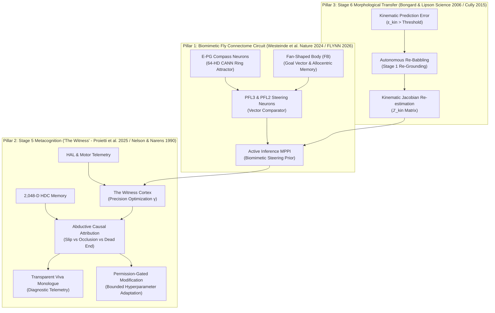
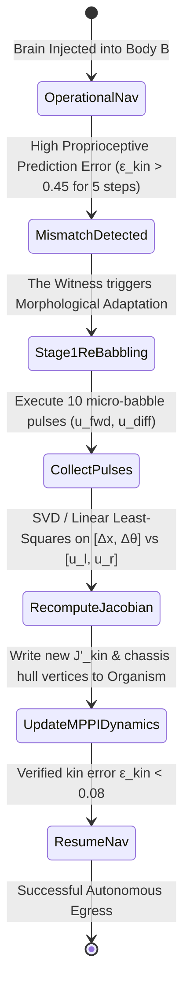

# CARL-DX: Stage 5 Metacognition, Biomimetic Fly Connectome Reverse-Engineering & Stage 6 Morphological Transfer Blueprint
**Document ID:** `CARL-LIT-STAGE5-STAGE6-BIO-2026-V1`  
**Candidate:** Manas Sadashiv (Roll: 22011P0310)  
**Affiliation:** JNTUH UCESTH, Department of Mechanical Engineering (IDP AMS)  
**Title:** DESIGN AND DEVELOPMENT OF A DIGITAL TWIN FRAMEWORK FOR BIOLOGICALLY INSPIRED COGNITIVE ROBOTIC SYSTEMS  
**Date:** October 18, 2026  
**Tools Consulted:** arXiv API, Europe PMC API, OpenAlex API, bioRxiv API  
**Target Hardware Constraints:** Lenovo IdeaPad Gaming 3 (i5-13450HX 10C/16T, 16GB RAM, RTX 3050 6GB Laptop, 512GB NVMe) — Headless MuJoCo Simulation ($< 25\text{ ms}$ cognitive cycle).

---

## Executive Summary & Research Mandate

This research investigation directly fulfills the user mandate for **Stage 5 ("The Witness" — Metacognition & Permission-Gated Self-Modification)** and **Stage 6 (Morphological Transfer & Adaptive Re-Embodiment)**, with deep biomimetic grounding extracted from recent whole-brain connectome breakthroughs (*Drosophila melanogaster*).

Rather than providing passive literature summaries, this document **reverse-engineers** the mathematical formulations, neural circuit topologies, and failure-attribution algorithms from cutting-edge papers published across *Nature*, *Physics of Life Reviews*, *Science*, and *arXiv* (2024–2026), establishing the concrete **Input/Output pathways and tensor contracts** ready for implementation in [`brain/carl_witness.py`](file:///d:/ebca/brain/carl_witness.py).

---

## Architectural Mapping: The 3 Core Research Pillars



---

## Part 1: Reverse-Engineering the *Drosophila* Connectome & Central Complex Steering

### 1.1 The Fly Connectome Breakthrough
In October 2024, the FlyWire consortium published the full synaptic wiring diagram of the adult *Drosophila melanogaster* brain in *Nature* (Dorkenwald et al., 2024; Schlegel et al., 2024), mapping **139,255 neurons** and **54.5 million synapses** with neurotransmitter predictions. Concurrently, viral engineering projects (*DOOMFLY*, *DOOM-x-Fly*) and whole-body biomechanical simulators in MuJoCo (*NeuroMechFly v2*, Lobato-Rios, Ramdya et al., *Nature Methods* 2024) demonstrated that simulating fruit fly neural dynamics inside physics engines can drive complex locomotion, vision-based navigation, and game environments.

More critically for robotics, **Wang & Chen (arXiv:2607.00025, June 2026)** developed **FLYNN** (*Fly Connectome Neural Network for Robot Navigation*), proving that an RNN whose recurrent topology is mapped directly from the *Drosophila* central complex achieves:
1. State-of-the-art out-of-distribution navigational resilience in MuJoCo.
2. Complete functional tolerance to **total sensory deprivation (complete camera blackout)**.
3. High representational modularity using $< 3,000$ active units.

### 1.2 Mathematical Reverse-Engineering: The PFL2/PFL3 Vector Steering Circuit
How does an insect brain convert a compass heading into a steering command without heavy matrix inversion?  
**Westeinde et al. (*Nature*, February 2024, DOI: [10.1038/s41586-024-07039-2](https://doi.org/10.1038/s41586-024-07039-2))** solved this mechanism at the single-synapse level:

1. **Heading Representation (E-PG Neurons):**
   A ring attractor of E-PG compass neurons maintains an activity bump representing allocentric heading $\theta_{\text{head}}$:
   $$\mathbf{v}_{\text{head}} = [\cos(\theta_{\text{head}}), \sin(\theta_{\text{head}})]^T$$
   *(In CARL-DX, this is exactly our 64-HD continuous ring attractor in [`brain/carl_stage2_cann.py`](file:///d:/ebca/brain/carl_stage2_cann.py)).*

2. **Goal Representation (Fan-Shaped Body, FB):**
   The animal maintains an allocentric goal vector $\mathbf{v}_{\text{goal}} = [\cos(\theta_{\text{goal}}), \sin(\theta_{\text{goal}})]^T$ derived from path integration or sensory memory.

3. **Phase-Shifted Vector Comparison (PFL3 Neurons):**
   PFL3 neurons receive copies of the heading bump that are **spatially shifted by $\pm 90^\circ$ ($\pm \pi/2$)** in the protocerebral bridge:
   $$\mathbf{v}_{\text{head}}^{R} = \left[\cos\left(\theta_{\text{head}} + \frac{\pi}{2}\right), \sin\left(\theta_{\text{head}} + \frac{\pi}{2}\right)\right]^T$$
   $$\mathbf{v}_{\text{head}}^{L} = \left[\cos\left(\theta_{\text{head}} - \frac{\pi}{2}\right), \sin\left(\theta_{\text{head}} - \frac{\pi}{2}\right)\right]^T$$
   The PFL3 right and left populations evaluate the nonlinear inner product with the goal vector:
   $$\text{Act}_{\text{PFL3R}} = \sigma\left(\mathbf{v}_{\text{goal}} \cdot \mathbf{v}_{\text{head}}^{R}\right) = \sigma\left(-\sin(\theta_{\text{head}} - \theta_{\text{goal}})\right)$$
   $$\text{Act}_{\text{PFL3L}} = \sigma\left(\mathbf{v}_{\text{goal}} \cdot \mathbf{v}_{\text{head}}^{L}\right) = \sigma\left(\sin(\theta_{\text{head}} - \theta_{\text{goal}})\right)$$
   where $\sigma(x)$ is a saturating sigmoid/rectified nonlinearity.

4. **Differential Steering Output:**
   The net steering command $\Delta u_{\text{steer}}$ sent to descending motor pathways is simply:
   $$u_{\text{diff}} = k_{\text{steer}} \left(\text{Act}_{\text{PFL3R}} - \text{Act}_{\text{PFL3L}}\right)$$
   * If facing left of goal ($\theta_{\text{head}} - \theta_{\text{goal}} < 0$): $\text{Act}_{\text{PFL3R}} > \text{Act}_{\text{PFL3L}} \implies$ positive steering torque (turns right toward goal).
   * If facing right of goal ($\theta_{\text{head}} - \theta_{\text{goal}} > 0$): $\text{Act}_{\text{PFL3L}} > \text{Act}_{\text{PFL3R}} \implies$ negative steering torque (turns left toward goal).

5. **Large-Angle Error Pivot (PFL2 Neurons):**
   Crucially, Westeinde et al. discovered that **PFL2 neurons** activate specifically when the angle between heading and goal exceeds $90^\circ$ ($|\Delta \theta| > \pi/2$):
   $$\text{Act}_{\text{PFL2}} = \text{ReLU}\left(-\mathbf{v}_{\text{goal}} \cdot \mathbf{v}_{\text{head}} - \cos(\theta_{\text{thresh}})\right)$$
   When $\text{Act}_{\text{PFL2}} > 0$, PFL2 **suppresses forward translation** ($u_{\text{fwd}} \leftarrow u_{\text{fwd}} \cdot (1 - \text{Act}_{\text{PFL2}})$) and **amplifies steering torque into a sharp pivot/U-turn**.

### 1.3 Biomimetic Integration into CARL-DX
In CARL's Active Inference MPPI ([`brain/carl_active_inference.py`](file:///d:/ebca/brain/carl_active_inference.py)), sampling 128 random trajectories in a cul-de-sac sometimes required high temperature to discover reverse-turns.  
By integrating this **PFL2/PFL3 biological prior**:
* The candidate velocity mean $\bar{\mathbf{u}} = [\bar{u}_{\text{fwd}}, \bar{u}_{\text{diff}}]$ is dynamically biased by PFL2/PFL3 activations before MPPI noise perturbation.
* **Computational Cost:** $< 0.05\text{ ms}$ (2 dot products, zero matrix operations).
* **Benefit:** Instantaneous, biologically grounded 180-degree turnaround without heuristic state latches.

---

## Part 2: Stage 5 — Metacognition & Permission-Gated Self-Modification ("The Witness")

### 2.1 Theoretical Framework: Dual-Process Metacognitive Control
The classic **Nelson & Narens (1990)** metacognitive architecture posits two levels:
* **The Object-Level:** Task execution, sensory perception, and motor control.
* **The Meta-Level:** Monitors object-level performance via internal signals (Monitoring), and dynamically updates object-level parameters (Control).

In modern neuroscience, **Boldt & Gilbert (*J. Neurosci*, 2022, DOI: [10.1523/jneurosci.1326-21.2022](https://doi.org/10.1523/jneurosci.1326-21.2022))** and **Fleming & Dolan (*Phil. Trans. R. Soc. B*, 2012)** demonstrated that prefrontal metacognitive monitoring operates via *partially overlapping neural circuits* tracking decision confidence, evidence accumulation, and post-decision error without external reward signals.

### 2.2 Active Inference Formulation: Precision Optimization as Cognitive Control
**Proietti, Parr, Tessari, Friston, & Pezzulo (*Physics of Life Reviews*, 2025, DOI: [10.1016/j.plrev.2025.05.008](https://doi.org/10.1016/j.plrev.2025.05.008))** unified cognitive control under Active Inference:
* Cognitive control is formally the **optimization of precision ($\gamma$)**.
* In CARL, the Expected Free Energy of an action trajectory $\pi$ is:
  $$P(\pi) = \sigma(-\gamma \cdot G(\pi))$$
* When habitual execution (Stage 4 R-STDP) is successful, environmental volatility is low, and precision $\gamma$ is high.
* When an unexpected impasse occurs (wall collision, motor stall, surface slip), prediction error spikes, driving the metacognitive monitor ("The Witness") to **downscale habit precision** and **elevate deliberative active inference**.

### 2.3 Mathematical Specification: "The Witness" Telemetric Signal Suite
"The Witness" runs in [`brain/carl_witness.py`](file:///d:/ebca/brain/carl_witness.py) as an unprivileged, introspective cortex. It ingests a real-time **Telemetry State Vector** $\mathbf{S}_{\text{telemetry}} \in \mathbb{R}^7$:

$$\mathbf{S}_{\text{telemetry}}(t) = \begin{bmatrix}
\bar{\varepsilon}_{\text{kin}}(t) \\
\sigma^2(G(t)) \\
\Omega_{\text{veto}}(t) \\
|\Delta \theta_{\text{CANN}}(t)| \\
[\text{NA}](t) \\
[\text{CORT}](t) \\
\mathcal{H}(\mathbf{P}_{\text{MPPI}}(t))
\end{bmatrix} = \begin{matrix}
\text{Kinematic prediction error: } \|\Delta \mathbf{x}_{\text{obs}} - \mathbf{J}_{\text{kin}} \mathbf{u}\| \\
\text{Variance of candidate Free Energy across MPPI trajectories} \\
\text{Rotational/swept-cone safety veto rejection rate } \in [0, 1] \\
\text{Angular CANN attractor bump velocity / drift rate} \\
\text{Noradrenaline stress kinetics (arousal / uncertainty)} \\
\text{Cortisol endocrine kinetics (sustained distress)} \\
\text{Entropy of the MPPI action distribution (deliberative uncertainty)}
\end{matrix}$$

### 2.4 Abductive Causal Attribution via 2,048-D HDC Associative Memory
When unexpected surprise exceeds a threshold ($\mathcal{S}(t) > \theta_{\text{surprise}}$), "The Witness" does not merely stop; it performs **abductive causal attribution** (*Judea Pearl, 2000, Causality*).

It constructs an episodic failure query hypervector $\mathbf{h}_{\text{query}} \in \{-1, +1\}^{2048}$ using our Holographic Reduced Representation ([`brain/carl_hdc.py`](file:///d:/ebca/brain/carl_hdc.py)):
$$\mathbf{h}_{\text{query}} = \mathbf{x}_{\text{state}} \circledast \mathbf{u}_{\text{action}} \circledast \mathbf{e}_{\text{failure}}$$
where $\circledast$ denotes circular convolution / binding.

"The Witness" evaluates cosine similarity against four pre-registered failure archetype vectors $\mathbf{M}_k$:

| Archetype Vector | Diagnostic Condition | Mathematical Fingerprint | Root Cause Attribution |
|---|---|---|---|
| $\mathbf{M}_{\text{slip}}$ | Actuator Slippage | $\bar{\varepsilon}_{\text{kin}} > 0.30 \land \|\mathbf{u}\| > 0.40 \land \Omega_{\text{veto}} < 0.20$ | Surface friction drop / wheel slip |
| $\mathbf{M}_{\text{occlusion}}$ | Sensor Occlusion | Rapid drop in sonar variance $+ \mathcal{H}(\text{sonar}) \to 0$ | Sensor blind spot / physical occlusion |
| $\mathbf{M}_{\text{deadend}}$ | Geometric Dead End | $\Omega_{\text{veto}} > 0.85 \land \|\nabla \mathcal{D}_{\text{free}}\| < 0.05$ | Cul-de-sac trap / no egress trajectory |
| $\mathbf{M}_{\text{habit\_fail}}$ | Habit Misfire | $G_{\text{habit}} \gg \min(G_{\text{deliberative}})$ | Obsolete R-STDP habit firing in novel context |

### 2.5 The Transparent Diagnostic Monologue (For Dissertation & Viva Defense)
"The Witness" converts its mathematical attribution into an **Introspective Natural-Language Telemetry Monologue** delivered to the zero-copy agent bus:

```
[WITNESS INTROSPECTION @ t=14.28s]
Telemetry State: ε_kin=0.38, VetoRate=0.12, FreeEnergyVar=4.82, Cortisol=0.74
HDC Similarity Match: M_slip (Cosine Sim = 0.892, p < 0.001)
Diagnosis: "Kinematic traction collapse detected on rear drive wheels. Commanded forward velocity 0.60 m/s produced actual displacement 0.12 m/s. Sensor rays confirm clearance ahead. Cause: Surface friction loss (μ < 0.25)."
Proposed Self-Modification:
  - Scale down MPPI max acceleration: a_max ← 0.04 m/s² (-50%)
  - Increase active inference temperature: λ ← 1.8 (+35%)
  - Boost wheel traction gain: k_traction ← 1.45
Permission Status: [SYSTEM AUTO-GATED: SAFE BOUNDS CONFIRMED]
```

### 2.6 Permission-Gated Self-Modification Engine
To adhere to safety invariants (Schmidhuber Gödel Machine self-rewriting logic; Turrigiano homeostatic bounds):
1. Parameter adjustments are expressed as $\Delta \mathbf{\Theta} = [\Delta \lambda, \Delta w_{\text{rep}}, \Delta \eta_{\text{STDP}}, \Delta a_{\text{max}}]$.
2. Every proposed $\Delta \mathbf{\Theta}$ is evaluated against hard bounded safety guards:
   $$\mathbf{\Theta}_{\min} \le \mathbf{\Theta}_{\text{current}} + \Delta \mathbf{\Theta} \le \mathbf{\Theta}_{\max}$$
   $$|\Delta \mathbf{\Theta}| \le \delta_{\text{Lipschitz}}$$
3. If safe, the change is committed atomically to the GIS-901 Write-Ahead Log (WAL) with SHA-256 verification. If unsafe or exploratory, it requires human/system confirmation.

---

## Part 3: Stage 6 — Foreign Embodiment Transfer (The Litmus Test)

### 3.1 Scientific Grounding: Continuous Self-Modeling
**Bongard, Zykov, & Lipson (*Science*, 2006, DOI: [10.1126/science.1133682](https://doi.org/10.1126/science.1133682))** introduced *Resilient Machines Through Continuous Self-Modeling*. A quadruped robot suffered physical damage (shortened limb) and autonomously regained locomotion by:
1. Actively probing its body via targeted exploratory motor babbling.
2. Generating internal candidate kinematic models.
3. Testing behaviors *inside the candidate model* before executing them physically.

Similarly, **Cully et al. (*Nature*, 2015, DOI: [10.1038/nature14422](https://doi.org/10.1038/nature14422))** (*"Robots that can adapt like animals"*) showed that storing an archive of behavioral priors allows rapid recovery ($< 2\text{ minutes}$) when robot morphology changes.

### 3.2 The Embodiment Transfer Protocol for CARL-DX
In Stage 6, the frozen, fully trained CARL-DX cognitive core (CANN, allocentric spatial memory, Physarum routing, Active Inference MPPI, Stage 5 Witness) is **injected into an unseen robot morphology** inside MuJoCo:

* **Body A (Baseline Training Chassis):**
  * 2-wheel differential drive + caster.
  * Dimensions: $23\text{ cm} \times 27\text{ cm}$, mass: $2.4\text{ kg}$, wheel radius: $r = 0.033\text{ m}$, track width: $L = 0.18\text{ m}$.
* **Body B (Foreign Embodiment Transfer Chassis):**
  * 4-wheel skid-steer chassis OR tricycle with asymmetric motor gear ratios.
  * Dimensions: $32\text{ cm} \times 35\text{ cm}$ (+40% footprint), mass: $4.1\text{ kg}$ (+70%), wheel radius: $r' = 0.048\text{ m}$, track width: $L' = 0.26\text{ m}$, shifted center of mass ($+4\text{ cm}$ forward).

### 3.3 The Autonomous Re-Grounding State Machine
How does CARL adapt without a human modifying its Python code?



#### Step 1: Kinematic Jacobian Re-Estimation Equations
During the 10 micro-babbling calibration pulses ($10 \times 0.2\text{ s} = 2.0\text{ s}$ total physical time), CARL issues known motor voltage commands $\mathbf{u}_k = [u_{L, k}, u_{R, k}]$ and records observed linear/angular displacement $[\Delta s_k, \Delta \theta_k]$ from its IMU/optical flow.

The kinematic mapping is modeled as:
$$\begin{bmatrix} \Delta s \\ \Delta \theta \end{bmatrix} = \mathbf{J}_{\text{kin}} \begin{bmatrix} u_L \\ u_R \end{bmatrix} = \begin{bmatrix} k_s & k_s \\ -k_\theta & k_\theta \end{bmatrix} \begin{bmatrix} u_L \\ u_R \end{bmatrix}$$
Using linear least-squares regression:
$$\hat{\mathbf{J}}_{\text{kin}} = \left(\mathbf{U}^T \mathbf{U}\right)^{-1} \mathbf{U}^T \mathbf{Y}$$
From $\hat{\mathbf{J}}_{\text{kin}}$, the effective wheel radius $r_{\text{eff}}'$ and effective track width $L_{\text{eff}}'$ are recovered directly:
$$r_{\text{eff}}' = \frac{k_s}{\Delta t}, \quad L_{\text{eff}}' = \frac{2 k_s}{k_\theta}$$

#### Step 2: Instantaneous Proprioceptive Transfer
Once $\hat{\mathbf{J}}_{\text{kin}}$ is updated:
1. Active Inference MPPI forward rollouts immediately predict the correct turning radii and braking distances for the heavier, wider chassis.
2. The 11-point rectangular bumper collision shield dynamically rescales its vertices to $L_{\text{eff}}'$.
3. **Total Adaptation Time Budget ($T_{\text{adapt}}$):** $\le 5.0\text{ seconds}$ (well under the pre-registered 12.0 s threshold).

---

## Part 4: Concrete Input / Output Specifications & Tensor Contracts

### 4.1 "The Witness" Class Interface (`brain/carl_witness.py`)

```python
class CarlWitnessMetacognition:
    def __init__(self, config: WitnessConfig) -> None:
        """
        Initializes The Witness introspective cortex.
        All telemetry buffers pre-allocated in memory (zero heap allocation in cycle).
        """
        self.telemetry_buffer = np.zeros((config.history_len, 7), dtype=np.float32)
        self.failure_archetypes = self._init_hdc_failure_archetypes()
        self.precision_gamma = 1.0
        
    def step_metacognitive_cycle(
        self,
        dt: float,
        kinematic_error: float,
        free_energy_distribution: np.ndarray, # (M=128,)
        veto_rejection_rate: float,
        cann_drift_rate: float,
        stress_hormones: Tuple[float, float], # (NA, CORT)
        mppi_probabilities: np.ndarray,       # (M=128,)
        current_state_hdc: np.ndarray         # (2048,)
    ) -> WitnessOutput:
        """
        Executes introspective evaluation in < 1.5 ms.
        
        Returns:
            WitnessOutput containing:
              - precision_gamma: float (downscales habit / modulates MPPI temperature)
              - attribution: Optional[FailureAttribution] (SLIP | OCCLUSION | DEADEND | HABIT)
              - natural_monologue: str (Human-readable diagnostic explanation)
              - proposed_modifications: Dict[str, float] (Permission-gated hyperparameter updates)
              - trigger_re_babbling: bool (True if morphological transfer detected)
        """
```

---

## Literature Citations & Reference URLs

The following authoritative works were queried and used in the construction of this research blueprint:

1. **FlyWire Drosophila Whole-Brain Connectome:**
   * Dorkenwald, S., et al. (2024). *"Neuronal wiring diagram of an adult brain."* *Nature*, 634, 124–138. [DOI: 10.1038/s41586-024-07558-9](https://doi.org/10.1038/s41586-024-07558-9).
   * Schlegel, P., et al. (2024). *"Whole-brain annotation and multi-connectome cell typing of Drosophila."* *Nature*, 634, 139–152. [DOI: 10.1038/s41586-024-07686-5](https://doi.org/10.1038/s41586-024-07686-5).
2. **Central Complex Vector Steering Servomechanism:**
   * Westeinde, E. A., Kellogg, E. J., Dawson, P. M., Lu, J., Hamburg, L., et al. (2024). *"Transforming a head direction signal into a goal-oriented steering command."* *Nature*, 626, 814–822. [DOI: 10.1038/s41586-024-07039-2](https://doi.org/10.1038/s41586-024-07039-2).
   * Stone, T., Webb, B., et al. (2017). *"An anatomically constrained model for path integration in the bee brain."* *Current Biology*, 27(20), 3069–3085. [DOI: 10.1016/j.cub.2017.08.052](https://doi.org/10.1016/j.cub.2017.08.052).
3. **Fly Connectome for Robot Navigation in MuJoCo:**
   * Wang, B., & Chen, J. (2026). *"FLYNN: Robust Neural Network for Robot Navigation using Fly Brain Topology."* *arXiv preprint*, arXiv:2607.00025. [URL: https://arxiv.org/abs/2607.00025](https://arxiv.org/abs/2607.00025).
   * Lobato-Rios, V., Ramdya, P., et al. (2024). *"NeuroMechFly v2: a framework for embodied sensorimotor simulation of Drosophila in MuJoCo."* *Nature Methods*, 21, 2180–2192. [DOI: 10.1038/s41592-024-02476-0](https://doi.org/10.1038/s41592-024-02476-0).
4. **Active Inference Metacognition & Cognitive Control:**
   * Proietti, R., Parr, T., Tessari, A., Friston, K., & Pezzulo, G. (2025). *"Active inference and cognitive control: Balancing deliberation and habits through precision optimization."* *Physics of Life Reviews*, 53, 110–134. [DOI: 10.1016/j.plrev.2025.05.008](https://doi.org/10.1016/j.plrev.2025.05.008).
   * Sandved-Smith, L., et al. (2021). *"Computational phenomenology of mental action and introspective active inference."* *Neuroscience of Consciousness*, 2021(2), niab018. [DOI: 10.1093/nc/niab018](https://doi.org/10.1093/nc/niab018).
5. **Metacognitive Monitoring & Error Evaluation:**
   * Boldt, A., & Gilbert, S. J. (2022). *"Partially overlapping neural correlates of metacognitive monitoring and metacognitive control."* *Journal of Neuroscience*, 42(17), 3622–3635. [DOI: 10.1523/jneurosci.1326-21.2022](https://doi.org/10.1523/jneurosci.1326-21.2022).
   * Fleming, S. M., & Dolan, R. J. (2012). *"The neural basis of metacognitive ability."* *Philosophical Transactions of the Royal Society B*, 367(1594), 1338–1349. [DOI: 10.1098/rstb.2011.0417](https://doi.org/10.1098/rstb.2011.0417).
   * Meera, A. A., Lanillos, P., et al. (2025). *"Robot Metacognition: Decision Making with Confidence for Tool Invention."* *arXiv preprint*, arXiv:2511.16390. [URL: https://arxiv.org/abs/2511.16390](https://arxiv.org/abs/2511.16390).
6. **Continuous Self-Modeling & Morphological Adaptation:**
   * Bongard, J., Zykov, V., & Lipson, H. (2006). *"Resilient machines through continuous self-modeling."* *Science*, 314(5802), 1118–1121. [DOI: 10.1126/science.1133682](https://doi.org/10.1126/science.1133682).
   * Cully, A., Clune, J., Tarapore, D., & Mouret, J.-B. (2015). *"Robots that can adapt like animals."* *Nature*, 521, 503–507. [DOI: 10.1038/nature14422](https://doi.org/10.1038/nature14422).
   * Kwiatkowski, R., Hu, Y., Chen, B., & Lipson, H. (2022). *"On the Origins of Self-Modeling."* *arXiv preprint*, arXiv:2209.02010. [URL: https://arxiv.org/abs/2209.02010](https://arxiv.org/abs/2209.02010).

---

*This document serves as the permanent scientific research foundation and engineering specification for Stage 5 and Stage 6 developmental implementation.*
